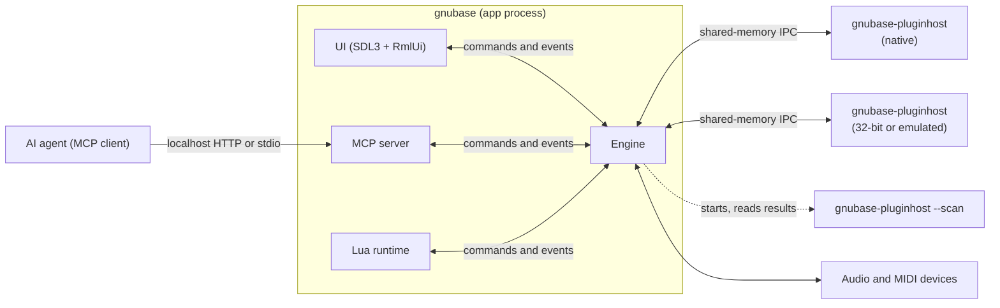
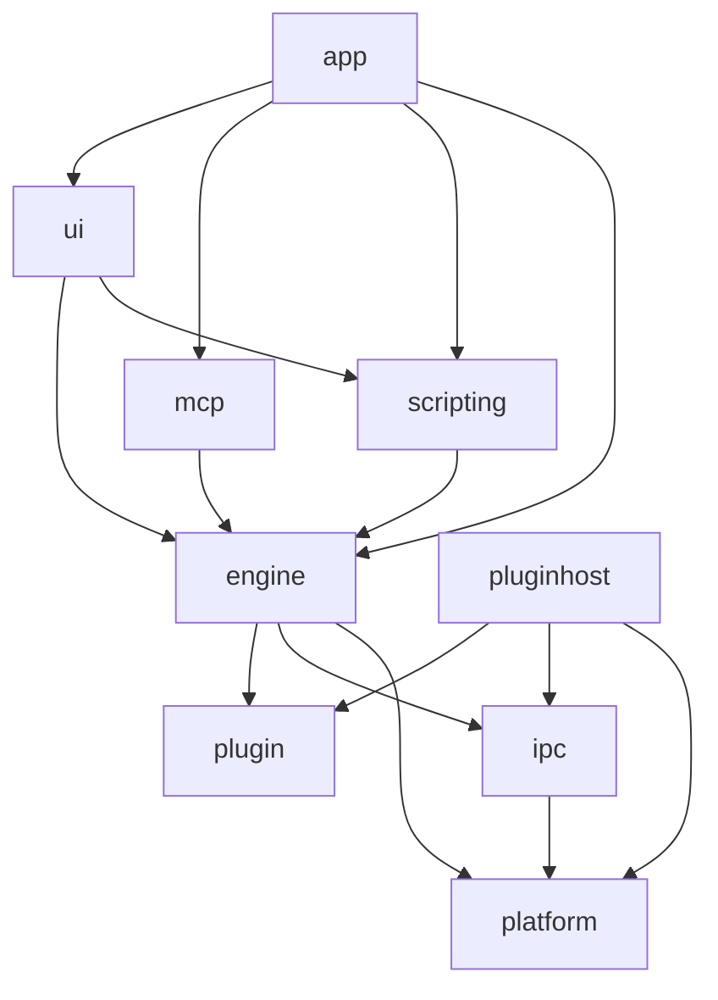
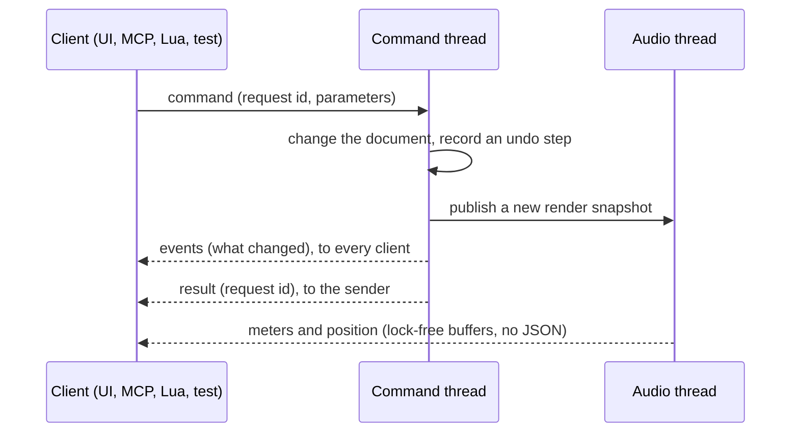
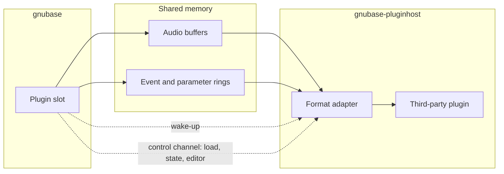

# GNUbase architecture

How GNUbase is put together: processes, modules, threads, the engine API and the rules that keep audio real-time safe. Read this before changing module boundaries, threads or the engine API. [CLAUDE.md](../CLAUDE.md) has the short version of the rules; this document has the details and the reasoning.

Parts marked **decided in #N** are open until that ticket lands; the ticket refines the section.

## Principles

1. The engine is a headless library. The UI, the MCP server, Lua scripts and tests are all clients of the same engine API.
2. Everything a user can do is a command; everything that changes is reported as an event.
3. Third-party plugins never run in the GNUbase process.
4. Audio threads never wait: no allocations, locks, blocking calls or I/O.
5. Output is deterministic: the same project and input give the same samples for any number of threads.
6. Projects are DAWproject files.

## Processes

- **gnubase** is the application: the engine, the UI (left out with `--headless`), the MCP server and the Lua runtime.
- **gnubase-pluginhost** runs third-party plugins. How plugins are grouped into host processes is a user setting: all in one, per vendor (the default until #76 measures), per plugin or per instance, with an override per plugin. There is no in-process mode (#64). Variants for 32-bit plugins (Windows, Linux) and for x86-64 plugins on Apple Silicon (Rosetta) and Windows ARM64 (emulation) speak the same protocol (#151, #152, #153).
- **Plugin scanning** uses the host binary in scan mode: one short-lived process per plugin file, with a timeout. A crash only blocklists that plugin (#66).
- When a host process crashes or misses its deadline, its plugins output silence, the UI is told, and the plugins can be reloaded with their last state (#65). GNUbase keeps running.

## Modules

| Module | Folder | Contents | May depend on |
|---|---|---|---|
| platform | `src/platform` | OS abstractions: audio and MIDI backends, threads and priorities, shared memory, child processes, clocks. Real-time primitives (lock-free queues, RT checker), logging, assertions, crash reports | OS libraries |
| ipc | `src/ipc` | Shared-memory buffers and rings, wake-up primitives, message protocol | platform |
| plugin | `src/plugin` | The GNUbase plugin API: the plugin wrapper's interface, events and extensions ([plugin-api.md](plugin-api.md)), header-only; the remote plugin proxy and stub, their messages and the engine's connection to a host process in `src/plugin/remote` | nothing; `src/plugin/remote`: ipc, platform |
| engine | `src/engine` | Command registry, document model, undo, time, audio graph, transport, file I/O, plugin slots | plugin, ipc, platform |
| scripting | `src/scripting` | Lua runtime and the bindings generated from the command registry | engine API |
| mcp | `src/mcp` | MCP protocol and transports, tools generated from the command registry | engine API, UI automation interface |
| ui | `src/ui` | SDL3 windows, RmlUi documents, docking, widgets, UI automation | engine API, scripting, SDL3, RmlUi |
| pluginhost | `src/pluginhost` | Host process, scanner, format adapters (VST3, CLAP, AU, LV2, FST) | plugin, ipc, platform, plugin SDKs |
| app | `src/app` | `main` and the wiring between modules | all of the above |

- The engine never depends on UI code, SDL or RmlUi. CMake checks this when configuring (`gnubase_require_no_ui`).
- The MCP server does not depend on the UI either: it defines a UI automation interface, the UI implements it and the app connects the two. A headless app simply has no UI tools.
- The plugin host does not link the engine; the two only share the IPC protocol.
- Third-party code lives in `ext/`, see [dependencies.md](dependencies.md).

## Threads in the app process

| Thread | Runs | Rules |
|---|---|---|
| UI (main thread) | SDL event loop, RmlUi layout and rendering, Lua UI scripts | Sends commands, renders from events, never blocks on the engine |
| Engine command thread | Every command: document changes, undo, building render snapshots | The only thread that writes the document |
| Audio thread | The device callback, one processing cycle at a time | Real-time rules |
| Audio workers | Track chains in parallel (#212) | Real-time rules, real-time priority |
| Prefetch threads | Nodes without live input, ahead of the device in larger blocks (#23) | Real-time rules, real-time priority below the audio workers |
| Disk threads | Streaming audio files in and recordings out (#17) | Work ahead of the audio thread |
| Plugin control | Reads the replies and notifications of one host process and watches the process; main-thread calls to its plugins (loading, state, presets, editors, [plugin-api.md](plugin-api.md#threading-rules)) wait for their replies with a timeout | One per host process connection |
| Plugin monitor | Notices remote plugins that failed and has the engine report them | Low priority, every 20 ms |
| Background threads | Peak files, analysis, saving projects, plugin scan coordination | Low priority |
| Log writer | Writes what audio threads logged, every 10 ms (#8) | Low priority |
| MCP I/O thread | The MCP server's HTTP or stdio transport | Only forwards to the command thread |
| Script thread | Lua in headless mode; with a UI, Lua runs on the UI thread | Never an audio thread |

Data moves between threads only through:

- lock-free queues: commands to the engine, events to clients, messages to the audio thread (#14);
- immutable render snapshots, published with an atomic pointer swap; the command thread frees an old snapshot once the audio thread no longer uses it;
- triple buffers for continuous values such as meters and the playback position, read by the UI once per frame.

## Logging and crash reports

- Every process (the app, each plugin host) writes its own log file in the per-user log folder, through a `logging::Session` created in `main`. The previous run's file is kept as `<name>.previous.log` (#8).
- Audio threads log without allocating or locking: the message and its strings are copied into a lock-free queue, and the log writer thread writes them. If the queue is full, messages are dropped and the number is logged.
- `GNUBASE_ASSERT` checks in every build: a failure is logged, and debug builds stop there. `GNUBASE_ASSERT_REALTIME` marks code that must run on an audio thread; `rt::assertNotRealtime` marks code that must not.
- A crash adds a backtrace to the log (macOS, Linux) or writes a minidump next to it (Windows).

## Engine API

Every action is a **command** in the command registry, with a name, a version, typed parameters and results (JSON schema), documentation and undo behaviour (#10). The MCP tools (#25) and the Lua bindings (#205) are generated from the registry, and CI fails if a command is missing from either (#31).

- The API is `gnubase::engine::Engine` and `Client` (`src/engine/engine.h`). Commands are asynchronous: `send` returns a request id, then the events and the result arrive in the client's queue; `call` sends and waits for the result.
- Parameters are checked against the command's JSON schema before it runs, and results against theirs; a failure becomes an error result with the reason. A command's events reach every client before its result reaches the sender, and a failed command emits none.
- **Events** name what changed (object ids and properties), so a client updates only what it shows.
- **Meters and the playback position** are not events and never JSON. The audio thread writes them into lock-free buffers, holding each meter's peak until it is read so none is lost between frames, and the UI reads all of them at once per frame (#111). MCP and Lua get them through a query when they need them.
- **Queries** are read-only commands. They also run on the command thread, so they always see a consistent document.
- Because commands, results and events are serializable, the same API works in-process (UI, tests), over MCP and from Lua, and could later run across processes.

## Document model and undo

- A project is a tree of objects with stable ids: tracks, channels, busses, parts, events, clips, automation and plugin slots (#11). The document (`src/engine/document`) has busses, tracks in folders, each track's channel, media files, clips, audio events, and MIDI parts with notes and controllers; automation and plugin slots come with their milestones. Ids count up per project, are never reused, and 0 means none.
- Only commands change it: `project.*`, `bus.*`, `track.*`, `channel.set`, `media.*`, `clip.*`, `audioEvent.*`, `midiPart.*`, `note.*` and `controller.*`. `project.get` returns the whole document. Every change emits events such as `track.added`, `channel.changed` or `note.removed`. A command checks everything before it changes anything, so a failed command changes nothing.
- Positions are in their track's time base: ticks when musical, samples when linear. Notes and controllers are in ticks from their part's start; audio event offsets and lengths are in the clip's sample frames. Linear positions keep their time when the sample rate changes.
- Audio events have a volume in dB (-144 to +6) and can be muted. In DAWproject a muted event is a disabled clip; the volume is GNUbase-only data.
- Every command that changes the project is one undo step (#12). Undo steps are stored as **differences**: before a command runs, the model copies the project; afterwards it records each object that changed with its state before and after (`src/engine/document/history.h`). Notes and controllers count as objects, so editing one note doesn't store its whole part. Undo and redo put recorded states back instead of computing inverse operations, so they restore the project exactly. The copy also makes every command atomic: if it fails halfway, the project is restored. Copying costs time in proportion to the project's size, like compiling the render snapshot; if that gets slow for large projects, commands can record what they touch instead and keep the same steps.
- `history.transaction` runs several commands as one step, and none of them if one fails. Each step has an action name, a time and the user's details; `history.undo` and `history.redo` move one or more steps, and `history.set` limits their number. Undoing an addition doesn't free its ids, so ids stay unique. Selection and view state are not in the document and so not in undo.
- The audio thread never reads the document. After each change the command thread compiles an immutable **render snapshot** (`RenderSnapshot`): busses, media files, and the channels in track order with their routing as indices, audio events, notes and controllers in the project's samples, sorted by time. `rt::SnapshotPublisher` hands it to the audio thread. The processing graph is built from it (see "Audio processing").

## Audio processing

One cycle on the audio thread:

1. Read the current render snapshot and the transport state (#16).
2. Schedule MIDI and automation for the cycle, sample-accurately (#19).
3. Run the task graph: track chains in parallel on the workers, each bus once all its inputs are done (#15, #212). A plugin slot hands its block to its host process and waits for the result.
4. Sum busses in a fixed order, apply latency compensation (#71), write the outputs, and feed meters and capture taps.

The **processing graph** (`src/engine/graph`) is what the audio thread runs:

- Its nodes are busses, channels, built-in processors and plugin slots, joined by audio connections and event connections (notes, controllers, parameter changes). `describe` turns a render snapshot into a graph description: a node per bus, then a node per channel, with each channel's input and output routing; MIDI channels send events to their instrument channel instead of audio. `graph.get` returns it.
- The command thread compiles the description into a `CompiledGraph`: it orders the nodes, allocates every audio and event buffer, prepares the processors and computes each node's path latency, the hook for latency compensation (#71). Compiling a new graph never stops the old one; `rt::SnapshotPublisher` swaps it in between two blocks, and the old one is freed on the command thread.
- Processors (`graph::Processor`) belong to the descriptions, not to a compiled graph, so the next graph reuses them with their state and a rebuild causes no glitch. They are prepared again only when the sample rate or the block size changes, which only happens while audio is stopped.
- Processing a block takes the nodes in a fixed order: every node after the nodes it receives from, otherwise by index. A node's input is the sum of its audio inputs in the order of their node indices, so the output is bit-identical for the same input. GCC and Clang build without fused multiply-adds (`-ffp-contract=off`), which round differently, so every platform renders the same samples. Events carry their sample offset within the block, and a node's events arrive sorted by offset.
- For now one thread processes every node; #212 runs independent chains in parallel and keeps the same summing order.
- The **audio engine** (`src/engine/audio`) plays the project through an audio device (`audio::AudioCallback` in `src/platform/audio`). After every command that changes the project it compiles a new graph for the device's sample rate and block size. Once per block it copies the device inputs into the input busses, processes the graph and copies the output busses to the device outputs. Busses take consecutive device channels in bus order until users can pick ports (#43).
- The **dummy device** (`audio::DummyDevice`, backend `dummy`) has no hardware. Its input is silent or a built-in generator, its output and MIDI output are captured into memory allocated up front, and MIDI is injected at frame positions. It runs offline (`audio.render`: blocks on the calling thread as fast as possible) or in simulated real time (`audio.start`, `audio.stop`: its own thread processes one block per block duration). Both modes produce the same samples, because the output depends only on the project, the input and the block size. `audio.capture` reads what it captured.
- **Analysis** of the captured output (#28), for tests and AI agents: `audio.analyze` measures channels over a range of frames (peak and RMS level, a spectrum summary with the strongest frequencies and octave band levels, and the integrated loudness per ITU-R BS.1770-4); `audio.compare` subtracts a reference audio file and measures what remains (null test); `audio.record` writes the capture to a WAV file. The measurements are pure functions in `src/engine/analysis`, the commands in `src/engine/audio/analysiscommands.cpp`; they run on the command thread. Busses and track channels can be recorded and measured once the graph has capture taps; until then, the device outputs that the output busses reach.
- The **transport** (`Transport` in `src/engine/audio`) holds the project cursor, the left and right locators and the playback modes. Commands (`transport.play`, `stop`, `toggle`, `locate`, `set`, `exchangeLocators`, `get`) send requests through a lock-free queue; the audio thread applies them at the start of its next block, or the command thread right away while no device runs. For every block it hands the graph a `graph::TransportBlock`: whether it plays and, while playing, segments of consecutive project positions. In cycle mode a new segment starts at the exact sample where playback reaches the right locator and jumps to the left one, so loop points are sample-accurate for any block size; with the right locator before the left one the range is skipped instead. Processors read the block from `ProcessContext::transport`; the built-in `positionProbe` outputs each frame's position, so tests check where every frame played. Start from cycle start and return to start position on stop are settings; the selection-based start modes belong to the UI, which knows the selection. Every transport command emits `transport.changed`.
- **Audio tracks** play their audio events from disk streams (`Playback` and `TrackPlayer` in `src/engine/audio/playback.h`). When the graph is rebuilt, each audio track gets a **playlist**: its events in the project's samples, sorted and cut where they overlap. A track plays one event at a time, and where events overlap the one added last (the highest id) is in front; muted events don't play and hide nothing. A clip at another sample rate is converted by its disk stream, and its offset and length are scaled to the project's rate. A clip's channels go one to one to the track's channels, a mono clip goes to all of them, extra clip channels are left out; a mono track reaches a stereo bus through the graph's mono-to-stereo mix.
- Each audio track has a few **voices**: disk streams of its clips. The command thread positions them ahead of playback ("cueing") at every point where playback enters an entry: the cursor, the start of each next entry whose clip doesn't simply continue the one before, and the left locator after a cycle jump. The audio thread takes the voice that is waiting at the frame it needs, so events and cycle jumps start at their exact sample; within an entry it reads on from the same voice. A voice that isn't there in time, or a late disk stream, leaves silence, counted as `playbackDropouts` in `audio.get`.
- Offline rendering (`audio.render`) cues and then waits until every voice's buffer is full before each block, so it never drops out and renders the same samples every time. In real time a cue thread cues the next two seconds every 5 ms; `transport.play` and `transport.locate` cue the start position first and wait up to two seconds for it. Real time and offline rendering produce the same samples as long as the disks keep up.
- GNUbase's built-in processors (`src/engine/processors`) are `graph::Processor`s that run in the engine: for now signal generators (sine, noise, impulse), a position probe for transport tests, gain and pan, and a polyphonic test synth, so MIDI-to-audio paths are tested before plugin hosting. Each one handles parameter changes and notes at their sample offset. `processor.list` returns them with their parameters' ids, ranges, defaults and units, and `processors::createBuiltin` creates one by id.

Time is kept in samples and in musical time (PPQ ticks), with tempo and time signature maps (#13). Tracks that are not monitored live are processed ahead with larger buffers on lower-priority threads; [anticipative-processing.md](anticipative-processing.md) describes how (#23).

## Audio devices

Audio devices are OS abstractions in `src/platform/audio` (`device.h`); the engine only sees the interfaces.

- A **backend** (`audio::Backend`) is a kind of driver: `dummy` everywhere, and per platform ASIO and WASAPI (Windows), CoreAudio (macOS), PipeWire and JACK (Linux) as they land (#34 to #38). `audio::makeBackends()` returns the backends of the build, the preferred one first and the dummy backend last; the `Engine` constructor takes them, so tests can add fake ones. A backend lists its devices (`DeviceInfo`: id, name, channel names, sample rates, block sizes, clock sources, control panel) and opens one (`DeviceConfig`: device, sample rate, block size, clock source; zero or empty leaves the choice to the driver).
- An open **device** (`audio::Device`) reports its format, a complete `DeviceInfo` and its input and output latency in frames, starts and stops, and can open its driver's control panel. While it runs it calls the `AudioCallback` once per block on its audio thread, in the realtime context, with at most `blockSize` frames, silent outputs, and positions that count on across restarts. Platform code stays thin behind this interface; the engine never sees a driver API.
- A **driver-initiated reset** (settings changed in the driver's control panel, a new buffer size, a lost and regained device) reaches the device's reset handler on a thread other than the audio thread. The audio engine then posts `audio.reset` to the command thread (`Engine::post`: a command without a sender, whose events still reach every client). `audio.reset` opens the device again with the settings it was opened with, compiles the graph for its new format and restarts it if it ran, so GNUbase keeps running; clients see `audio.changed`.
- One **contract test suite** (`tests/device_tests.cpp`) checks every backend: listing, opening with each listed sample rate, block size and clock source, the callback rules, stop and restart. It runs against the dummy backend in CI and against the hardware backends locally with `gnubase-tests "[hardware]"`.
- Commands: `audio.devices` lists the backends and their devices, `audio.setDevice` opens one (the dummy device by default; another backend's device is closed before the next one opens, since drivers often allow only one), `audio.get` reports the device with its latencies and clock source, `audio.reset` and `audio.controlPanel` do what their names say, and `audio.start` and `audio.stop` run any device. `audio.render` and `audio.capture` are the dummy device's. Headless mode takes the backend with `--audio`.

## Audio files and disk streaming

- `AudioFileReader` and `AudioFileWriter` (`src/engine/audiofile`) read WAV, RF64, Wave64, AIFF, FLAC, Ogg Vorbis and MP3, and write WAV (also BWF and RF64), AIFF and FLAC (#17). Formats are recognized by content; paths are UTF-8 everywhere.
- The audio thread never touches files. A `DiskStream` holds blocks of frames, allocated once, that pass between the disk thread (`DiskStreamer`) and the audio thread through lock-free queues; the disk thread keeps them filled ahead of playback. `read()` never waits: missing frames are silence and count as dropouts, and later frames stay at their time.
- A seek starts a new generation of blocks: the disk thread takes back the older ones and reads from the new position, and the audio thread ignores blocks of older generations. `ready()` says when the buffer is full again, and `full()` when it also holds again every block the audio thread gave back since; offline rendering waits for `full()` before every block.
- Files at another sample rate are converted by the disk thread with r8brain-free-src (`Resampler`). After a seek, reading starts early enough for the filters and on the same frame grid as from the start, so the output is the same as when playing through. `media.convert` writes a converted copy, for importing at the project's sample rate.

## Plugin hosting and IPC

- **Audio path:** audio, notes and parameter changes for a block go through shared memory, and a wake-up tells the other side. No allocations or locks on this path (#62).
- **Control path:** loading, state, presets, editor windows and scans use a separate, versioned message channel that is not real-time.
- The binary layout is fixed (no pointers, explicit sizes and alignment), so 32-bit and emulated host processes use the same protocol.

The **IPC transport** (`src/ipc`, #62) is a `Connection` between the engine and a host process: one segment of named shared memory (`platform::SharedMemory`: a file mapping on Windows, `shm_open` elsewhere) that the engine creates under a unique name and passes to the host on its command line. A plugin slot owns one connection, so a host process running several plugins holds one connection per plugin, and parallel audio workers never share a ring.

- **Layout** (`ipc/protocol.h`): a 128-byte `SegmentHeader` (magic, protocol version, configuration, process ids, each side's state), then two audio lanes and two control lanes (engine to host, host to engine), then their data. Each lane has a wake word, and each ring a head and a tail, on cache lines of their own. Both sides compute every offset from the configuration in the header (`layoutFor`), so the memory holds no offsets or pointers. Only fixed-width integers and lock-free 32-bit atomics are in it; static asserts pin every size and offset.
- **Versions:** a host refuses a segment with another major version, an unknown header size, an invalid configuration or the wrong size (`checkSegment`), and a second host. Minor versions only add what older peers can ignore. Every message carries its own type and version, so hosts and engines of different minor versions can skip what they don't know.
- **Rings** (`ipc/rings.h`), all single-producer, single-consumer with free-running 32-bit indices: a `BlockRing` of fixed-size slots per audio lane, each slot a `BlockHeader` (sequence, position, frames, channels, event count) followed by the channels, which both sides read and write in place; and a `MessageRing` of variable-sized messages for events and for control messages, each with an 8-byte header, padded to 8 bytes, wrapping with a padding record. A block's events go into the event ring before the block, and its event count says how many belong to it, so several blocks can be in flight.
- **Nothing from the peer is trusted.** A host runs third-party code that may scribble over the memory, so each side keeps its own indices privately and checks the peer's (a head more than a ring ahead, a misaligned head, impossible sizes or headers). The reader copies messages and block headers out before checking them, so the peer cannot change them afterwards, and never reads outside a ring. A peer that breaks the protocol makes reads return `Corrupt` from then on. Fuzz tests feed random ring contents and headers to the readers.
- **Wake-up** (`ipc::Doorbell`): the sender counts up a 32-bit word in shared memory and wakes the receiver: a shared futex on Linux, the kernel's shared compare-and-wait (`__ulock_wait`/`__ulock_wake`, what the system's own locks use; named semaphores have no timed wait on macOS) on macOS, and a named auto-reset event on Windows, where the word tells a real wake-up from a stale one. Ringing never blocks, so the audio thread rings after committing a block. Joining the device's audio workgroup on macOS is up to the host's audio thread (still open).
- **Deadlines:** `waitForBlock` waits for the answer until a timeout and returns `Ready`, `Timeout` or `PeerClosed`. It is the one wait on the audio path, bounded by the timeout; on Windows its timeout is rounded up to whole milliseconds. A peer that closes in an orderly way sets its state to `Closed` and rings, so the wait ends at once. A crashed or hung host just misses the deadline; the watchdog (#65) tells the two apart through the process (`platform::ChildProcess`), which also starts host processes.
- **Real-time safety:** `beginBlock`, `sendBlock`, `sendEvent`, `receiveBlock`, `releaseBlock`, `receiveEvent` and `waitForBlock` never allocate, lock or make blocking calls other than that wait; a test runs a round trip under the RT checker. Creating and opening connections and the control path are for other threads.
- A test runs a helper host process (`tests/ipcpeer.cpp`) and checks round trips, the control channel, a killed and a hung host and an orderly close. It also measures the round-trip latency: around 10 µs for 128 frames on a desktop PC.

The **plugin host process** (`gnubase-pluginhost`, `src/pluginhost`, #64) runs plugins for the engine, which starts it with the name of a control connection (`--connect`) and its log file (`--log`):

- **Handshake:** opening the connection checks the IPC version (`checkSegment`); then the engine sends `Hello` with the version of the plugin messages (`plugin::remote::g_protocolVersion`) and of the plugin API, and a host with other versions refuses and exits with code 4.
- **Control connection:** one per host process. Every main-thread call to one of its plugins is a request with an id and the instance it is for, answered by a `Reply` (`src/plugin/remote/protocol.h`): create (by plugin id and file), activate, deactivate, destroy, save and load state, parameter texts, flushing parameters. Messages larger than the ring go out in fragments, so large plugin states fit. The host's main thread runs the control loop and is the plugins' main thread; plugin editors will add the OS event loop to it (#69). What plugins ask of the engine (restart, state changed, ...) goes back as notifications.
- **Audio connections:** one per active plugin instance, created by the engine when it activates the plugin and sized for its ports and block size. A block carries a `ProcessInfo` (steady time, process mode, start, stop and reset flags, the inputs' constant masks), the transport segments, the input events (`plugin::Event` as it is, sysex bytes after their event) and the input ports' channels one after the other; the answer carries a `ProcessResult` (status, the outputs' constant masks), the output events and the output channels. Each instance's blocks are processed by a thread of its own in the host, at real-time priority (`platform::setRealtimePriority`), so sharing a process doesn't serialize a parallel graph.
- **Format adapters:** the host creates plugins through `pluginhost::Formats`: a `Format` per plugin format loads a plugin file and returns its `plugin::Factory`, and the part of the plugin id before `:` names the format. For now the only format is `test`, plugins built into the host for tests (`test:gain`, `test:hang`, `src/pluginhost/testplugins.h`); CLAP (#67) and VST3 (#68) add theirs, and the test plugins in plugin formats come with #63.
- **Exit:** the host exits when the engine closes the control connection or its process is gone (checked every 200 ms), so no host outlives a crashed engine. A plugin that hangs in `process()` can't be stopped; the host then exits without cleaning up.

On the engine's side (`src/plugin/remote`, `src/engine/plugins`):

- **`plugin::remote::RemotePlugin`**, the proxy, implements `plugin::Plugin` with the extensions `AudioPorts`, `Params`, `State`, `Latency` and `Tail` by forwarding to its instance; it caches ports, parameter infos, latency and tail, and mirrors every parameter value from the events it sends and gets back. The other extensions follow with their tickets (#69, #70, #72). `process` is real-time safe: it fills the block, rings the host and waits for the answer until the deadline, in slices of 5 ms, so a host that crashed is noticed at once.
- **`plugin::remote::HostConnection`** starts a host process, shakes hands with it and runs its plugin control thread.
- **`engine::plugins::HostManager`** decides which process runs a plugin, by the hosting mode, starts processes and drops the ones without plugins. Its monitor thread watches the remote plugins, and the engine reports failures as `plugin.failed` events.
- **`engine::plugins::PluginSlot`** is the `graph::Processor` of a plugin slot node: it hosts any `plugin::Plugin`, built in or remote, activates it when the graph is compiled, converts the node's audio, events and transport, and outputs silence for blocks the plugin fails. Plugin slots in the document come with the insert and instrument slots.
- **Failures:** a block that misses its deadline (100 ms in real time and prefetch, 10 s offline, until #65 and #76 tune them), a host process that exits, or one that breaks the protocol makes the remote plugin fail: from then on it is bypassed, outputs silence and doesn't wait for its host. The monitor tells crashed hosts (the process is gone) from hung ones (it runs), marks a hung host so no new plugins go there, and the engine emits `plugin.failed` with the instance, plugin, process and reason. GNUbase keeps running; reloading the plugin with its last state is #65.
- **Hosting modes:** `shared`, `perVendor`, `perPlugin` or `perInstance`, plus overrides per plugin id (`pluginhost.get`, `pluginhost.setMode`, `pluginhost.setOverride`). The default is per vendor: a crash takes down one vendor's plugins, and the number of processes stays small; #76 decides by benchmark. When the mode changes, every plugin whose group changes moves: the proxy saves its state, creates the plugin in the new process, loads the state, activates it with a new audio connection and takes it over between two blocks, so it keeps sounding while the old instance goes. The mode lives in the engine until GNUbase has user preferences to store it in.
- Tests (`tests/pluginhost_tests.cpp`) compare a test plugin processed through the host process with the same plugin in the engine, bit for bit, switch the hosting mode while plugins process, kill a host in the middle of rendering and let one hang; a test in `rtcheck_tests.cpp` runs the proxy under the RT checker.
- A watchdog gives every host process a deadline per cycle (#65).
- Plugin editors are windows of the host process, kept in front of and positioned relative to GNUbase's windows (#69).
- Inside the host, every format is adapted to the **GNUbase plugin API**, modeled on CLAP: a core interface (`plugin::Plugin`, `plugin::Host`) plus extensions looked up by id, in `src/plugin`. [plugin-api.md](plugin-api.md) describes it, how each format maps onto it, and how it is split between the processes. GNUbase's own built-in plugins implement the same API but run inside the engine (#114).
- In the engine, a plugin slot is a `graph::Processor` that hosts a `plugin::Plugin`: a built-in plugin, or a proxy that forwards to an adapter in a host process. Events (`plugin::Event`) and the transport are fixed-layout records, so the IPC copies them as they are. The engine mirrors every parameter value, so reading one never waits for a host process.
- **Test plugins** (`tests/plugins`, #63) are GNUbase's own minimal plugins for hosting tests: gain, a synth, a latency reporter, a parameter stress plugin, crash and hang on demand, and a state blob round trip. They are built as CLAP plugins with each platform's file layout (CMake option `GNUBASE_TEST_PLUGINS`, on by default), and loader smoke tests load them through the format's own entry points. Crash and hang are only ever triggered in a plugin host process. [tests/plugins/README.md](../tests/plugins/README.md) describes each plugin and how tests use them.

## Scripting, MCP and tests

- **Lua** runs on the UI thread, or on the script thread when headless, with bindings generated from the command registry. RmlUi's Lua plugin shares the same runtime (#205, #208). Scripts that come with a project never run without the user's consent.
  - `scripting::Runtime` (`src/scripting/runtime.h`) is a Lua 5.4 state with the global table `gnubase`: one function per command (`gnubase.track.add{type = "audio"}` for `track.add`), returning the result as a table or raising an error with the reason; `gnubase.on(name, handler)` for events, `gnubase.waitFor(name, seconds)` and `gnubase.events()`. Commands run synchronously on the script's thread, so coroutines can call them too.
  - Trusted scripts (`gnubase --headless --script file.lua`) get every standard library except `os.exit`, which would skip the engine's shutdown. Untrusted ones, such as scripts in projects, get no `io`, `os`, `debug`, `package`, `require`, `dofile` or `loadfile`, and `load` only accepts source code.
  - MCP clients run untrusted scripts with the tool `script_run`, at most 60 seconds of Lua code each (a count hook stops longer ones). The app adds it through `mcp::Server::addTool`, which also takes the UI tools later; the MCP module itself doesn't depend on scripting.
  - [lua.md](lua.md) is the API reference, generated from the command registry. A test fails when it's out of date (`GNUBASE_UPDATE_DOCS=1` rewrites it), and another fails when a command lacks its MCP tool, its Lua function, a parameter schema or a description (#31).
- **MCP:** streamable HTTP on localhost with an access token, or stdio in headless mode (#25, #26). Its tools come from the command registry plus the UI automation interface: DOM tree, screenshots, input injection (#58). [mcp.md](mcp.md) is the guide for agents and their users, with a tool catalogue that `mcp::catalogue` generates from the server's `tools/list`; a test fails when it is out of date (`GNUBASE_UPDATE_DOCS=1` rewrites it).
  - `gnubase --headless` (`src/app/headless.h`) sets up the audio device and loads `--project`, then serves MCP on stdio until stdin ends, or on HTTP (`--mcp-http`) until Ctrl+C or SIGTERM. Stdout belongs to MCP; messages go to stderr and the log file `gnubase-headless.log`. Exit codes are 0 done, 1 unexpected error, 2 invalid command line, 3 audio device or project not set up. Everything except `main` is in the `gnubase-app` library, which has no UI dependency, so tests run it in-process as well as through the real executable.
  - `mcp::Server` (`src/mcp/server.h`) speaks MCP revision 2025-06-18 over JSON-RPC. Every command is a tool named with `_` instead of `.` (MCP clients accept only letters, digits, `_` and `-`), with the command's parameter schema as input schema, its result schema as output schema, and queries marked read-only. Queries without required parameters are also resources, `gnubase://<command>`. A failing command is a tool result with `isError`, so the agent sees why; protocol mistakes are JSON-RPC errors.
  - Each request uses its own engine client, so concurrent requests are safe and no events pile up between requests.
  - `mcp::HttpServer` listens on 127.0.0.1 only. It refuses requests from other addresses, from web pages of other origins (DNS rebinding), and without `Authorization: Bearer <token>` (`mcp::makeToken`). POST /mcp answers with JSON, or 202 for notifications. A stream for server-initiated messages (GET) comes later. `mcp::serveStdio` reads one message per line and writes one response per line.
  - `tests/mcptools_tests.cpp` uses every tool for projects, tracks, parts, events, the transport and undo the way an MCP client does, with JSON-RPC requests as text (#27).
- **Tests** take the same paths: the dummy device and offline rendering (#21), golden files, and the UI automation API from C++ (#59) or Lua (#206, #208).
  - `gnubase.test` is the Lua test framework (`src/scripting/testing.lua`, compiled in as bytes by CMake): test cases, assertions, fixtures and golden files ([lua.md](lua.md#tests)). The runtime loads it into every Lua state, trusted or not, and runs the test cases a script registered when it ends; the report is printed in TAP format, and a failure fails the script. So `script_run` runs test cases as well, and no command area may be called `test`.
  - Every `tests/lua/*.lua` is a ctest test (labels `integration` and `lua`) that runs `gnubase --headless --script` in the source folder, so failures name `tests/lua/<file>.lua` and the line. Sanitizer builds don't build the app and skip them; the C++ tests of the framework still run there.

## Project format

- Projects are `.dawproject` files: a zip container with XML and media (#22). `project.save` and `project.load` write and read them (`src/engine/dawproject`), with miniz for the container and pugixml for the XML.
- `project.xml` gets everything DAWproject can describe: tracks with their folders, channels with their routing (groups as `submix`, output busses as `master` channels), audio events and MIDI parts as clips, notes, MIDI controllers as `Points`, markers, and tempo and time signature with their changes. Media files are embedded under `audio/` or referenced where they are. GNUbase's output validates against the format's `Project.xsd`.
- GNUbase data that DAWproject cannot express goes into an extra entry in the same container, so other applications can still open the file. The entry is **`gnubase.json`**: the whole document as `project.get` returns it, the id counter, the media paths, and a checksum of `project.xml`. If the checksum matches, loading restores the project exactly (ids, input busses, time bases, MIDI tracks, exact sample positions); if another application changed `project.xml`, the entry is ignored and the project is built from `project.xml`, so stale GNUbase data never overrides someone else's edits.
- Plugin states are stored as DAWproject specifies (#72).

## Open decisions

| Topic | Ticket |
|---|---|
| UI render backend | #47 |
| Plugin editor windows and their header | #69 |
| Remaining plugin API questions ([plugin-api.md](plugin-api.md#open-questions)) | #70, #72, #76 |
| Default hosting mode | #76 |
