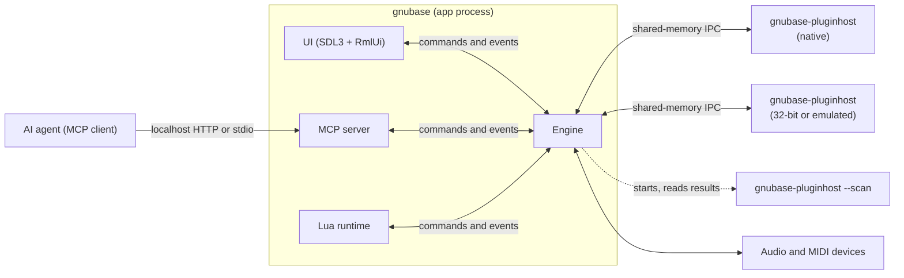
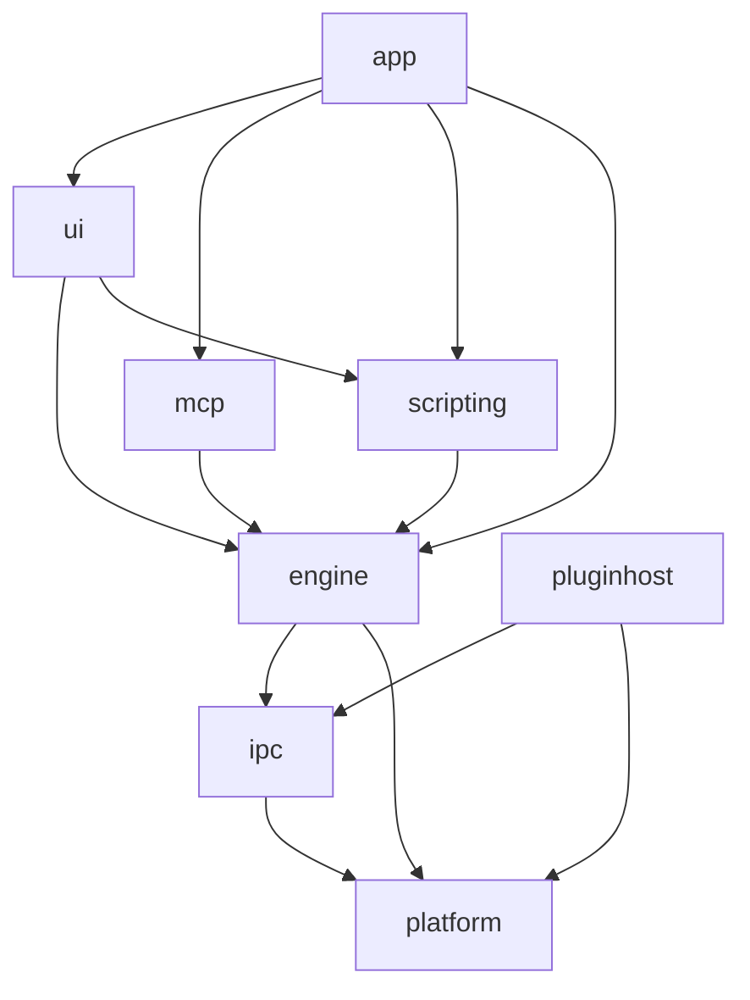
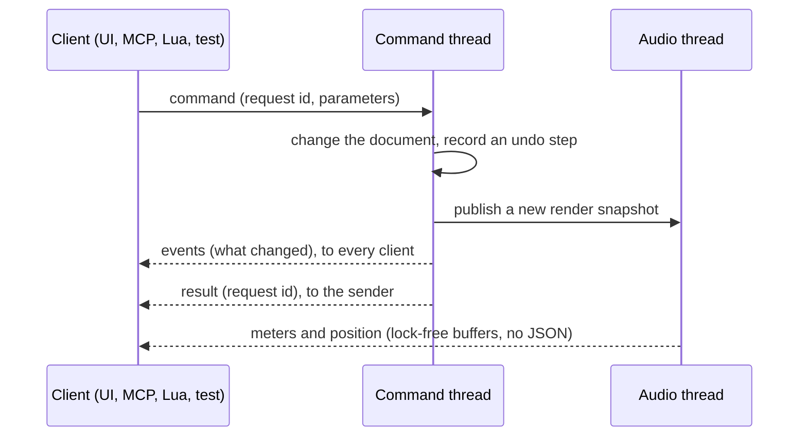
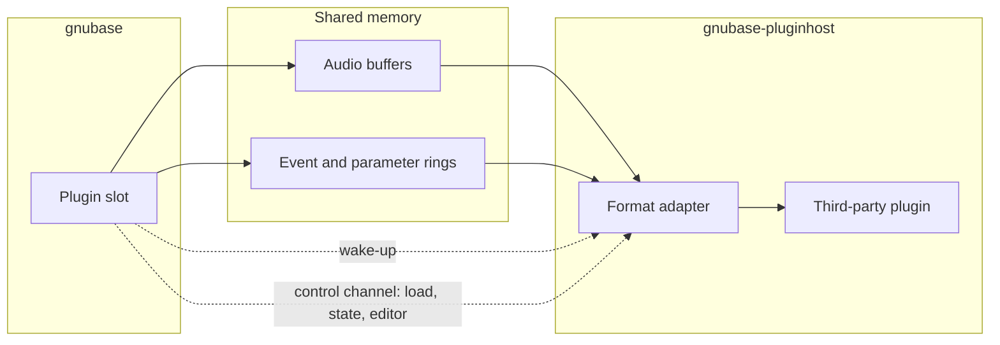

# GNUbase architecture

How GNUbase is put together: processes, modules, threads, the engine API and the rules that keep audio real-time safe. Read this before changing module boundaries, threads or the engine API. [CLAUDE.md](../CLAUDE.md) has the short version of the rules; this document has the details and the reasoning.

Parts marked **decided in #N** are open until that ticket lands; the ticket refines the section.

## Principles

1. The engine is a headless library. The UI, the MCP server, Lua scripts and tests are all clients of the same engine API.
2. Everything a user can do is a command; everything that changes is reported as an event.
3. Third-party plugins never run in the GNUbase process.
4. Audio threads never wait: no allocations, locks, blocking calls or I/O.
5. Output is deterministic: the same project and input give the same samples for any number of threads.
6. Projects are DAWproject files.

## Processes

- **gnubase** is the application: the engine, the UI (left out with `--headless`), the MCP server and the Lua runtime.
- **gnubase-pluginhost** runs third-party plugins. How plugins are grouped into host processes is a user setting: all in one, per vendor, per plugin or per instance. There is no in-process mode (#64). Variants for 32-bit plugins (Windows, Linux) and for x86-64 plugins on Apple Silicon (Rosetta) and Windows ARM64 (emulation) speak the same protocol (#151, #152, #153).
- **Plugin scanning** uses the host binary in scan mode: one short-lived process per plugin file, with a timeout. A crash only blocklists that plugin (#66).
- When a host process crashes or misses its deadline, its plugins output silence, the UI is told, and the plugins can be reloaded with their last state (#65). GNUbase keeps running.

## Modules

| Module | Folder | Contents | May depend on |
|---|---|---|---|
| platform | `src/platform` | OS abstractions: audio and MIDI backends, threads and priorities, shared memory, clocks. Real-time primitives (lock-free queues, RT checker), logging, assertions, crash reports | OS libraries |
| ipc | `src/ipc` | Shared-memory buffers and rings, wake-up primitives, message protocol | platform |
| engine | `src/engine` | Command registry, document model, undo, time, audio graph, transport, file I/O, plugin slots | ipc, platform |
| scripting | `src/scripting` | Lua runtime and the bindings generated from the command registry | engine API |
| mcp | `src/mcp` | MCP protocol and transports, tools generated from the command registry | engine API, UI automation interface |
| ui | `src/ui` | SDL3 windows, RmlUi documents, docking, widgets, UI automation | engine API, scripting, SDL3, RmlUi |
| pluginhost | `src/pluginhost` | Host process, scanner, format adapters (VST3, CLAP, AU, LV2, FST) | ipc, platform, plugin SDKs |
| app | `src/app` | `main` and the wiring between modules | all of the above |

- The engine never depends on UI code, SDL or RmlUi. CMake checks this when configuring (`gnubase_require_no_ui`).
- The MCP server does not depend on the UI either: it defines a UI automation interface, the UI implements it and the app connects the two. A headless app simply has no UI tools.
- The plugin host does not link the engine; the two only share the IPC protocol.
- Third-party code lives in `ext/`, see [dependencies.md](dependencies.md).

## Threads in the app process

| Thread | Runs | Rules |
|---|---|---|
| UI (main thread) | SDL event loop, RmlUi layout and rendering, Lua UI scripts | Sends commands, renders from events, never blocks on the engine |
| Engine command thread | Every command: document changes, undo, building render snapshots | The only thread that writes the document |
| Audio thread | The device callback, one processing cycle at a time | Real-time rules |
| Audio workers | Track chains in parallel (#212) | Real-time rules, real-time priority |
| Disk threads | Streaming audio files in and recordings out (#17) | Work ahead of the audio thread |
| Background threads | Peak files, analysis, saving projects, plugin scan coordination | Low priority |
| Log writer | Writes what audio threads logged, every 10 ms (#8) | Low priority |
| MCP I/O thread | The MCP server's HTTP or stdio transport | Only forwards to the command thread |
| Script thread | Lua in headless mode; with a UI, Lua runs on the UI thread | Never an audio thread |

Data moves between threads only through:

- lock-free queues: commands to the engine, events to clients, messages to the audio thread (#14);
- immutable render snapshots, published with an atomic pointer swap; the command thread frees an old snapshot once the audio thread no longer uses it;
- triple buffers for continuous values such as meters and the playback position, read by the UI once per frame.

## Logging and crash reports

- Every process (the app, each plugin host) writes its own log file in the per-user log folder, through a `logging::Session` created in `main`. The previous run's file is kept as `<name>.previous.log` (#8).
- Audio threads log without allocating or locking: the message and its strings are copied into a lock-free queue, and the log writer thread writes them. If the queue is full, messages are dropped and the number is logged.
- `GNUBASE_ASSERT` checks in every build: a failure is logged, and debug builds stop there. `GNUBASE_ASSERT_REALTIME` marks code that must run on an audio thread; `rt::assertNotRealtime` marks code that must not.
- A crash adds a backtrace to the log (macOS, Linux) or writes a minidump next to it (Windows).

## Engine API

Every action is a **command** in the command registry, with a name, a version, typed parameters and results (JSON schema), documentation and undo behaviour (#10). The MCP tools (#25) and the Lua bindings (#205) are generated from the registry, and CI fails if a command is missing from either (#31).

- The API is `gnubase::engine::Engine` and `Client` (`src/engine/engine.h`). Commands are asynchronous: `send` returns a request id, then the events and the result arrive in the client's queue; `call` sends and waits for the result.
- Parameters are checked against the command's JSON schema before it runs, and results against theirs; a failure becomes an error result with the reason. A command's events reach every client before its result reaches the sender, and a failed command emits none.
- **Events** name what changed (object ids and properties), so a client updates only what it shows.
- **Meters and the playback position** are not events and never JSON. The audio thread writes them into lock-free buffers, holding each meter's peak until it is read so none is lost between frames, and the UI reads all of them at once per frame (#111). MCP and Lua get them through a query when they need them.
- **Queries** are read-only commands. They also run on the command thread, so they always see a consistent document.
- Because commands, results and events are serializable, the same API works in-process (UI, tests), over MCP and from Lua, and could later run across processes.

## Document model and undo

- A project is a tree of objects with stable ids: tracks, channels, busses, parts, events, clips, automation and plugin slots (#11).
- Only commands change it. Each command records an undo step; transactions group several into one (#12). How undo steps are stored (inverse operations or differences) is **decided in #12**.
- The audio thread never reads the document. After each change the command thread compiles an immutable **render snapshot**: the processing graph plus events and automation in sample time.

## Audio processing

One cycle on the audio thread:

1. Read the current render snapshot and the transport state (#16).
2. Schedule MIDI and automation for the cycle, sample-accurately (#19).
3. Run the task graph: track chains in parallel on the workers, each bus once all its inputs are done (#15, #212). A plugin slot hands its block to its host process and waits for the result.
4. Sum busses in a fixed order, apply latency compensation (#71), write the outputs, and feed meters and capture taps.

Time is kept in samples and in musical time (PPQ ticks), with tempo and time signature maps (#13). Tracks that are not monitored live can be processed ahead with larger buffers; how is **decided in #23**.

## Plugin hosting and IPC

- **Audio path:** audio, notes and parameter changes for a block go through shared memory. Wake-up uses OS primitives: events on Windows, semaphores with the device's audio workgroup on macOS, futexes on Linux. No allocations or locks on this path (#62).
- **Control path:** loading, state, presets, editor windows and scans use a separate, versioned message channel that is not real-time.
- The binary layout is fixed (no pointers, explicit sizes and alignment), so 32-bit and emulated host processes use the same protocol.
- A watchdog gives every host process a deadline per cycle (#65).
- Plugin editors are windows of the host process, kept in front of and positioned relative to GNUbase's windows (#69).
- Inside the host, every format is adapted to the **GNUbase plugin API** (#61), modeled on CLAP's extension mechanism. GNUbase's own built-in processors implement the same API but run inside the engine (#114).

## Scripting, MCP and tests

- **Lua** runs on the UI thread, or on the script thread when headless, with bindings generated from the command registry. RmlUi's Lua plugin shares the same runtime (#205, #208). Scripts that come with a project never run without the user's consent.
- **MCP:** streamable HTTP on localhost with an access token, or stdio in headless mode (#25, #26). Its tools come from the command registry plus the UI automation interface: DOM tree, screenshots, input injection (#58).
- **Tests** take the same paths: the dummy device and offline rendering (#21), golden files, and the UI automation API from C++ (#59) or Lua (#206, #208).

## Project format

- Projects are `.dawproject` files: a zip container with XML and media (#22).
- GNUbase data that DAWproject cannot express goes into an extra entry in the same container, so other applications can still open the file. Its name and format are **decided in #22**.
- Plugin states are stored as DAWproject specifies (#72).

## Open decisions

| Topic | Ticket |
|---|---|
| How undo steps are stored | #12 |
| DAWproject extension entry | #22 |
| Anticipative processing | #23 |
| UI render backend | #47 |
| Plugin API details | #61 |
| IPC wake-up details, default hosting mode | #62, #76 |
