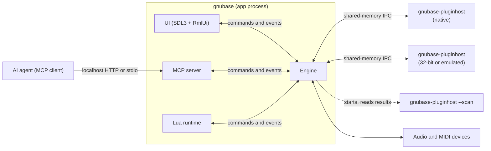
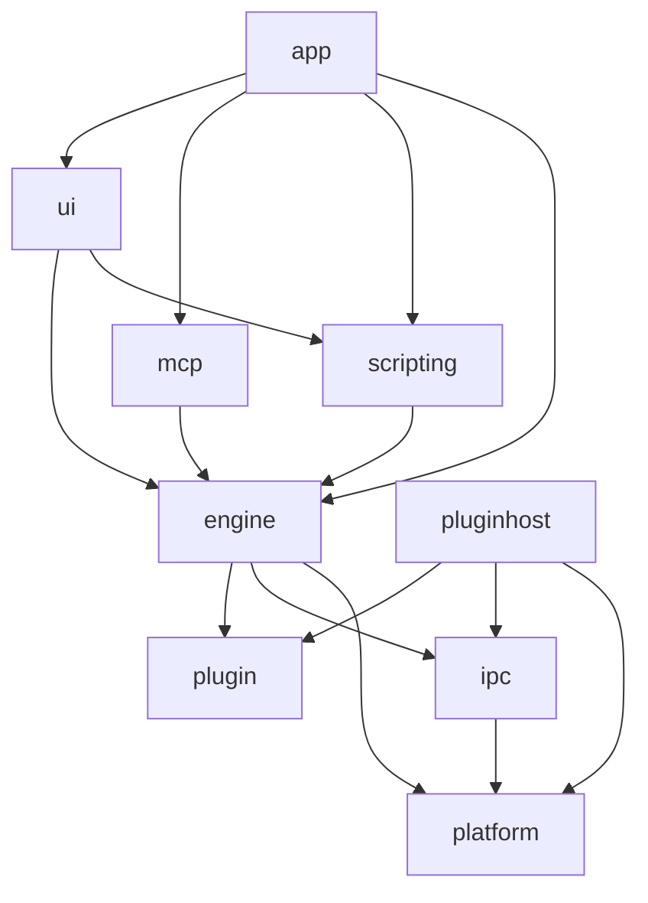
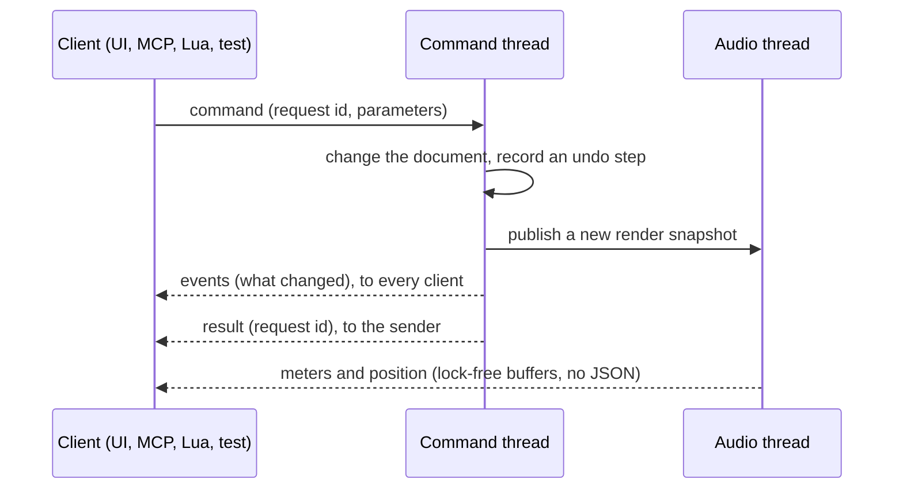
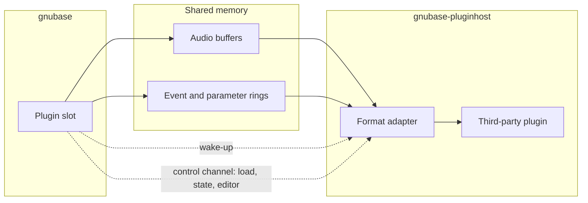

# GNUbase architecture

How GNUbase is put together: processes, modules, threads, the engine API and the rules that keep audio real-time safe. Read this before changing module boundaries, threads or the engine API. [CLAUDE.md](../CLAUDE.md) has the short version of the rules; this document has the details and the reasoning.

Parts marked **decided in #N** are open until that ticket lands; the ticket refines the section.

## Principles

1. The engine is a headless library. The UI, the MCP server, Lua scripts and tests are all clients of the same engine API.
2. Everything a user can do is a command; everything that changes is reported as an event.
3. Third-party plugins never run in the GNUbase process.
4. Audio threads never wait: no allocations, locks, blocking calls or I/O.
5. Output is deterministic: the same project and input give the same samples for any number of threads.
6. Projects are DAWproject files.

## Processes

- **gnubase** is the application: the engine, the UI (left out with `--headless`), the MCP server and the Lua runtime.
- **gnubase-pluginhost** runs third-party plugins. How plugins are grouped into host processes is a user setting: all in one, per vendor, per plugin or per instance. There is no in-process mode (#64). Variants for 32-bit plugins (Windows, Linux) and for x86-64 plugins on Apple Silicon (Rosetta) and Windows ARM64 (emulation) speak the same protocol (#151, #152, #153).
- **Plugin scanning** uses the host binary in scan mode: one short-lived process per plugin file, with a timeout. A crash only blocklists that plugin (#66).
- When a host process crashes or misses its deadline, its plugins output silence, the UI is told, and the plugins can be reloaded with their last state (#65). GNUbase keeps running.

## Modules

| Module | Folder | Contents | May depend on |
|---|---|---|---|
| platform | `src/platform` | OS abstractions: audio and MIDI backends, threads and priorities, shared memory, child processes, clocks. Real-time primitives (lock-free queues, RT checker), logging, assertions, crash reports, per-user folders and atomic file writes | OS libraries |
| ipc | `src/ipc` | Shared-memory buffers and rings, wake-up primitives, message protocol | platform |
| plugin | `src/plugin` | The GNUbase plugin API: the plugin wrapper's interface, events and extensions ([plugin-api.md](plugin-api.md)), header-only; the remote plugin proxy and stub, their messages and the engine's connection to a host process in `src/plugin/remote` | nothing; `src/plugin/remote`: ipc, platform |
| engine | `src/engine` | Command registry, document model, undo, time, audio graph, transport, file I/O, plugin slots, user settings | plugin, ipc, platform |
| scripting | `src/scripting` | Lua runtime and the bindings generated from the command registry | engine API |
| mcp | `src/mcp` | MCP protocol and transports, tools generated from the command registry | engine API, UI automation interface |
| ui | `src/ui` | SDL3 windows, RmlUi documents drawn through SDL_GPU ([render-backend.md](render-backend.md)), docking, widgets, UI automation | engine API, scripting, SDL3, RmlUi |
| pluginhost | `src/pluginhost` | Host process, scanner, format adapters (VST3, CLAP, AU, LV2, FST) | plugin, ipc, platform, plugin SDKs |
| app | `src/app` | `main` and the wiring between modules | all of the above |

- The engine never depends on UI code, SDL or RmlUi. CMake checks this when configuring (`gnubase_require_no_ui`).
- The MCP server does not depend on the UI either: it defines a UI automation interface, the UI implements it and the app connects the two. A headless app simply has no UI tools.
- The plugin host does not link the engine; the two only share the IPC protocol.
- Third-party code lives in `ext/`, see [dependencies.md](dependencies.md).

## Threads in the app process

| Thread | Runs | Rules |
|---|---|---|
| UI (main thread) | SDL event loop, RmlUi layout and rendering, Lua UI scripts | Sends commands, renders from events, never blocks on the engine |
| Engine command thread | Every command: document changes, undo, building render snapshots, user settings | The only thread that writes the document and the user settings |
| Audio thread | The device callback, one processing cycle at a time | Real-time rules |
| Audio workers | Track chains in parallel (#212) | Real-time rules, real-time priority |
| Prefetch threads | Nodes without live input, ahead of the device in larger blocks (#23) | Real-time rules, real-time priority below the audio workers |
| Disk threads | Streaming audio files in and recordings out (#17) | Work ahead of the audio thread |
| Plugin control | Reads the replies and notifications of one host process and watches the process; main-thread calls to its plugins (loading, state, presets, editors, [plugin-api.md](plugin-api.md#threading-rules)) wait for their replies with a timeout | One per host process connection |
| Background threads | Peak files (the peak cache's worker), analysis, saving projects, plugin scan coordination | Low priority |
| Job threads | Background jobs such as backups, one thread each (`src/engine/jobs`) | Normal priority, never wait for the command thread |
| Log writer | Writes what audio threads logged, every 10 ms (#8) | Low priority |
| MCP I/O thread | The MCP server's HTTP or stdio transport | Only forwards to the command thread |
| Script thread | Lua in headless mode; with a UI, Lua runs on the UI thread | Never an audio thread |

Data moves between threads only through:

- lock-free queues: commands to the engine, events to clients, messages to the audio thread (#14);
- immutable render snapshots, published with an atomic pointer swap; the command thread frees an old snapshot once the audio thread no longer uses it;
- triple buffers for continuous values such as meters and the playback position, read by the UI once per frame;
- sequence locks (`rt::SeqLockPair`) for values that several threads must read together, such as the transport cursor and the locate still waiting for the audio thread, which the command and cue threads read: the writer never waits, a reader retries while a store is under way.

## Logging and crash reports

- Every process (the app, each plugin host) writes its own log file in the per-user log folder, through a `logging::Session` created in `main`. The previous run's file is kept as `<name>.previous.log` (#8).
- Audio threads log without allocating or locking: the message and its strings are copied into a lock-free queue, and the log writer thread writes them. If the queue is full, messages are dropped and the number is logged.
- `GNUBASE_ASSERT` checks in every build: a failure is logged, and debug builds stop there. `GNUBASE_ASSERT_REALTIME` marks code that must run on an audio thread; `rt::assertNotRealtime` marks code that must not.
- A crash adds a backtrace to the log (macOS, Linux) or writes a minidump next to it (Windows).

## Engine API

Every action is a **command** in the command registry, with a name, a version, typed parameters and results (JSON schema), documentation and undo behaviour (#10). The MCP tools (#25) and the Lua bindings (#205) are generated from the registry, and CI fails if a command is missing from either (#31).

- The API is `gnubase::engine::Engine` and `Client` (`src/engine/engine.h`). Commands are asynchronous: `send` returns a request id, then the events and the result arrive in the client's queue; `call` sends and waits for the result.
- Parameters are checked against the command's JSON schema before it runs, and results against theirs; a failure becomes an error result with the reason. A command's events reach every client before its result reaches the sender, and a failed command emits none.
- **Events** name what changed (object ids and properties), so a client updates only what it shows.
- A command can run another command as part of it with `CommandContext::call`: the parameters and result are checked against that command's schemas, its events go out with the outer command's, and its failure fails the outer command. It is for commands outside the document, such as the transport; document commands combine through `history.transaction` instead, so each undo step stays one command or one transaction.
- **Meters and the playback position** are not events and never JSON. The audio thread writes them into lock-free buffers, holding each meter's peak until it is read so none is lost between frames, and the UI reads all of them at once per frame (#111). MCP and Lua get them through a query when they need them.
- **Queries** are read-only commands. They also run on the command thread, so they always see a consistent document.
- **Jobs** are long work that would hold up the command thread, such as `project.backup` and copying media (`Jobs` in `src/engine/jobs/jobs.h`). The command checks its parameters, copies what the job needs (the project as it is then) and starts the job on a thread of its own; it returns the job at once. `job.started` is announced before the thread starts, so it always comes first. The job announces `job.progress` (0 to 1, at most once per percent, and what it is working on) and ends with `job.finished`: done with a result, failed with an error, or cancelled. These events go out through `Engine::broadcast`, so they have no request id. `job.get` and `job.list` report jobs, for MCP clients that poll; `job.cancel` asks one to stop, and the job checks between chunks of work and cleans up what it made.
- Jobs never touch the document. One that changes it runs a command on the command thread and waits for its result (`JobContext::command`, through `Engine::post` with a callback): copies of media are put in place with one `media.relink` in a transaction, a single undo step that skips media changed meanwhile, and a backup is opened with `project.load` only if the project is still at the revision it was backed up from (`project.revision`), so no edit made meanwhile is lost. Their events reach clients before `job.finished`. The engine cancels and waits for running jobs when it shuts down; commands they posted that didn't run fail.
- Jobs that write files create each one exclusively, taking the next free name if one is there, so two jobs never write the same file and a cancelled job only removes its own. A backup claims its folder: another backup into it, or into a folder inside or around it, is refused while the job runs.
- Because commands, results and events are serializable, the same API works in-process (UI, tests), over MCP and from Lua, and could later run across processes.

## Document model and undo

- A project is a tree of objects with stable ids: tracks, channels, busses, parts, events, clips, automation and plugin slots (#11). The document (`src/engine/document`) has busses, tracks in folders, each track's channel, media files, clips, audio events, MIDI parts with notes and controllers, and automation lanes with their points; plugin slots come with their milestone. Ids count up per project, are never reused, and 0 means none.
- Only commands change it: `project.*`, `bus.*`, `track.*`, `channel.set`, `media.*`, `clip.*`, `audioEvent.*`, `midiPart.*`, `note.*`, `controller.*`, `quantize.*`, `midiFile.import`, `automationLane.*`, `automationPoint.*` and `marker.*`. `project.get` returns the whole document. Every change emits events such as `track.added`, `channel.changed` or `note.removed`. A command checks everything before it changes anything, so a failed command changes nothing.
- Positions are in their track's time base: ticks when musical, samples when linear. Notes and controllers are in ticks from their part's start; audio event offsets and lengths are in the clip's sample frames. Linear positions keep their time when the sample rate changes.
- Audio events have a volume in dB (-144 to +6) and can be muted. In DAWproject a muted event is a disabled clip; the volume is GNUbase-only data.
- Notes have a pitch, a MIDI channel, a velocity and a release (note-off) velocity, which defaults to the center, MIDI 1.0's 64 (#137); DAWproject stores it as `rel`.
- MIDI controllers have a type: `controller` (a number and a value), `pitchBend`, `channelPressure`, `polyPressure` (a key and a value), `program` (a number and an optional bank, 0 to 16383) and `sysEx` (the whole message, from 0xF0 to 0xF7). Values are normalized: 0 to 1, pitch bend centered at 0.5. In DAWproject controllers, pitch bend and both kinds of pressure are `Points` lanes; program changes and SysEx are GNUbase-only data. An instrument track's channel names the built-in instrument it plays (`channel.set` with `instrument`), until plugin slots come.
- **MIDI quantizing** (`src/engine/midi/quantize.h`, #132) moves note starts or ends toward a grid or a groove, or sets note lengths. A grid is a note value (straight, triplet or dotted) with optional tuplets and swing; it is in project time and starts again at every bar, so it follows time signature changes. A groove is a list of positions repeating every groove length, given directly or extracted from a MIDI part. Strength, catch range, safe range, randomizing (seeded per note, so the same seed gives the same result on every platform) and, for grooves, pre-quantizing, max. move and velocity and length strengths shape how notes move. A quantized note keeps its timing from before it was first quantized and what quantizing made of it (`Note::origin`): quantizing again starts from the original unless it is soft (iterative), `quantize.reset` puts the original back and `quantize.freeze` drops it. A note whose timing no longer is the quantized one was changed by other means, such as `note.set`, so its original no longer counts; other commands don't need to know about quantizing. The commands are `quantize.*` (`quantizecommands.h`), registered through `ProjectModel::addEdit`. The project keeps its current quantize settings and the auto quantize switch, saved in the DAWproject extension entry but not undo steps; recording will apply auto quantize. Presets (the factory grids and the user's, with grooves) belong to the engine, so every project has them; saving the user's presets to disk comes with user settings.
- A channel has a fader: a volume in dB (-144 to +6) and, on audio channels, a pan from -1 (left) to 1 (right); MIDI channels have neither (#107 builds the mixer on them).
- **Automation** (#120) lives in lanes (`AutomationLane`): one per track and target, with a read flag (write modes come with #122) and points. A target is the channel's `volume` or `pan`, a parameter of the track's built-in `instrument`, or a MIDI `controller` (number and channel), `pitchBend` or `channelPressure` on MIDI and instrument tracks. A point has a position in its track's time base, a value in the target's unit (dB for volume, -1 to 1 for pan, the parameter's range, 0 to 1 for MIDI) and the shape of the segment that starts at it: `step` holds the value, `linear` ramps to the next point, `curve` bends the ramp by `curve` (-1 to 1). Like the track's events, points are in ticks on musical tracks, so automation follows the tempo map, and in samples on linear ones, so it keeps its time when the tempo changes; switching the time base or the sample rate keeps their time. Points at one position play in the order they were added: the last one is the value from there on, which makes jumps. With `automation.set` `followsEvents` (a setting, off by default, not part of the project or undo) moving an audio event or a MIDI part moves the points in its range with it and replaces the points where it lands, in the same undo step.
- **Markers** (#91) sit on marker tracks: tracks without a channel that stay at the top level, at most 10 per project. One marker track is active (`activeMarkerTrack`): marker commands without a track use it, a new marker track becomes it, and removing it activates the topmost one. A position marker marks a position, a cycle marker a range (position and end). Positions are in the marker track's time base; position and cycle markers are numbered separately on each track from 1 (the first free number), and the numbers are what key commands like "locate to marker 3" use. `marker.add`, `marker.set` (move, rename, renumber, move to another marker track), `marker.remove`, `marker.renumber` and `marker.activateTrack` are undo steps with `marker.added`, `marker.changed`, `marker.removed` and `marker.trackActivated` events; `marker.add` without a marker track adds one in the same step. `marker.list` and `marker.range` (the range between the markers around a position, which a range selection by markers spans) are queries.
- Locating with markers moves the transport, which is not in the document: `marker.locateNext`, `marker.locatePrevious`, `marker.locate` (marker N, or by id) and `marker.setLocators` (to a cycle marker) compute sample positions from the document and run `transport.locate` or `transport.set` inside the command (`CommandContext::call`), so clients see `transport.changed` and no undo step. Marker commands that default to the cursor or the locators read them with `transport.get` the same way.
- Projects from files are checked: `projectFromJson` refuses automation the commands wouldn't make (a lane on no track or one it doesn't fit, target numbers out of range, a point's position, value or curve not a finite number in its range) and channel volume or pan out of range, and a DAWproject loads from `project.xml` then. `project.xml` points or channel values that aren't finite numbers are left out or replaced by the default.
- Every command that changes the project is one undo step (#12). Undo steps are stored as **differences**: before a command runs, the model copies the project; afterwards it records each object that changed with its state before and after (`src/engine/document/history.h`). Notes and controllers count as objects, so editing one note doesn't store its whole part. Undo and redo put recorded states back instead of computing inverse operations, so they restore the project exactly. The copy also makes every command atomic: if it fails halfway, the project is restored. Copying costs time in proportion to the project's size, like compiling the render snapshot; if that gets slow for large projects, commands can record what they touch instead and keep the same steps.
- `history.transaction` runs several commands as one step, and none of them if one fails. Each step has an action name, a time and the user's details; `history.undo` and `history.redo` move one or more steps, and `history.set` limits their number. Undoing an addition doesn't free its ids, so ids stay unique. Selection and view state are not in the document and so not in undo.
- The audio thread never reads the document. After each change the command thread compiles an immutable **render snapshot** (`RenderSnapshot`): busses, media files, and the channels in track order with their routing as indices, audio events, notes and controllers in the project's samples, sorted by time, and the read-enabled automation lanes with their points in samples (volume as a linear gain). `rt::SnapshotPublisher` hands it to the audio thread. The processing graph is built from it (see "Audio processing").

## Audio processing

One cycle on the audio thread:

1. Read the current render snapshot and the transport state (#16).
2. Schedule MIDI and automation for the cycle, sample-accurately (#19).
3. Run the task graph: track chains in parallel on the workers, each bus once all its inputs are done (#15, #212). A plugin slot hands its block to its host process and waits for the result.
4. Sum busses in a fixed order, apply latency compensation (#71), write the outputs, and feed meters and capture taps.

The **processing graph** (`src/engine/graph`) is what the audio thread runs:

- Its nodes are busses, channels, built-in processors and plugin slots, joined by audio connections and event connections (notes, controllers, parameter changes). `describe` turns a render snapshot into a graph description: a node per bus, then a node per channel, with each channel's input and output routing; MIDI channels send events to their instrument channel instead of audio. `graph.get` returns it.
- The command thread compiles the description into a `CompiledGraph`: it orders the nodes, allocates every audio and event buffer, prepares the processors and computes each node's path latency, the hook for latency compensation (#71). Compiling a new graph never stops the old one; `rt::SnapshotPublisher` swaps it in between two blocks, and the old one is freed on the command thread.
- Processors (`graph::Processor`) belong to the descriptions, not to a compiled graph, so the next graph reuses them with their state and a rebuild causes no glitch. They are prepared again only when the sample rate or the block size changes, which only happens while audio is stopped.
- Processing a block takes the nodes in a fixed order: every node after the nodes it receives from, otherwise by index. A node's input is the sum of its audio inputs in the order of their node indices, so the output is bit-identical for the same input. GCC and Clang build without fused multiply-adds (`-ffp-contract=off`), which round differently, so every platform renders the same samples. Events carry their sample offset within the block, and a node's events arrive sorted by offset.
- **Multi-processing** (#212): the audio thread and a pool of real-time workers (`rt::WorkerPool` in `src/platform/rt`) process the nodes as tasks. Each node counts the nodes it still waits for; the last one to finish puts it on a lock-free ready queue, so a bus starts as soon as all its inputs are done, and nothing allocates, locks or blocks. Of the nodes that are ready at the start of a block, those with the most measured work ahead of them (a moving average of earlier blocks) start first. Because a node sums its inputs in index order once all are done, the output is bit-identical for any number of threads; a random-graph test checks this from 1 to 8 threads, and the TSan job runs it.
- Every thread processes in the same floating-point mode, so a node's output doesn't depend on the thread that ran it: `CompiledGraph::process` flushes subnormal numbers to zero (`rt::ScopedDenormalsDisabled`), on the serial path too, and `WorkerPool::run` hands its caller's mode (MXCSR or FPCR) to every worker on job entry.
- Workers get real-time priority: the "Pro Audio" MMCSS task on Windows, a time-constraint policy on macOS (joining the device's audio workgroup comes with the CoreAudio backend), SCHED_FIFO on Linux where the user may (rtkit follows with the Linux backends), there one priority below the audio thread's once a real-time audio thread runs jobs, so the device's own thread and the IRQ threads above it keep precedence. The pool's constructor waits until every worker has tried, so `realtime()` is reliable. The audio thread waits for nodes that workers hold, and a worker the OS can preempt would make it miss its deadline: only workers with real-time priority help, and without any the audio thread processes alone (`limitedBy: "realtime"` in the `processing` of `audio.get`). If the system refuses to start threads, `audio.setProcessing` fails and keeps the previous settings; opening a device then processes on the audio thread alone (`limitedBy: "system"`).
- CPU use: a block wakes at most as many workers as the graph is wide (the most nodes at one depth) minus one, and a graph of width 1 never touches the pool. A worker that finds no ready node for 50 us leaves the block. After a block, a worker that took part spins for a sixteenth of the period (20 to 200 us), which only catches the next block near full load, then sleeps on a semaphore that the audio thread releases without blocking; a worker the block didn't need sleeps at once. So below about 95 % load workers block in every period and stay clear of Linux's real-time throttling.
- `audio.setProcessing` turns multi-processing on or off and sets the number of threads, the audio thread included. The default is half the hardware threads, at least one: about one per physical core, since the second hardware thread of a core adds little to DSP code, and the disk streamer, the command thread, the UI and the plugin host processes (which do most of a real project's DSP) need cores too. At most one thread per hardware thread processes (`activeThreads`): more would only wait for each other, since a worker that holds a node loses its core to those spinning for the next.
- **Performance data** (#24): the audio engine times every block (`PerformanceMeter`). The load is the share of the block's duration spent processing it, averaged over about 0.3 s, with the peak block and the overloads (blocks above 1) since the last reset, and each processing thread's load from the time it spent on nodes. The audio thread publishes them through a triple buffer; `audio.performance` returns them with the disk streams' load (how far the stream furthest behind has run empty) and the playback dropouts. `audio.resetPerformance` starts a new measurement, like clicking the overload indicator in the performance monitor (#45), and tells every client with an event; a new device or new processing threads start over from nothing. A disk stream's load counts the blocks it still has to fill, so a new stream and one just located read as empty.
- `gnubase-bench` (`tests/bench`) measures the engine by rendering instrument tracks offline: `workers` with 1, 2, 4 ... threads up to the hardware's, `tracks` with 8 to 128 tracks and `blockSizes` with blocks of 32 to 2048 frames. CI runs it with `--quick` after the tests of every platform's Release build, without failing on its numbers, and keeps the JSON results as artifacts.
- The **audio engine** (`src/engine/audio`) plays the project through an audio device (`audio::AudioCallback` in `src/platform/audio`). After every command that changes the project it compiles a new graph for the device's sample rate and block size. Once per block it copies the device inputs into the input busses, processes the graph and copies the output busses to the device outputs. Busses take consecutive device channels in bus order until users can pick ports (#43).
- The **dummy device** (`audio::DummyDevice`, backend `dummy`) has no hardware. Its input is silent or a built-in generator, its output and MIDI output are captured into memory allocated up front, and MIDI is injected at frame positions. It runs offline (`audio.render`: blocks on the calling thread as fast as possible) or in simulated real time (`audio.start`, `audio.stop`: its own thread processes one block per block duration). Both modes produce the same samples, because the output depends only on the project, the input and the block size. `audio.capture` reads what it captured.
- **Analysis** of the captured output (#28), for tests and AI agents: `audio.analyze` measures channels over a range of frames (peak and RMS level, a spectrum summary with the strongest frequencies and octave band levels, and the integrated loudness per ITU-R BS.1770-4); `audio.compare` subtracts a reference audio file and measures what remains (null test); `audio.record` writes the capture to a WAV file. The measurements are pure functions in `src/engine/analysis`, the commands in `src/engine/audio/analysiscommands.cpp`; they run on the command thread. Busses and track channels can be recorded and measured once the graph has capture taps; until then, the device outputs that the output busses reach.
- The **transport** (`Transport` in `src/engine/audio`) holds the project cursor, the left and right locators and the playback modes. Commands (`transport.play`, `stop`, `toggle`, `locate`, `set`, `exchangeLocators`, `get`) send requests through a lock-free queue; the audio thread applies them at the start of its next block, or the command thread right away while no device runs. For every block it hands the graph a `graph::TransportBlock`: whether it plays and, while playing, segments of consecutive project positions. In cycle mode a new segment starts at the exact sample where playback reaches the right locator and jumps to the left one, so loop points are sample-accurate for any block size; with the right locator before the left one the range is skipped instead. Processors read the block from `ProcessContext::transport`; the built-in `positionProbe` outputs each frame's position, so tests check where every frame played. Start from cycle start and return to start position on stop are settings; the selection-based start modes belong to the UI, which knows the selection. Every transport command emits `transport.changed`.
- **Audio tracks** play their audio events from disk streams (`Playback` and `TrackPlayer` in `src/engine/audio/playback.h`). When the graph is rebuilt, each audio track gets a **playlist**: its events in the project's samples, sorted and cut where they overlap. A track plays one event at a time, and where events overlap the one added last (the highest id) is in front; muted events don't play and hide nothing. A clip at another sample rate is converted by its disk stream, and its offset and length are scaled to the project's rate. A clip's channels go one to one to the track's channels, a mono clip goes to all of them, extra clip channels are left out; a mono track reaches a stereo bus through the graph's mono-to-stereo mix.
- Each audio track has a few **voices**: disk streams of its clips. The command thread positions them ahead of playback ("cueing") at every point where playback enters an entry: the cursor, the start of each next entry whose clip doesn't simply continue the one before, and the left locator after a cycle jump. The audio thread takes the voice that is waiting at the frame it needs, so events and cycle jumps start at their exact sample; within an entry it reads on from the same voice. A voice that isn't there in time, or a late disk stream, leaves silence, counted as `playbackDropouts` in `audio.get`. Cue and audio thread hand voices over by compare-and-swap on each voice's state: a cue repositions a voice only if the audio thread hasn't started reading it since the cue looked, and the audio thread skips a voice that a cue is repositioning.
- Offline rendering (`audio.render`) cues and then waits until every voice's buffer is full before each block, so it never drops out and renders the same samples every time. In real time a cue thread cues the next two seconds every 5 ms; `transport.play` and `transport.locate` cue the start position first and wait up to two seconds for it. Real time and offline rendering produce the same samples as long as the disks keep up.
- **MIDI and instrument tracks** play their parts through a `MidiSequencer` per channel (`src/engine/audio/sequencer.h`), the channel's processor. It reads the channel's notes and controllers from an immutable sequence that the command thread publishes after every change, and turns the transport's segments into events at their sample offset: at one sample note-offs first, then controller events, then note-ons, so a note that ends where the next one starts is retriggered cleanly. It keeps every sounding note with its end and sends its note-off even if the note was edited or removed meanwhile. A stop, a locate and a cycle jump end all sounding notes at their exact sample; notes that started before the new position don't sound again (chasing notes and controllers comes later). An instrument channel (`InstrumentChannel`) runs its sequencer, adds the events of the MIDI channels routed to it and feeds them to its instrument. Sequencers and instruments are kept per channel across rebuilds, so editing never cuts a sound; when a MIDI track is routed elsewhere, the instrument releases the notes it still holds. SysEx events point into the sequence, which stays alive until the next block.
- **Automation** plays in each channel's `ChannelStrip` (`src/engine/audio/automation.h`), which wraps the channel's processor (the sequencer, instrument channel or pass-through) and, on audio channels, a `ChannelFader` for volume and pan. The command thread publishes the channel's lanes to the strip's `AutomationPlayer`, which turns them into parameter events with sample offsets for every transport segment: a value at each point, a step exactly at its sample, and a ramp as one event whose `ramp` field says over how many frames the value moves in a straight line. The fader glides along it frame by frame, so a gain ramp has no zipper noise and is sample-accurate for any block size. The fader glides along curves as straight pieces between points of a 64-sample grid counted from the segment's first point. Processors that don't glide get the value of each grid point at that point: instrument parameters as parameter events, MIDI controller lanes as controller, pitch-bend or channel-pressure events in the channel's event stream, only where the value changes at MIDI 1.0's resolution (7 bits, 14 for pitch bend). All of it renders the same for any block size, after cycle jumps and from any locate. A ramp's steps fill at most half of a block's events, so notes keep their room; the end of a ramp always arrives. After a start, a locate, a cycle jump or a change of the channel's processor (e.g. a new instrument, whose graph may reach the audio thread after the automation) the player sends every lane's value at the new position at once; while stopped it sends the values at the cursor when the cursor or the automation changes. A lane that doesn't read leaves its target at the channel's static value. All of this allocates nothing on the audio thread.
- Events are MIDI 2.0 resolution: 16-bit velocities and 32-bit controller values (`src/engine/midi/midivalues.h`). Converting to and from MIDI 1.0 follows the MIDI 2.0 min-center-max rule: scaling up repeats bits so the center and the maximum stay exact, scaling down shifts.
- GNUbase's built-in processors (`src/engine/processors`) are `graph::Processor`s that run in the engine: for now signal generators (sine, noise, impulse), a position probe for transport tests, a note probe that outputs how many notes sound and the sum of their pitches, gain and pan, and a polyphonic test synth, so MIDI-to-audio paths are tested before plugin hosting. Each one handles parameter changes and notes at their sample offset. `processor.list` returns them with their parameters' ids, ranges, defaults and units, and `processors::createBuiltin` creates one by id.

Time is kept in samples and in musical time (PPQ ticks), with tempo and time signature maps (#13). Tracks that are not monitored live are processed ahead with larger buffers on lower-priority threads; [anticipative-processing.md](anticipative-processing.md) describes how (#23).

## Audio devices

Audio devices are OS abstractions in `src/platform/audio` (`device.h`); the engine only sees the interfaces.

- A **backend** (`audio::Backend`) is a kind of driver: `dummy` everywhere, and per platform ASIO and WASAPI (Windows), CoreAudio (macOS), PipeWire and JACK (Linux) as they land (#34 to #38). `audio::makeBackends()` returns the backends of the build, the preferred one first and the dummy backend last; the `Engine` constructor takes them, so tests can add fake ones. A backend lists its devices (`DeviceInfo`: id, name, channel names, sample rates, block sizes, clock sources, control panel) and opens one (`DeviceConfig`: device, sample rate, block size, clock source; zero or empty leaves the choice to the driver).
- An open **device** (`audio::Device`) reports its format, a complete `DeviceInfo` and its input and output latency in frames, starts and stops, and can open its driver's control panel. While it runs it calls the `AudioCallback` once per block on its audio thread, in the realtime context, with at most `blockSize` frames, silent outputs, and positions that count on across restarts. Platform code stays thin behind this interface; the engine never sees a driver API.
- A **driver-initiated reset** (settings changed in the driver's control panel, a new buffer size, a lost and regained device) reaches the device's reset handler on a thread other than the audio thread. The audio engine then posts `audio.reset` to the command thread (`Engine::post`: a command without a sender, whose events still reach every client). `audio.reset` opens the device again with the settings it was opened with, compiles the graph for its new format and restarts it if it ran, so GNUbase keeps running; clients see `audio.changed`.
- One **contract test suite** (`tests/device_tests.cpp`) checks every backend: listing, opening with each listed sample rate, block size and clock source, the callback rules, stop and restart. It runs against the dummy backend in CI and against the hardware backends locally with `gnubase-tests "[hardware]"`.
- Commands: `audio.devices` lists the backends and their devices, `audio.setDevice` opens one (the dummy device by default; another backend's device is closed before the next one opens, since drivers often allow only one), `audio.get` reports the device with its latencies and clock source, `audio.reset` and `audio.controlPanel` do what their names say, and `audio.start` and `audio.stop` run any device. `audio.render` and `audio.capture` are the dummy device's. Headless mode takes the backend with `--audio`.

## Audio files and disk streaming

- `AudioFileReader` and `AudioFileWriter` (`src/engine/audiofile`) read WAV, RF64, Wave64, AIFF, FLAC, Ogg Vorbis and MP3, and write WAV (also BWF and RF64), AIFF and FLAC (#17). Formats are recognized by content; paths are UTF-8 everywhere.
- The audio thread never touches files. A `DiskStream` holds blocks of frames, allocated once, that pass between the disk thread (`DiskStreamer`) and the audio thread through lock-free queues; the disk thread keeps them filled ahead of playback. `read()` never waits: missing frames are silence and count as dropouts, and later frames stay at their time.
- A seek starts a new generation of blocks: the disk thread takes back the older ones and reads from the new position, and the audio thread ignores blocks of older generations. `ready()` says when the buffer is full again, and `full()` when it also holds again every block the audio thread gave back since; offline rendering waits for `full()` before every block.
- Files at another sample rate are converted by the disk thread with r8brain-free-src (`Resampler`). After a seek, reading starts early enough for the filters and on the same frame grid as from the start, so the output is the same as when playing through. `media.convert` writes a converted copy, for importing at the project's sample rate.
- Time-stretching and pitch-shifting use Rubber Band Library behind a thin wrapper (`dsp::TimeStretcher` in `src/engine/dsp/timestretch.h`): offline mode for the best quality, real-time mode with a real-time safe process path and latency reporting, and algorithm presets. `media.stretch` writes a stretched and shifted copy. [time-stretch.md](time-stretch.md) has the evaluation and how audio tracks will warp events (#142).

## Waveform overviews

Waveforms draw from **peaks**, not from the audio file (#83). The code is in `src/engine/peaks`.

- A file's peaks are the smallest and largest sample per channel over blocks of 256, 4096 and 65536 frames: three levels, each built from the one before (`PeakBuilder`). They are 16-bit, with full scale at 32767; minimums round down and maximums up, so a peak always contains its samples. A one-hour stereo file at 48 kHz has about 5.7 MB of peaks.
- **Peak files** (`<audio file name>.gbpeaks`) are stored **next to their audio file**, so they move with the project folder and need no clean-up. Where that folder can't be written (a read-only sample library), they go to the per-user cache folder (`%LOCALAPPDATA%\GNUbase\peaks`, `~/Library/Caches/GNUbase/peaks` or `~/.cache/gnubase/peaks`), named after the file plus a hash of its path. Peak files are never committed (`.gitignore`).
- The binary format is versioned and little-endian: a header (magic, version, channels, sample rate, frames, the audio file's stamp and path), a level table and the levels' values. It is written to a temporary file and renamed, so no reader sees half a file; temporary files a crash left behind (older than ten minutes) are removed by the cache's worker, in the cache folder and in each audio file's folder. The reader checks the file's size against the header before it reads the values, so a file of another version or with a wrong size, however large, is ignored and generated again.
- A peak file is valid only for the audio file it was made from: its **stamp** is the file's size, its modification time (nanoseconds since 1970 on every system, so a folder shared between systems keeps its peak files) and an FNV-1a hash of its first 64 KiB. Loading compares all three. Every `media.peaks` query compares the size and time (one `stat`), so a file changed while the project is open gets new peaks.
- The **peak cache** (`PeakCache`) belongs to the engine. After every command, once the command's own events are sent (so `media.added` comes before `media.peaksReady`), it compares the render snapshot's media files with its own: for a new file, its background worker loads the peak file, or generates the peaks from the audio file in chunks and writes the peak file. A removed file's generation stops at the next chunk. It reports `media.peaksProgress` (at most every 5 %), `media.peaksReady` and `media.peaksFailed` to every client (`Engine::broadcast`). A file that failed is tried again once it changes or appears: one that exists but can't be read keeps its size and time, so it isn't tried on every query.
- `media.peaks {media, start, frames, pixels, channels}` returns min and max columns from the coarsest level that still has a peak per column, so a view costs a few peaks per column at any zoom and any length: a few milliseconds for a one-hour file (`[slow]` test in `tests/peaks_tests.cpp`). Positions are in the file's sample frames, like audio event offsets. `frames` defaults to the rest of the file from `start`, `channels` to all of them; pixels times channels is at most 262144, so a file with many channels can't make a huge result. The query copies only the peaks its columns read while it holds the peaks' lock, and computes the columns after, so a recorder's `append` never waits for it. While peaks are generated, the frames done so far have columns. `media.peakStatus` reports each file's state.
- **Recording** appends to peaks as the file grows: `PeakCache::record` returns a `PeakRecorder`, whose `append` the disk thread calls with each block it writes, and whose `finish`, once the file is closed, makes the peaks ready and leaves hashing the file and writing its peak file to the cache's worker. Queries read the growing peaks meanwhile. Peaks never touch audio threads.

## Plugin hosting and IPC

- **Audio path:** audio, notes and parameter changes for a block go through shared memory, and a wake-up tells the other side. No allocations or locks on this path (#62).
- **Control path:** loading, state, presets, editor windows and scans use a separate, versioned message channel that is not real-time.
- The binary layout is fixed (no pointers, explicit sizes and alignment), so 32-bit and emulated host processes use the same protocol.

The **IPC transport** (`src/ipc`, #62) is a `Connection` between the engine and a host process: one segment of named shared memory (`platform::SharedMemory`: a file mapping on Windows, `shm_open` elsewhere) that the engine creates under a unique name and passes to the host on its command line. A host process has one control connection and one audio connection per active plugin instance (#64), so parallel audio workers never share a ring.

- **Layout** (`ipc/protocol.h`): a 128-byte `SegmentHeader` (magic, protocol version, configuration, process ids, each side's state), then two audio lanes and two control lanes (engine to host, host to engine), then their data. Each lane has a wake word, and each ring a head and a tail, on cache lines of their own. Both sides compute every offset from the configuration in the header (`layoutFor`), so the memory holds no offsets or pointers. Only fixed-width integers and lock-free 32-bit atomics are in it; static asserts pin every size and offset.
- **Versions:** a host refuses a segment with another major version, an unknown header size, an invalid configuration or the wrong size (`checkSegment`), and a second host. Minor versions only add what older peers can ignore. Every message carries its own type and version, so hosts and engines of different minor versions can skip what they don't know.
- **Rings** (`ipc/rings.h`), all single-producer, single-consumer with free-running 32-bit indices: a `BlockRing` of fixed-size slots per audio lane, each slot a `BlockHeader` (sequence, position, frames, channels, event count) followed by the channels, which both sides read and write in place; and a `MessageRing` of variable-sized messages for events and for control messages, each with an 8-byte header, padded to 8 bytes, wrapping with a padding record. A block's events go into the event ring before the block, and its event count says how many belong to it, so several blocks can be in flight.
- **Nothing from the peer is trusted.** A host runs third-party code that may scribble over the memory, so each side keeps its own indices privately and checks the peer's (a head more than a ring ahead, a misaligned head, impossible sizes or headers). The reader copies messages and block headers out before checking them, so the peer cannot change them afterwards, and never reads outside a ring. A peer that breaks the protocol makes reads return `Corrupt` from then on. Fuzz tests feed random ring contents and headers to the readers.
- **Wake-up** (`ipc::Doorbell`): the sender counts up a 32-bit word in shared memory and wakes the receiver: a shared futex on Linux, the kernel's shared compare-and-wait (`__ulock_wait`/`__ulock_wake`, what the system's own locks use; named semaphores have no timed wait on macOS) on macOS, and a named auto-reset event on Windows, where the word tells a real wake-up from a stale one. Ringing never blocks, so the audio thread rings after committing a block. Joining the device's audio workgroup on macOS is up to the host's audio thread (#64).
- **Deadlines:** `waitForBlock` waits for the answer until a timeout and returns `Ready`, `Timeout` or `PeerClosed`. It is the one wait on the audio path, bounded by the timeout. On Windows a plain timed wait ends at the next tick of the system timer, up to 15.6 ms late, longer than a whole block at small buffer sizes, so the doorbell waits on its event together with a high-resolution waitable timer; a test bounds the overshoot of a 2 ms wait. A peer that closes in an orderly way sets its state to `Closed` and rings, so the wait ends at once. A crashed or hung host just misses the deadline; the watchdog (#65) tells the two apart through the process (`platform::ChildProcess`), which also starts host processes.
- **Late answers:** a host that answers after the deadline leaves that answer in the ring, where the next wait finds it, with an old sequence number. The engine waits with `waitForAnswer(sequence)`, which drops answers to older blocks, with their events, and treats an answer to a block that was never sent as a broken protocol.
- **Memory:** creating a segment reserves its pages (`posix_fallocate` on Linux, where a full `/dev/shm` would otherwise be a SIGBUS on first touch from an audio thread; committed pages on Windows) and both sides map every page up front (`MAP_POPULATE` on Linux, touching each page elsewhere), so audio threads take no page faults on it.
- **Real-time safety:** `beginBlock`, `sendBlock`, `sendEvent`, `receiveBlock`, `releaseBlock`, `receiveEvent`, `waitForBlock` and `waitForAnswer` never allocate, lock or make blocking calls other than that wait; a test runs a round trip under the RT checker. Creating and opening connections and the control path are for other threads.
- **Host processes** (`platform::ChildProcess`) start with standard input and output on the null device (in headless mode stdout carries MCP), standard error in a file or GNUbase's own, and no other inherited handles or file descriptors; on Windows without a console window. `kill()` waits a bounded time and then leaves a stuck process (driver I/O, Linux's D state) to a reaper, so no thread hangs on it.
- **Hosts never outlive the engine.** On Windows every child process is in a job that ends it when GNUbase ends, crashed or not. On Linux a host has the kernel kill it when the engine dies (`PR_SET_PDEATHSIG`, set by `Connection::open`); the kernel goes by the thread that started the host, so hosts are started from a thread that lives as long as they do. Everywhere, a host's waits report `PeerClosed` instead of `Timeout` once the engine's process is gone (`platform::ProcessWatch`), which is how macOS hosts notice. The engine never kills a process by the id the host wrote into the segment: a host claims the segment by swapping in its process id before writing anything else, but only `ChildProcess::id()` decides what to kill.
- A test runs a helper host process (`tests/ipcpeer.cpp`) and checks round trips, the control channel, a killed and a hung host, an orderly close, a host that ends with its engine, and the host process's inherited handles and standard streams. It also measures the round-trip latency: around 10 µs for 128 frames on a desktop PC.
- A watchdog gives every host process a deadline per cycle (#65).
- Plugin editors are windows of the host process, kept in front of and positioned relative to GNUbase's windows (#69).
- Inside the host, every format is adapted to the **GNUbase plugin API**, modeled on CLAP: a core interface (`plugin::Plugin`, `plugin::Host`) plus extensions looked up by id, in `src/plugin`. [plugin-api.md](plugin-api.md) describes it, how each format maps onto it, and how it is split between the processes. GNUbase's own built-in plugins implement the same API but run inside the engine (#114).
- In the engine, a plugin slot is a `graph::Processor` that hosts a `plugin::Plugin`: a built-in plugin, or a proxy that forwards to an adapter in a host process. Events (`plugin::Event`) and the transport are fixed-layout records, so the IPC copies them as they are. The engine mirrors every parameter value, so reading one never waits for a host process.
- **Test plugins** (`tests/plugins`, #63) are GNUbase's own minimal plugins for hosting tests: gain, a synth, a latency reporter, a parameter stress plugin, crash and hang on demand, and a state blob round trip. They are built as CLAP and VST3 plugins with each platform's file layout (CMake option `GNUBASE_TEST_PLUGINS`, on by default), and loader smoke tests load them through the format's own entry points. Crash and hang are only ever triggered in a plugin host process. [tests/plugins/README.md](../tests/plugins/README.md) describes each plugin and how tests use them.

## Scripting, MCP and tests

- **Lua** runs on the UI thread, or on the script thread when headless, with bindings generated from the command registry. RmlUi's Lua plugin shares the same runtime (#205, #208). Scripts that come with a project never run without the user's consent.
  - `scripting::Runtime` (`src/scripting/runtime.h`) is a Lua 5.4 state with the global table `gnubase`: one function per command (`gnubase.track.add{type = "audio"}` for `track.add`), returning the result as a table or raising an error with the reason; `gnubase.on(name, handler)` for events, `gnubase.waitFor(name, seconds)` and `gnubase.events()`. Commands run synchronously on the script's thread, so coroutines can call them too.
  - Trusted scripts (`gnubase --headless --script file.lua`) get every standard library except `os.exit`, which would skip the engine's shutdown. Untrusted ones, such as scripts in projects, get no `io`, `os`, `debug`, `package`, `require`, `dofile` or `loadfile`, and `load` only accepts source code.
  - MCP clients run untrusted scripts with the tool `script_run`, at most 60 seconds of Lua code each (a count hook stops longer ones). The app adds it through `mcp::Server::addTool`, which also takes the UI tools later; the MCP module itself doesn't depend on scripting.
  - [lua.md](lua.md) is the API reference, generated from the command registry. A test fails when it's out of date (`GNUBASE_UPDATE_DOCS=1` rewrites it), and another fails when a command lacks its MCP tool, its Lua function, a parameter schema or a description (#31).
- **MCP:** streamable HTTP on localhost with an access token, or stdio in headless mode (#25, #26). Its tools come from the command registry plus the UI automation interface: DOM tree, screenshots, input injection (#58). [mcp.md](mcp.md) is the guide for agents and their users, with a tool catalogue that `mcp::catalogue` generates from the server's `tools/list`; a test fails when it is out of date (`GNUBASE_UPDATE_DOCS=1` rewrites it).
  - `gnubase --headless` (`src/app/headless.h`) sets up the audio device and loads `--project`, then serves MCP on stdio until stdin ends, or on HTTP (`--mcp-http`) until Ctrl+C or SIGTERM. Stdout belongs to MCP; messages go to stderr and the log file `gnubase-headless.log`. Exit codes are 0 done, 1 unexpected error, 2 invalid command line, 3 audio device or project not set up. Everything except `main` is in the `gnubase-app` library, which has no UI dependency, so tests run it in-process as well as through the real executable.
  - `mcp::Server` (`src/mcp/server.h`) speaks MCP revision 2025-06-18 over JSON-RPC. Every command is a tool named with `_` instead of `.` (MCP clients accept only letters, digits, `_` and `-`), with the command's parameter schema as input schema, its result schema as output schema, and queries marked read-only. Queries without required parameters are also resources, `gnubase://<command>`. A failing command is a tool result with `isError`, so the agent sees why; protocol mistakes are JSON-RPC errors.
  - Each request uses its own engine client, so concurrent requests are safe and no events pile up between requests.
  - Events reach MCP clients through sessions (`src/mcp/sessions.h`, #273). One `engine::Listener` hands every event to the queue of every session on the command thread, before the command's result, so a client sees a command's events as soon as its result and no engine queue grows while nobody asks. Each queue keeps the newest 1000 events and counts the ones it drops; the tool `events_take` takes them. Pushing events to clients (notifications, the HTTP stream) comes later.
  - `mcp::HttpServer` listens on 127.0.0.1 only. It refuses requests from other addresses, from web pages of other origins (DNS rebinding), and without `Authorization: Bearer <token>` (`mcp::makeToken`). POST /mcp answers with JSON, or 202 for notifications. `initialize` starts a session and returns its id in `Mcp-Session-Id`; DELETE /mcp ends it, and so do 30 minutes without requests, after which its requests get 404. A stream for server-initiated messages (GET) comes later. `mcp::serveStdio` reads one message per line and writes one response per line; its input is one session.
  - `tests/mcptools_tests.cpp` uses every tool for projects, tracks, parts, events, the transport and undo the way an MCP client does, with JSON-RPC requests as text (#27).
- **Tests** take the same paths: the dummy device and offline rendering (#21), golden files, and the UI automation API from C++ (#59) or Lua (#206, #208).
  - `gnubase.test` is the Lua test framework (`src/scripting/testing.lua`, compiled in as bytes by CMake): test cases, assertions, fixtures and golden files ([lua.md](lua.md#tests)). The runtime loads it into every Lua state, trusted or not, and runs the test cases a script registered when it ends; the report is printed in TAP format, and a failure fails the script. So `script_run` runs test cases as well, and no command area may be called `test`.
  - Every `tests/lua/*.lua` is a ctest test (labels `integration` and `lua`) that runs `gnubase --headless --script` in the source folder, so failures name `tests/lua/<file>.lua` and the line. Sanitizer builds run them too, with the app built under the same sanitizers.

## Project format

- Projects are `.dawproject` files: a zip container with XML and media (#22). `project.save` and `project.load` write and read them (`src/engine/dawproject`), with miniz for the container and pugixml for the XML.
- `project.xml` gets everything DAWproject can describe: tracks with their folders, channels with their routing (groups as `submix`, output busses as `master` channels), audio events and MIDI parts as clips, notes, MIDI controllers as `Points`, channel volume and pan, automation of volume, pan and MIDI controllers as track-level `Points` (volume as a linear gain, pan normalized, curves written as eight linear pieces, steps as `hold`), markers, and tempo and time signature with their changes. DAWproject has one list of markers in the arrangement and no ranges: it gets the markers of every marker track in timeline order, cycle markers at their start; read from another application, they become position markers on one marker track. Media files are embedded under `audio/` or referenced: relative to the project file if they are in its folder, so the folder can move, otherwise by their absolute path. GNUbase's output validates against the format's `Project.xsd`.
- GNUbase data that DAWproject cannot express goes into an extra entry in the same container, so other applications can still open the file. The entry is **`gnubase.json`**: the whole document as `project.get` returns it, the id counter, the media paths, and a checksum of `project.xml`. If the checksum matches, loading restores the project exactly (ids, input busses, time bases, MIDI tracks, exact sample positions, marker tracks with cycle markers and marker numbers); if another application changed `project.xml`, the entry is ignored and the project is built from `project.xml`, so stale GNUbase data never overrides someone else's edits.
- Plugin states are stored as DAWproject specifies (#72).

### Self-contained projects and backups

A project that is moved or archived needs its media with it (#170). `src/engine/media/backup.h` has the file work; the commands are in the project model.

- The **project folder** is the folder of the file the project was last saved as or loaded from (`project.location`; `project.save` announces it with `project.saved`); its **media folder** is `Audio` in it. A project without a file has neither. Project folder layout beyond that comes with project handling (#77).
- `media.add` with `copy` adds a file from outside the project folder where it is and copies it into the media folder as a job, which then points the media file at the copy (the engine part of the import option, #92). Names stay unique: `take.wav`, `take-2.wav`.
- `media.prepareArchive` copies every media file from outside the project folder into the media folder as a job, then points the media at the copies as one undo step; missing files are listed and left alone. Saved without embedding, the project then refers to its media relative to itself, and the folder can move.
- `media.relink` points media files at other files with the same sample rate and channel count, as one undo step.
- `project.backup` writes a copy of the project as it is into an empty or new folder: `<name>.dawproject` and its media in `Audio`, referred to relatively, so the backup opens on another machine. The open project and its files stay as they are. It runs as a job (see "Engine API"): it copies in 1 MB chunks, reports progress, and if it is cancelled or fails it removes what it wrote. Options:
  - `minimize` writes only the ranges of each audio file that its audio events play, plus `handles` seconds on each side, merged where they overlap and joined one after the other; the events' offsets move with them. Ranges of a file at another sample rate than the project's start on the resampling grid, which counts from the file's first frame (a multiple of 147 frames for 44.1 kHz in a 48 kHz project), so every file plays sample for sample the same. A minimized file keeps its format where GNUbase writes it without changing a sample (16- and 24-bit WAV, AIFF and FLAC, float WAV) and is a 32-bit float WAV otherwise, which holds every sample as it is read. 32-bit integer files, whose samples don't fit into a float, and Broadcast Wave files, whose time reference counts from the first frame, are copied whole, as is a file that no range leaves out. Other metadata, such as tags or cue points, isn't kept in minimized files.
  - `removeUnused` leaves out clips that no audio event uses and media that no clip uses.
  - `name` names the file and the backed-up project.
  - `activate` opens the backup once it's done, unless the project changed meanwhile; the result says whether it was opened, and why not.
  - `currentVersionsOnly` (offline processing #141, track versions #165) and `skipVideo` (#198) are accepted and do nothing until those exist.
  - A media file that can't be read doesn't stop the backup: the result lists it under `missing`, and the backup keeps its old path.

## MIDI files

Standard MIDI files (SMF) are exported and imported in `src/engine/midifile` (#137), on the command thread like every file:

- `smf.h` is the file format: tracks of MIDI 1.0 channel messages, SysEx and meta events at ticks, and `write` and `read` for files of type 0, 1 and 2. The writer uses running status and ends every track with an end-of-track event. The reader also takes running status across meta events, unknown chunks, a missing end-of-track event, a cut-off last chunk, SysEx sent in packets and files in a RIFF (RMID) container; SMPTE time division is refused. A track ends before tick 2^32, so that every position fits in 64 bits as project ticks.
- `midiconvert.h` converts between the file and the project. **Export** (`midiFile.export`): type 0 puts everything in one track, type 1 a tempo track (the project's name, tempo, time signatures and markers) and then a track per MIDI or instrument track, named after it. Notes and controllers are written as they play, cut at the end of their parts, at a chosen resolution (24-960 ticks per quarter note). Values go from MIDI 2.0 resolution to MIDI 1.0 by the MIDI 2.0 rules (`midivalues.h`); a note-on's velocity is at least 1, the note-off carries the release velocity, and a program change with a bank is preceded by bank select (controllers 0 and 32). Tempo ramps become a jump per sixteenth note, each taking as long as the ramp does there. At one tick, meta events come first, then note-offs, controllers and note-ons, as the sequencer plays them. A note ends where the next note of its pitch and channel starts: a note-off ends the oldest sounding note of its key, so overlapping notes of one key would otherwise be read back paired differently. A range exports what starts in it, moved to the file's start, with the tempo and signature in effect at its start.
- **Import** (`midiFile.import`) gives a MIDI or instrument track per file track with events, or per MIDI channel for type 0, with one part from the bar of its first event to the end of the bar of its last. The first note-on of a pitch and channel is the first one a note-off ends; notes without one end with their track. Bank select at the tick of a program change becomes its bank. The file's tempo and time signatures replace the project's unless `tempo` is false: tempo is kept to 1-999 BPM, signatures move to the next bar start and those with a beat the project can't hold are left out. Markers are added unless `markers` is false. The tracks of a type 2 file are independent sequences: they are laid out one after another, each from the first bar start after the previous one's end and at 120 BPM in 4/4 unless it sets its own. Track and marker names stay as they are if they are valid UTF-8 and are otherwise read as Windows-1252, the superset of Latin-1 most such files use. The import is one undo step, made of the same `track.add`, `midiPart.add`, `note.add` and `controller.add` a client would send, so it emits their events.
- MIDI 1.0 data survives a round trip unchanged: export and import give back the notes, controllers, tempo, time signatures and markers, and importing a file GNUbase wrote and exporting it again gives the same bytes.

## Settings

GNUbase keeps two kinds of settings apart (#51):

- **User settings** belong to the user and apply to every project: the UI scale and theme, the audio device, and later key commands, workspaces, profiles and the preferences (#162, #163). They are files in the user's settings folder, changed with `settings.*` commands, and not part of undo.
- **Project settings** belong to one project: sample rate, tempo, tracks, channels and everything else `project.*` and the other document commands change. They live in the document, so they are saved in the `.dawproject` file and undone like any other change.

A setting is one or the other, never both: no user setting is saved in a project, and no project setting in the settings folder. Where a feature needs a user's preference as a project's starting point (say, the sample rate of new projects), the user setting is copied into the project when the project is made, and from then on the project's own value counts.

**Where.** The settings folder is per user (`files::settingsDirectory()` in `src/platform/files.h`):

| OS | Folder |
|---|---|
| Windows | `%APPDATA%\GNUbase`, the roaming application data, so settings follow the user in a domain |
| macOS | `~/Library/Application Support/GNUbase` |
| Linux | `$XDG_CONFIG_HOME/gnubase` if that is an absolute path, otherwise `~/.config/gnubase` |

- On macOS, `~/Library/Preferences` belongs to the system's preferences service: it holds the property lists that `cfprefsd` reads and caches for an application's user defaults, and Apple's guidelines put files that an application writes itself into Application Support. GNUbase writes its own JSON files, so they go there.
- Without `APPDATA`, `HOME` and the like, GNUbase asks the OS for the folder: `SHGetKnownFolderPath` on Windows, the user database (`getpwuid_r`) elsewhere. If the user has none, the settings are kept in memory only, never in a folder that other users share, such as the temporary one.
- `GNUBASE_SETTINGS_DIR` overrides the folder on every OS, and `gnubase --settings DIR` overrides both, for portable installs and tests. On Windows the app reads its command line as UTF-16, so `--settings`, `--script` and `--project` take paths with any characters. ctest sets the variable to the build's test output folder, so tests never touch the user's settings. An `Engine` constructed without a folder, as in tests, keeps its settings in memory only.
- Copying the folder to another computer takes every user setting along.

**Files.** A `settings::Store` (`src/engine/settings/store.h`) holds the settings of one file, `<name>.json`, described by a `settings::Format`: a version, and for each setting a key (`area.name`), a description, a JSON schema and a default. `settings.json` holds the user settings (`settings::userFormat()`); later kinds of settings, such as key commands or workspaces, get formats and files of their own.

- The file is `{"version": N, "values": {...}}` with only the values that differ from their defaults, so a default that changes in a later version reaches every user who didn't change the setting.
- Values are checked against the setting's schema when they are set and when they are read. C++ code reads them typed: `store.get(settings::g_uiScale)` is a `double`.
- Every change writes the file at once and atomically (`files::writeAtomically`): a temporary file next to it, flushed to the disk, then renamed over it. A crash or a full disk leaves the old file or the new one, never half of one; a temporary file that a crash left behind is removed the next time the file is locked. If `settings.json` is a symbolic link, as dotfile managers make them, the file it points to is replaced and the link stays. If writing fails, the setting keeps its old value and the command fails.
- Several GNUbase processes can run at once. A change takes the lock file `<name>.lock` (`files::FileLock`), reads the file again, changes only its own setting in it and writes it, so that no process loses another one's changes. Each process keeps using the values it read until it starts again.
- Values the file has that this GNUbase doesn't know, or doesn't accept, stay in the file: a newer release may have added the setting or a value (a new theme, say), and the setting doesn't change the file's version. This GNUbase uses the default instead, and only a change of that very setting replaces the value.

**Loading.** The store reads its file when it is created and never discards anything without keeping it:

- A file that can't be read, isn't JSON or isn't a settings file is moved to `<name>.corrupt.json`, and the settings start from their defaults.
- A file of an older version runs through the format's **migrations**, one per version step: each one turns the values of version n into those of version n + 1 (renaming keys, converting values). The original is copied to `<name>.v<n>.json`, so an older GNUbase can still be used, and the migrated file is saved at the current version.
- A file older than the oldest migration, or a migration that fails, is moved to `<name>.v<n>.json`, and the settings start from their defaults.
- A file of a newer GNUbase stays where it is, untouched, so the newer GNUbase finds it again; this one starts from the defaults and saves nothing.
- A single value that is unknown or doesn't fit its schema falls back to its default and stays in the file (see above).
- **Read-only.** If the file belongs to a newer GNUbase, or a backup can't be made before the file is moved or rewritten, or the file can't be locked, the store is read-only until GNUbase quits: changes apply, but nothing is written, so nothing is lost.
- `settings.list` reports what happened (`missing`, `loaded`, `migrated`, `reset`, `newer`), the problems found, where the backup is and whether the store is read-only; the log has the same.

Adding a setting only needs a definition. Renaming one, or changing what its values mean, raises the format's version and adds a migration; `tests/data/settings` gets an example file of every version, and a test checks that all of them still load.

**Commands.** `settings.get` reads one setting, `settings.set` changes one, `settings.reset` puts one or all back to their defaults, and `settings.list` describes every setting with its schema, default and value, the file and how it was loaded. Changes emit `settings.changed` with the changed values. The keys are an enum in the parameter schemas, and the description of `settings.set` lists every setting, so MCP clients and [lua.md](lua.md) show them all.

**Threads.** The engine loads the settings in its constructor; after that only the command thread reads and writes them. Audio threads never do: the store's functions assert it (`rt::assertNotRealtime`), and a feature that needs a setting on an audio thread gets it like everything else there, copied by the command thread into a render snapshot or a lock-free message.

## Open decisions

| Topic | Ticket |
|---|---|
| Plugin editor windows and their header | #69 |
| Remaining plugin API questions ([plugin-api.md](plugin-api.md#open-questions)) | #64, #70, #72 |
| Default hosting mode | #76 |
