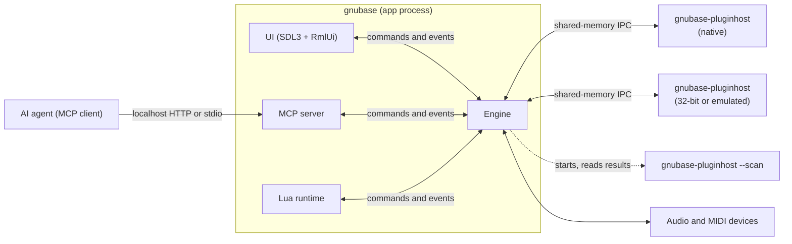
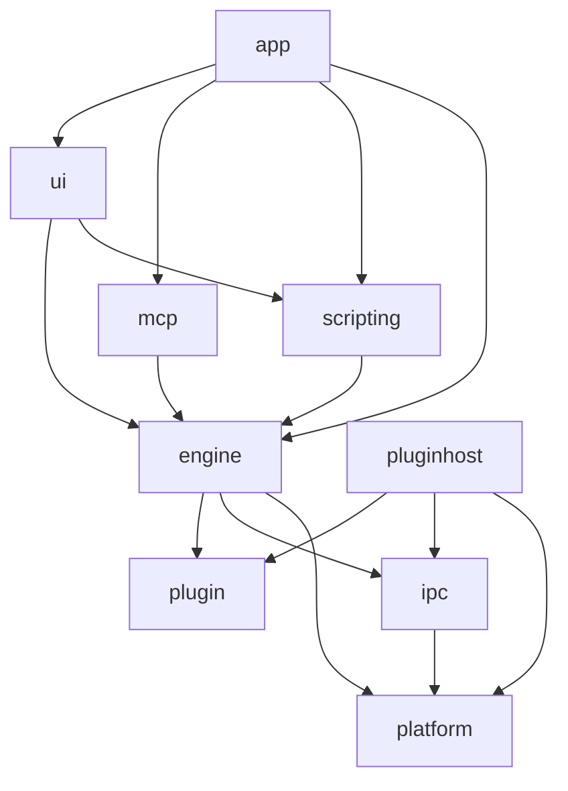
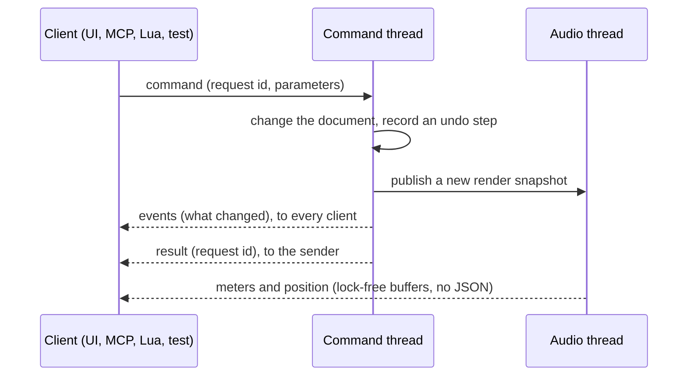
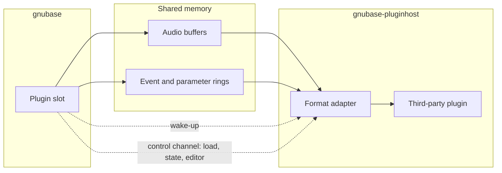

# GNUbase architecture

How GNUbase is put together: processes, modules, threads, the engine API and the rules that keep audio real-time safe. Read this before changing module boundaries, threads or the engine API. [CLAUDE.md](../CLAUDE.md) has the short version of the rules; this document has the details and the reasoning. How single features work, with their commands and how they map onto DAWproject, is in [features/](features/), one file per feature; this document only has what they build on.

Parts marked **decided in #N** are open until that ticket lands; the ticket refines the section.

## Principles

1. The engine is a headless library. The UI, the MCP server, Lua scripts and tests are all clients of the same engine API.
2. Everything a user can do is a command; everything that changes is reported as an event.
3. Third-party plugins never run in the GNUbase process.
4. Audio threads never wait: no allocations, locks, blocking calls or I/O.
5. Output is deterministic: the same project and input give the same samples for any number of threads.
6. Projects are DAWproject files.

## Processes

- **gnubase** is the application: the engine, the UI (left out with `--headless`), the MCP server and the Lua runtime.
- **gnubase-pluginhost** runs third-party plugins. How plugins are grouped into host processes is a user setting: all in one, per vendor (the default until #76 measures), per plugin or per instance, with an override per plugin. There is no in-process mode (#64). Variants for 32-bit plugins (Windows, Linux) and for x86-64 plugins on Apple Silicon (Rosetta) and Windows ARM64 (emulation) speak the same protocol (#151, #152, #153).
- **Plugin scanning** uses the host binary in scan mode: one short-lived process per plugin file, with a timeout. A crash only blocklists that plugin (#66).
- When a host process crashes or misses its deadline, its plugins output silence, the UI is told, and the plugins can be reloaded with their last state (#65). GNUbase keeps running.

## Modules

| Module | Folder | Contents | May depend on |
|---|---|---|---|
| platform | `src/platform` | OS abstractions: audio and MIDI backends, threads and priorities, shared memory, child processes, clocks. Real-time primitives (lock-free queues, RT checker), logging, assertions, crash reports, per-user folders and atomic file writes | OS libraries |
| ipc | `src/ipc` | Shared-memory buffers and rings, wake-up primitives, message protocol | platform |
| plugin | `src/plugin` | The GNUbase plugin API: the plugin wrapper's interface, events and extensions ([plugin-api.md](plugin-api.md)), header-only; the remote plugin proxy and stub, their messages and the engine's connection to a host process in `src/plugin/remote` | nothing; `src/plugin/remote`: ipc, platform |
| engine | `src/engine` | Command registry, document model, undo, time, audio graph, transport, file I/O, plugin slots, user settings | plugin, ipc, platform |
| scripting | `src/scripting` | Lua runtime and the bindings generated from the command registry | engine API |
| mcp | `src/mcp` | MCP protocol and transports, tools generated from the command registry | engine API, UI automation interface |
| ui | `src/ui` | SDL3 windows, RmlUi documents drawn through SDL_GPU ([render-backend.md](render-backend.md)), docking, widgets, UI automation | engine API, scripting, SDL3, RmlUi |
| pluginhost | `src/pluginhost` | Host process, scanner, format adapters (VST3, CLAP, AU, LV2, FST) | plugin, ipc, platform, plugin SDKs |
| app | `src/app` | `main` and the wiring between modules | all of the above |

- The engine never depends on UI code, SDL or RmlUi. CMake checks this when configuring (`gnubase_require_no_ui`).
- The MCP server does not depend on the UI either: it defines a UI automation interface, the UI implements it and the app connects the two. A headless app simply has no UI tools.
- The plugin host does not link the engine; the two only share the IPC protocol.
- Third-party code lives in `ext/`, see [dependencies.md](dependencies.md).

## Threads in the app process

| Thread | Runs | Rules |
|---|---|---|
| UI (main thread) | SDL event loop, RmlUi layout and rendering, Lua UI scripts | Sends commands, renders from events, never blocks on the engine |
| Engine command thread | Every command: document changes, undo, building render snapshots, user settings | The only thread that writes the document and the user settings |
| Audio thread | The device callback, one processing cycle at a time | Real-time rules |
| Audio workers | Track chains in parallel (#212) | Real-time rules, real-time priority |
| Prefetch threads | Nodes without live input, ahead of the device in larger blocks (#23) | Real-time rules, real-time priority below the audio workers |
| Disk threads | Streaming audio files in and recordings out (#17) | Work ahead of the audio thread |
| Plugin control | Reads the replies and notifications of one host process and watches the process; main-thread calls to its plugins (loading, state, presets, editors, [plugin-api.md](plugin-api.md#threading-rules)) wait for their replies with a timeout | One per host process connection |
| Plugin jobs | Everything that waits for a plugin host: starting host processes, creating, activating and moving plugins, states, fetching what plugins' notifications changed (`HostManager::run`) | One, so jobs run in order; host processes are started only here, since on Linux a host ends with the thread that started it |
| Plugin monitor | Notices remote plugins that failed and has the engine report them | Low priority, every 20 ms |
| Background threads | Peak files (the peak cache's worker), analysis, saving projects, plugin scan coordination | Low priority |
| Job threads | Background jobs such as backups, one thread each (`src/engine/jobs`) | Normal priority, never wait for the command thread |
| Log writer | Writes what audio threads logged, every 10 ms (#8) | Low priority |
| MCP I/O thread | The MCP server's HTTP or stdio transport | Only forwards to the command thread |
| Script thread | Lua in headless mode; with a UI, Lua runs on the UI thread | Never an audio thread |

Data moves between threads only through:

- lock-free queues: commands to the engine, events to clients, messages to the audio thread (#14);
- immutable render snapshots, published with an atomic pointer swap; the command thread frees an old snapshot once the audio thread no longer uses it;
- triple buffers for continuous values such as meters and the playback position, read by the UI once per frame;
- sequence locks (`rt::SeqLockPair`) for values that several threads must read together, such as the transport cursor and the locate still waiting for the audio thread, which the command and cue threads read: the writer never waits, a reader retries while a store is under way.

## Logging and crash reports

- Every process (the app, each plugin host) writes its own log file in the per-user log folder, through a `logging::Session` created in `main`. The previous run's file is kept as `<name>.previous.log` (#8).
- Audio threads log without allocating or locking: the message and its strings are copied into a lock-free queue, and the log writer thread writes them. If the queue is full, messages are dropped and the number is logged.
- `GNUBASE_ASSERT` checks in every build: a failure is logged, and debug builds stop there. `GNUBASE_ASSERT_REALTIME` marks code that must run on an audio thread; `rt::assertNotRealtime` marks code that must not.
- A crash adds a backtrace to the log (macOS, Linux) or writes a minidump next to it (Windows).

## Engine API

Every action is a **command** in the command registry, with a name, a version, typed parameters and results (JSON schema), documentation and undo behaviour (#10). The MCP tools (#25) and the Lua bindings (#205) are generated from the registry, and CI fails if a command is missing from either (#31).

- The API is `gnubase::engine::Engine` and `Client` (`src/engine/engine.h`). Commands are asynchronous: `send` returns a request id, then the events and the result arrive in the client's queue; `call` sends and waits for the result.
- Parameters are checked against the command's JSON schema before it runs, and results against theirs; a failure becomes an error result with the reason. A command's events reach every client before its result reaches the sender, and a failed command emits none.
- **Events** name what changed (object ids and properties), so a client updates only what it shows.
- A command can run another command as part of it with `CommandContext::call`: the parameters and result are checked against that command's schemas, its events go out with the outer command's, and its failure fails the outer command. It is for commands outside the document, such as the transport; document commands combine through `history.transaction` instead, so each undo step stays one command or one transaction.
- **Meters and the playback position** are not events and never JSON. The audio thread writes them into lock-free buffers, holding each meter's peak until it is read so none is lost between frames, and the UI reads all of them at once per frame (#111). MCP and Lua get them through a query when they need them.
- **Queries** are read-only commands. They also run on the command thread, so they always see a consistent document.
- **Jobs** are long work that would hold up the command thread, such as `project.backup` and copying media (`Jobs` in `src/engine/jobs/jobs.h`). The command checks its parameters, copies what the job needs (the project as it is then) and starts the job on a thread of its own; it returns the job at once. `job.started` is announced before the thread starts, so it always comes first. The job announces `job.progress` (0 to 1, at most once per percent, and what it is working on) and ends with `job.finished`: done with a result, failed with an error, or cancelled. These events go out through `Engine::broadcast`, so they have no request id. `job.get` and `job.list` report jobs, for MCP clients that poll; `job.cancel` asks one to stop, and the job checks between chunks of work and cleans up what it made.
- Jobs never touch the document. One that changes it runs a command on the command thread and waits for its result (`JobContext::command`, through `Engine::post` with a callback): copies of media are put in place with one `media.relink` in a transaction, a single undo step that skips media changed meanwhile, and a backup is opened with `project.load` only if the project is still at the revision it was backed up from (`project.revision`), so no edit made meanwhile is lost. Their events reach clients before `job.finished`. The engine cancels and waits for running jobs when it shuts down; commands they posted that didn't run fail.
- Jobs that write files create each one exclusively, taking the next free name if one is there, so two jobs never write the same file and a cancelled job only removes its own. A backup claims its folder: another backup into it, or into a folder inside or around it, is refused while the job runs.
- Because commands, results and events are serializable, the same API works in-process (UI, tests), over MCP and from Lua, and could later run across processes.

## Document model and undo

- A project is a tree of objects with stable ids: tracks, channels, busses, parts, events, clips, automation and plugin slots (#11). The document (`src/engine/document`) has busses, tracks in folders, each track's channel, media files, clips, audio events, MIDI parts with notes and controllers, and automation lanes with their points; plugin slots come with their milestone. Ids count up per project, are never reused, and 0 means none.
- Only commands change it; [lua.md](lua.md) and [mcp.md](mcp.md) list them all. `project.get` returns the whole document. Every change emits events such as `track.added`, `channel.changed` or `note.removed`. A command checks everything before it changes anything, so a failed command changes nothing.
- Positions are in their track's time base: ticks when musical, samples when linear. Notes and controllers are in ticks from their part's start; audio event offsets and lengths are in the clip's sample frames. Linear positions keep their time when the sample rate changes.
- Audio events have a volume in dB (-144 to +6) and can be muted. In DAWproject a muted event is a disabled clip; the volume is GNUbase-only data.
- Projects from files are checked: `projectFromJson` refuses automation the commands wouldn't make (a lane on no track or one it doesn't fit, target numbers out of range, a point's position, value or curve not a finite number in its range) and channel volume or pan out of range, and a DAWproject loads from `project.xml` then. `project.xml` points or channel values that aren't finite numbers are left out or replaced by the default.
- Every command that changes the project is one undo step (#12). Undo steps are stored as **differences**: before a command runs, the model copies the project; afterwards it records each object that changed with its state before and after (`src/engine/document/history.h`). Notes and controllers count as objects, so editing one note doesn't store its whole part. Undo and redo put recorded states back instead of computing inverse operations, so they restore the project exactly. The copy also makes every command atomic: if it fails halfway, the project is restored. Copying costs time in proportion to the project's size, like compiling the render snapshot; if that gets slow for large projects, commands can record what they touch instead and keep the same steps.
- `history.transaction` runs several commands as one step, and none of them if one fails. Each step has an action name, a time and the user's details; `history.undo` and `history.redo` move one or more steps, and `history.set` limits their number. Undoing an addition doesn't free its ids, so ids stay unique. Selection and view state are not in the document and so not in undo.
- The audio thread never reads the document. After each change the command thread compiles an immutable **render snapshot** (`RenderSnapshot`): busses, media files, and the channels in track order with their routing as indices, audio events, notes and controllers in the project's samples, sorted by time, and the read-enabled automation lanes with their points in samples (volume as a linear gain). `rt::SnapshotPublisher` hands it to the audio thread. The processing graph is built from it (see "Audio processing").

## Audio processing

One cycle on the audio thread:

1. Read the current render snapshot and the transport state (#16).
2. Schedule MIDI and automation for the cycle, sample-accurately (#19).
3. Run the task graph: track chains in parallel on the workers, each bus once all its inputs are done (#15, #212). A plugin slot hands its block to its host process and waits for the result.
4. Sum busses in a fixed order, apply latency compensation (#71), write the outputs, and feed meters and capture taps.

The **processing graph** (`src/engine/graph`) is what the audio thread runs:

- Its nodes are busses, channels, built-in processors and plugin slots, joined by audio connections and event connections (notes, controllers, parameter changes). `describe` turns a render snapshot into a graph description: a node per bus, then a node per channel, with each channel's input and output routing; MIDI channels send events to their instrument channel instead of audio. `graph.get` returns it.
- The command thread compiles the description into a `CompiledGraph`: it orders the nodes, allocates every audio and event buffer, prepares the processors and computes each node's path latency, the hook for latency compensation (#71). Compiling a new graph never stops the old one; `rt::SnapshotPublisher` swaps it in between two blocks, and the old one is freed on the command thread.
- Processors (`graph::Processor`) belong to the descriptions, not to a compiled graph, so the next graph reuses them with their state and a rebuild causes no glitch. They are prepared again only when the sample rate or the block size changes, which only happens while audio is stopped.
- Processing a block takes the nodes in a fixed order: every node after the nodes it receives from, otherwise by index. A node's input is the sum of its audio inputs in the order of their node indices, so the output is bit-identical for the same input. GCC and Clang build without fused multiply-adds (`-ffp-contract=off`), which round differently, so every platform renders the same samples. Events carry their sample offset within the block, and a node's events arrive sorted by offset.
- **Multi-processing** (#212): the audio thread and a pool of real-time workers (`rt::WorkerPool` in `src/platform/rt`) process the nodes as tasks. Each node counts the nodes it still waits for; the last one to finish puts it on a lock-free ready queue, so a bus starts as soon as all its inputs are done, and nothing allocates, locks or blocks. Of the nodes that are ready at the start of a block, those with the most measured work ahead of them (a moving average of earlier blocks) start first. Because a node sums its inputs in index order once all are done, the output is bit-identical for any number of threads; a random-graph test checks this from 1 to 8 threads, and the TSan job runs it.
- Every thread processes in the same floating-point mode, so a node's output doesn't depend on the thread that ran it: `CompiledGraph::process` flushes subnormal numbers to zero (`rt::ScopedDenormalsDisabled`), on the serial path too, and `WorkerPool::run` hands its caller's mode (MXCSR or FPCR) to every worker on job entry.
- Workers get real-time priority: the "Pro Audio" MMCSS task on Windows, a time-constraint policy on macOS (joining the device's audio workgroup comes with the CoreAudio backend), SCHED_FIFO on Linux where the user may (rtkit follows with the Linux backends), there one priority below the audio thread's once a real-time audio thread runs jobs, so the device's own thread and the IRQ threads above it keep precedence. The pool's constructor waits until every worker has tried, so `realtime()` is reliable. The audio thread waits for nodes that workers hold, and a worker the OS can preempt would make it miss its deadline: only workers with real-time priority help, and without any the audio thread processes alone (`limitedBy: "realtime"` in the `processing` of `audio.get`). If the system refuses to start threads, `audio.setProcessing` fails and keeps the previous settings; opening a device then processes on the audio thread alone (`limitedBy: "system"`).
- CPU use: a block wakes at most as many workers as the graph is wide (the most nodes at one depth) minus one, and a graph of width 1 never touches the pool. A worker that finds no ready node for 50 us leaves the block. After a block, a worker that took part spins for a sixteenth of the period (20 to 200 us), which only catches the next block near full load, then sleeps on a semaphore that the audio thread releases without blocking; a worker the block didn't need sleeps at once. So below about 95 % load workers block in every period and stay clear of Linux's real-time throttling.
- `audio.setProcessing` turns multi-processing on or off and sets the number of threads, the audio thread included. The default is half the hardware threads, at least one: about one per physical core, since the second hardware thread of a core adds little to DSP code, and the disk streamer, the command thread, the UI and the plugin host processes (which do most of a real project's DSP) need cores too. At most one thread per hardware thread processes (`activeThreads`): more would only wait for each other, since a worker that holds a node loses its core to those spinning for the next.
- The **audio engine** (`src/engine/audio`) plays the project through an audio device (`audio::AudioCallback` in `src/platform/audio`). After every command that changes the project it compiles a new graph for the device's sample rate and block size. Once per block it copies the device inputs into the input busses, processes the graph and copies the output busses to the device outputs. Busses take consecutive device channels in bus order until users can pick ports (#43).
- The **dummy device** (`audio::DummyDevice`, backend `dummy`) has no hardware. Its input is silent or a built-in generator, its output and MIDI output are captured into memory allocated up front, and MIDI is injected at frame positions. It runs offline (`audio.render`: blocks on the calling thread as fast as possible) or in simulated real time (`audio.start`, `audio.stop`: its own thread processes one block per block duration). Both modes produce the same samples, because the output depends only on the project, the input and the block size. `audio.capture` reads what it captured.

Time is kept in samples and in musical time (PPQ ticks), with tempo and time signature maps (#13). Tracks that are not monitored live are processed ahead with larger buffers on lower-priority threads; [anticipative-processing.md](anticipative-processing.md) describes how (#23).

## Audio devices

Audio devices are OS abstractions in `src/platform/audio` (`device.h`); the engine only sees the interfaces.

- A **backend** (`audio::Backend`) is a kind of driver: `dummy` everywhere, and per platform ASIO and WASAPI (Windows), CoreAudio (macOS), PipeWire and JACK (Linux) as they land (#34 to #38). `audio::makeBackends()` returns the backends of the build, the preferred one first and the dummy backend last; the `Engine` constructor takes them, so tests can add fake ones. A backend lists its devices (`DeviceInfo`: id, name, channel names, sample rates, block sizes, clock sources, control panel) and opens one (`DeviceConfig`: device, sample rate, block size, clock source; zero or empty leaves the choice to the driver).
- An open **device** (`audio::Device`) reports its format, a complete `DeviceInfo` and its input and output latency in frames, starts and stops, and can open its driver's control panel. While it runs it calls the `AudioCallback` once per block on its audio thread, in the realtime context, with at most `blockSize` frames, silent outputs, positions that count on across restarts, and the block's start on the host clock (`hostTime()` in `src/platform/hosttime.h`, nanoseconds of the monotonic clock), which places MIDI input. Platform code stays thin behind this interface; the engine never sees a driver API.
- A **driver-initiated reset** (settings changed in the driver's control panel, a new buffer size, a lost and regained device) reaches the device's reset handler on a thread other than the audio thread. The audio engine then posts `audio.reset` to the command thread (`Engine::post`: a command without a sender, whose events still reach every client). `audio.reset` opens the device again with the settings it was opened with, compiles the graph for its new format and restarts it if it ran, so GNUbase keeps running; clients see `audio.changed`.
- **WASAPI** (`wasapi.cpp`, Windows) comes as two backends: `wasapi` in shared mode, where Windows mixes GNUbase with other programs and converts sample rates, and `wasapi-exclusive`, where GNUbase has the device to itself at the device's own formats. A device is an output endpoint with an optional input endpoint: `default` (the default output and input, which follows changes of the defaults), an output's endpoint id, or `<output id>|<input id>`. The output's events drive processing under MMCSS ("Pro Audio"); the input follows through an `InputFifo`, which compensates the drift between the two clocks by dropping or repeating single frames. Each output period is processed in blocks of at most the block size, so any block size works; by default a block is a period. A removed endpoint, a changed default or a stream that fails asks for a reset. The control panel is Windows' sound settings.
- **ASIO** (`asiohost.cpp`, Windows, backend `asio`) uses the ASIO SDK's headers (`ext/asio`, under its GPLv3 option). A device is an installed driver (`HKLM\SOFTWARE\ASIO`), its id the driver's name. `audio.devices` lists names only: a driver tells its channels, rates and buffer sizes once loaded, and loading one would close the open one. Only one driver can be open at a time, since ASIO's callbacks carry no context and reach the open device through a global. Every call into the driver runs on a thread of its own, in a COM single-threaded apartment that handles window messages: drivers expect the thread that created them, and some show their control panel there. The buffer switch comes on the driver's own thread. All channels are used; block sizes are those the driver allows, the preferred one by default; `outputReady` is used when the driver has it. Reset, resync and buffer size change requests and sample rate changes ask the engine for a reset. Sample types: 16, 24 and 32-bit integers and 32-bit floats. Tests replace the installed drivers with a fake (`AsioDrivers`). Direct monitoring comes with the monitoring path (#44).
- Backends share `sampleformat.h`, which converts interleaved driver samples (32-bit float, 16, 24 and 32-bit integers) to one float buffer per channel and back.
- One **contract test suite** (`tests/device_tests.cpp`) checks every backend: listing, opening with each listed sample rate, block size and clock source, the callback rules, stop and restart. It runs against the dummy backend in CI and against the hardware backends locally with `gnubase-tests "[hardware]"`.
- Commands: `audio.devices` lists the backends and their devices, `audio.setDevice` opens one (the dummy device by default; another backend's device is closed before the next one opens, since drivers often allow only one), `audio.get` reports the device with its latencies and clock source, `audio.reset` and `audio.controlPanel` do what their names say, and `audio.start` and `audio.stop` run any device. `audio.render` and `audio.capture` are the dummy device's. Headless mode takes the backend with `--audio`.

## MIDI ports

MIDI ports are OS abstractions in `src/platform/midi` (`port.h`), next to the audio devices.

- A **MIDI backend** (`midi::Backend`) lists its ports (`PortInfo`: id, system name, input or output, whether the OS speaks MIDI 2.0 with it) and opens them, and reports when ports appear or disappear. `midi::makeBackends()` returns the build's backends, the dummy backend last; the `Engine` constructor takes them. Windows MIDI, CoreMIDI and ALSA follow (#40 to #42).
- Messages are MIDI 1.0 channel messages (`audio::MidiMessage`), stamped with host time. An open input calls its receiver on a driver thread; an output sends at a host time, or at once if that has passed. Backends that speak MIDI 2.0 translate Universal MIDI Packets; MIDI 2.0 resolution inside the engine comes later.
- The **dummy MIDI backend** (`midi::DummyBackend`) has loopbacks: an output and an input of the same name, where what is sent arrives at once, stamped with the time it was sent at. Adding and removing them simulates plugging devices in and out.
- **Windows MIDI** (`winmm.cpp`, backend `winmm`) uses WinMM. Decision (#40): WinMM works on every Windows 10 and 11, and where Windows MIDI Services is installed, WinMM goes through the new MIDI service, so it also sees the service's loopbacks and MIDI 2.0 devices, as MIDI 1.0 ports. A native Windows MIDI Services backend (Universal MIDI Packets, MIDI 2.0 resolution) needs the service's App SDK on users' machines and in the build; it follows once the engine handles MIDI 2.0. WinMM ids are port names, numbered from the second port of the same name ("USB MIDI #2"), since WinMM's indexes change when devices come and go. Inputs are stamped with the host time they arrive at (WinMM's own timestamps have only milliseconds); outputs send scheduled messages from a thread. Device interface notifications (`CM_Register_Notification`) report ports coming and going.
- **Timestamps to block offsets:** inputs push into a lock-free `midi::InputQueue`; the audio thread takes each block's messages from it. A block that starts at host time T gets the messages that arrived in the block duration before T, at the offsets of their arrival: one block of latency and no jitter. Later messages wait for their block, late ones go to offset 0, and offsets never decrease.
- The engine's `MidiPorts` (`src/engine/audio/midiports.h`) keeps the ports of every backend with their settings (reference manual pp. 29–31): the name a port is shown as, whether it is visible (hidden inputs are closed), and whether an input belongs to "all MIDI inputs". The first `midi.*` command lists the ports and opens the visible inputs, so an engine that never uses MIDI, like most tests, leaves the hardware alone; outputs open once something sends to them. When a backend reports changed ports, it posts `midi.refresh`: new and returning ports open, unplugged ones are listed as not present and keep their settings.
- Commands: `midi.ports`, `midi.setPort`, `midi.refresh`, and `midi.monitor`, which returns the input received since the last call with each message's frame position on the audio device. The audio engine collects the block's messages from all MIDI inputs for MIDI recording (#97).
- Contract tests (`tests/midi_tests.cpp`) run against the dummy backend in CI and against the hardware backends with `gnubase-tests "[hardware]"`; with `GNUBASE_TEST_MIDI_LOOPBACK` set to a loopback port's name, they also send and receive through it.

## Audio files and disk streaming

- `AudioFileReader` and `AudioFileWriter` (`src/engine/audiofile`) read WAV, RF64, Wave64, AIFF, FLAC, Ogg Vorbis and MP3, and write WAV (also BWF and RF64), AIFF and FLAC (#17). Formats are recognized by content; paths are UTF-8 everywhere.
- The audio thread never touches files. A `DiskStream` holds blocks of frames, allocated once, that pass between the disk thread (`DiskStreamer`) and the audio thread through lock-free queues; the disk thread keeps them filled ahead of playback. `read()` never waits: missing frames are silence and count as dropouts, and later frames stay at their time.
- A seek starts a new generation of blocks: the disk thread takes back the older ones and reads from the new position, and the audio thread ignores blocks of older generations. `ready()` says when the buffer is full again, and `full()` when it also holds again every block the audio thread gave back since; offline rendering waits for `full()` before every block.
- Files at another sample rate are converted by the disk thread with r8brain-free-src (`Resampler`). After a seek, reading starts early enough for the filters and on the same frame grid as from the start, so the output is the same as when playing through. `media.convert` writes a converted copy, for importing at the project's sample rate.
- Time-stretching and pitch-shifting use Rubber Band Library behind a thin wrapper (`dsp::TimeStretcher` in `src/engine/dsp/timestretch.h`): offline mode for the best quality, real-time mode with a real-time safe process path and latency reporting, and algorithm presets. `media.stretch` writes a stretched and shifted copy. [time-stretch.md](time-stretch.md) has the evaluation and how audio tracks will warp events (#142).

## Plugin hosting and IPC

- **Audio path:** audio, notes and parameter changes for a block go through shared memory, and a wake-up tells the other side. No allocations or locks on this path (#62).
- **Control path:** loading, state, presets, editor windows and scans use a separate, versioned message channel that is not real-time.
- The binary layout is fixed (no pointers, explicit sizes and alignment), so 32-bit and emulated host processes use the same protocol.

The **IPC transport** (`src/ipc`, #62) is a `Connection` between the engine and a host process: one segment of named shared memory (`platform::SharedMemory`: a file mapping on Windows, `shm_open` elsewhere) that the engine creates under a unique name and passes to the host on its command line. A host process has one control connection and one audio connection per active plugin instance (#64), so parallel audio workers never share a ring.

- **Layout** (`ipc/protocol.h`): a 128-byte `SegmentHeader` (magic, protocol version, configuration, process ids, each side's state), then two audio lanes and two control lanes (engine to host, host to engine), then their data. Each lane has a wake word, and each ring a head and a tail, on cache lines of their own. Both sides compute every offset from the configuration in the header (`layoutFor`), so the memory holds no offsets or pointers. Only fixed-width integers and lock-free 32-bit atomics are in it; static asserts pin every size and offset.
- **Versions:** a host refuses a segment with another major version, an unknown header size, an invalid configuration or the wrong size (`checkSegment`), and a second host. Minor versions only add what older peers can ignore. Every message carries its own type and version, so hosts and engines of different minor versions can skip what they don't know.
- **Rings** (`ipc/rings.h`), all single-producer, single-consumer with free-running 32-bit indices: a `BlockRing` of fixed-size slots per audio lane, each slot a `BlockHeader` (sequence, position, frames, channels, event count) followed by the channels, which both sides read and write in place; and a `MessageRing` of variable-sized messages for events and for control messages, each with an 8-byte header, padded to 8 bytes, wrapping with a padding record. A block's events go into the event ring before the block, and its event count says how many belong to it, so several blocks can be in flight.
- **Nothing from the peer is trusted.** A host runs third-party code that may scribble over the memory, so each side keeps its own indices privately and checks the peer's (a head more than a ring ahead, a misaligned head, impossible sizes or headers). The reader copies messages and block headers out before checking them, so the peer cannot change them afterwards, and never reads outside a ring. A peer that breaks the protocol makes reads return `Corrupt` from then on. Fuzz tests feed random ring contents and headers to the readers.
- **Wake-up** (`ipc::Doorbell`): the sender counts up a 32-bit word in shared memory and wakes the receiver: a shared futex on Linux, the kernel's shared compare-and-wait (`__ulock_wait`/`__ulock_wake`, what the system's own locks use; named semaphores have no timed wait on macOS) on macOS, and a named auto-reset event on Windows, where the word tells a real wake-up from a stale one. Ringing never blocks, so the audio thread rings after committing a block. Joining the device's audio workgroup on macOS is up to the host's audio thread (#64).
- **Deadlines:** `waitForBlock` waits for the answer until a timeout and returns `Ready`, `Timeout` or `PeerClosed`. It is the one wait on the audio path, bounded by the timeout. On Windows a plain timed wait ends at the next tick of the system timer, up to 15.6 ms late, longer than a whole block at small buffer sizes, so the doorbell waits on its event together with a high-resolution waitable timer; a test bounds the overshoot of a 2 ms wait. A peer that closes in an orderly way sets its state to `Closed` and rings, so the wait ends at once. A crashed or hung host just misses the deadline; the watchdog (#65) tells the two apart through the process (`platform::ChildProcess`), which also starts host processes.
- **Late answers:** a host that answers after the deadline leaves that answer in the ring, where the next wait finds it, with an old sequence number. The engine waits with `waitForAnswer(sequence)`, which drops answers to older blocks, with their events, and treats an answer to a block that was never sent as a broken protocol.
- **Memory:** creating a segment reserves its pages (`posix_fallocate` on Linux, where a full `/dev/shm` would otherwise be a SIGBUS on first touch from an audio thread; committed pages on Windows) and both sides map every page up front (`MAP_POPULATE` on Linux, touching each page elsewhere), so audio threads take no page faults on it.
- **Real-time safety:** `beginBlock`, `sendBlock`, `sendEvent`, `receiveBlock`, `releaseBlock`, `receiveEvent`, `waitForBlock` and `waitForAnswer` never allocate, lock or make blocking calls other than that wait; a test runs a round trip under the RT checker. Creating and opening connections and the control path are for other threads.
- **Host processes** (`platform::ChildProcess`) start with standard input and output on the null device (in headless mode stdout carries MCP), standard error in a file or GNUbase's own, and no other inherited handles or file descriptors; on Windows without a console window. `kill()` waits a bounded time and then leaves a stuck process (driver I/O, Linux's D state) to a reaper, so no thread hangs on it.
- **Hosts never outlive the engine.** On Windows every child process is in a job that ends it when GNUbase ends, crashed or not. On Linux a host has the kernel kill it when the engine dies (`PR_SET_PDEATHSIG`, set by `Connection::open`); the kernel goes by the thread that started the host, so hosts are started from a thread that lives as long as they do. Everywhere, a host's waits report `PeerClosed` instead of `Timeout` once the engine's process is gone (`platform::ProcessWatch`), which is how macOS hosts notice. The engine never kills a process by the id the host wrote into the segment: a host claims the segment by swapping in its process id before writing anything else, but only `ChildProcess::id()` decides what to kill.
- A test runs a helper host process (`tests/ipcpeer.cpp`) and checks round trips, the control channel, a killed and a hung host, an orderly close, a host that ends with its engine, and the host process's inherited handles and standard streams. It also measures the round-trip latency: around 10 µs for 128 frames on a desktop PC.

The **plugin host process** (`gnubase-pluginhost`, `src/pluginhost`, #64) runs plugins for the engine, which starts it with the name of a control connection (`--connect`) and its log file (`--log`):

- **Handshake:** opening the connection checks the IPC version (`checkSegment`); then the engine sends `Hello` with the version of the plugin messages (`plugin::remote::g_protocolVersion`) and of the plugin API, and a host with other versions refuses and exits with code 4.
- **Control connection:** one per host process. Every main-thread call to one of its plugins is a request with an id and the instance it is for, answered by a `Reply` (`src/plugin/remote/protocol.h`): create (by plugin id and file), describe, set the process mode, activate, deactivate, destroy, save and load state, parameter texts, flushing parameters. The host's main thread runs the control loop and is the plugins' main thread; plugin editors will add the OS event loop to it (#69).
- **Messages of any size:** `MessageWriter` splits a message larger than a ring message into parts, each starting with a `PartHeader` (a message id counting up, the part's index), and `MessageReader` puts them together. A sender that gives up halfway (the peer doesn't read in time) leaves its first parts behind; the reader drops them when the next message starts, so the stream never gets out of step. Both sides check the size against a limit (`g_maxControlMessage`, 256 MiB) before they send anything: a larger request fails at once, a larger reply becomes an error reply, and a receiver gets only the header of a message over its own limit, so nobody waits for an answer that never comes.
- **Notifications:** what a plugin asks of its host (restart, state changed, rescan parameters, ports or note ports, latency or tail changed) goes to the engine as a `Notify` message from the host's main loop. On the engine's side a restart request goes straight to the engine's `plugin::Host`; the rest marks the proxy, and a job (`RemotePlugin::refresh`) fetches what changed and passes it on to the engine's host extensions.
- **Audio connections:** one per active plugin instance, created by the engine when it activates the plugin and sized for its ports and block size as the plugin reports them right before. A block carries a `ProcessInfo` (steady time, process mode, start, stop, reset and flush flags, the inputs' constant masks), the transport segments, the input events (`plugin::Event` as it is, sysex bytes after their event) and the input ports' channels one after the other; the answer carries a `ProcessResult` (status, the outputs' constant masks, output events that were lost, what the plugin requested), the output events and the output channels. Starting and stopping are blocks without frames of their own, sent when the engine calls `startProcessing` and `stopProcessing`, so a plugin that can't start says so at once; a flush while the plugin processes is such a block too. Each instance's blocks are processed by a thread of its own in the host, at real-time priority (`platform::setRealtimePriority`), so sharing a process doesn't serialize a parallel graph.
- **The host trusts the engine no more than the plugins do:** it refuses an activation with an invalid sample rate or block sizes, or block sizes the audio connection has no room for, and fails blocks with more frames than the plugin was activated with, events outside the block, or transport segments that don't start at frame 0 or don't ascend, without calling the plugin.
- **Format adapters:** the host creates plugins through `pluginhost::Formats`: a `Format` per plugin format loads a plugin file and returns its `plugin::Factory`, and the part of the plugin id before `:` names the format. The shipped host has no formats yet: CLAP (#67) and VST3 (#68) add theirs to `builtinFormats()`. The host's code is a library (`gnubase-pluginhost-core`, `runPluginHost`), so the tests build a host of their own, `gnubase-testpluginhost`, with a `test` format that runs the test plugins (`tests/pluginhost/testformat.h`); the shipped host has no test plugins.
- **Exit:** the host exits when the engine closes the control connection or its process is gone, which its waits report. A plugin may block the host's main thread for good, so a watchdog thread of the host watches the engine's process too (`platform::ProcessWatch`, every 50 ms) and ends the process when the engine is gone: on macOS that is the only way, on Linux and Windows the kernel and the job object do it as well. A plugin that hangs in `process()` can't be stopped; the host then exits without cleaning up.

On the engine's side (`src/plugin/remote`, `src/engine/plugins`):

- **`plugin::remote::RemotePlugin`**, the proxy, implements `plugin::Plugin` with the extensions `AudioPorts`, `Params`, `State`, `Latency` and `Tail` by forwarding to its instance; it caches ports, parameter infos, latency and tail, and mirrors every parameter value from the events it sends and gets back. The other extensions follow with their tickets (#69, #70, #72). `process` is real-time safe: it fills the block, rings the host and waits for the answer until the deadline, in slices of 1 ms, so a host that crashed or was marked hung meanwhile fails the block at once. A request whose reply comes too late may still be carried out: a late create is followed by a destroy, a late activate by a deactivate.
- **`plugin::remote::HostConnection`** starts a host process, shakes hands with it and runs its plugin control thread, which reads replies and notifications and is the only thread that touches the process: `kill()` asks it to end the process, so it never waits for a lock the monitor holds.
- **`engine::plugins::HostManager`** decides which process runs a plugin, by the hosting mode, starts processes and drops the ones without plugins. Everything that waits for a host runs on its job thread, so the command thread never does: `load` creates a plugin, `run` runs a caller's slow plugin calls, and `setMode` moves plugins and reports when they moved. A host's standard error goes to `gnubase-pluginhost-<n>-stderr.log` next to its log. Its monitor thread watches the remote plugins, and the engine reports failures as `plugin.failed` events.
- **`engine::plugins::PluginSlot`** is the `graph::Processor` of a plugin slot node: it hosts any `plugin::Plugin`, built in or remote, activates it when the graph is compiled, converts the node's audio, events and transport, and outputs silence for blocks the plugin fails. Plugin slots in the document come with the insert and instrument slots.
- **Late blocks:** a block that misses its deadline is silence for that plugin and that block only. The deadline is two block periods in real time and prefetch, at least 2 ms and at most 100 ms, and 10 s per offline block (`plugin::remote::Deadlines`), until #65 and #76 tune them. The late answer is dropped before the next block goes out (`waitForAnswer`), so it never mixes into a later block and the host always has room to answer; the output events it carries are lost. A block the host can't take yet, because it still has the two before, isn't sent: its parameter changes go with the next block, which also resets the plugin, so no note hangs. The other plugins of the host process don't notice, since each has its own audio connection and host thread.
- **Failures:** a plugin that answers no block in time for 250 ms (`Deadlines::hang`, counted from the first late block's sending, and again after a pause in processing that long; an offline block that misses its deadline already exceeds it), a host process that exits, or one that breaks the protocol makes the remote plugin fail: from then on it is bypassed, outputs silence and doesn't wait for its host. A plugin that hangs marks its host hung: no new plugins go there, and the host's other plugins fail at their next block instead of waiting for a deadline each. The monitor tells crashed hosts (the process is gone) from hung ones (it runs), and the engine emits `plugin.failed` with the instance, plugin, process and reason. GNUbase keeps running; reloading the plugin with its last state is #65.
- **Hosting modes:** `shared`, `perVendor`, `perPlugin` or `perInstance`, plus overrides per plugin id (`pluginhost.get`, `pluginhost.setMode`, `pluginhost.setOverride`). The default is per vendor: a crash takes down one vendor's plugins, and the number of processes stays small; #76 decides by benchmark. When the mode changes, every plugin whose group changes moves, on the job thread: the proxy saves its state, creates the plugin in the new process, loads the state, activates it with a new audio connection and takes it over between two blocks, so it keeps sounding while the old instance goes. Parameter changes that reach the old instance after its state was saved go to the new one with its first block. Audio history doesn't move: delay lines and reverb tails start again from silence. `pluginhost.setMode` returns at once, and `pluginhost.changed` follows when the plugins moved. The mode lives in the engine until GNUbase has user preferences to store it in.
- Tests (`tests/pluginhost_tests.cpp`) compare a test plugin processed through the host process with the same plugin in the engine, bit for bit, switch the hosting mode while plugins process and change parameters, move a 4 MiB state, pass notifications on, send the host invalid blocks, kill a host in the middle of rendering, let one hang, kill an engine whose host's main thread hangs, and send control messages in parts, halfway and over the limit; a test in `rtcheck_tests.cpp` runs the proxy under the RT checker.
- A watchdog gives every host process a deadline per cycle (#65).
- Plugin editors are windows of the host process, kept in front of and positioned relative to GNUbase's windows (#69).
- Inside the host, every format is adapted to the **GNUbase plugin API**, modeled on CLAP: a core interface (`plugin::Plugin`, `plugin::Host`) plus extensions looked up by id, in `src/plugin`. [plugin-api.md](plugin-api.md) describes it, how each format maps onto it, and how it is split between the processes. GNUbase's own built-in plugins implement the same API but run inside the engine (#114).
- **The VST3 adapter** (`src/pluginhost/vst3`, #68) is the only code that talks to VST3. It loads a module with the SDK's module loader, lists its audio classes and creates a `plugin::Plugin` per instance that drives the component and its edit controller, connected through messages. It maps buses to ports, normalized parameters with their units to parameter infos, notes, expressions, MIDI 1.0, MIDI 2.0 and system exclusive messages to VST3 events (MIDI controllers through the plugin's MIDI mapping, program changes through its program change parameter), output parameters and events back, transport segments to sub-blocks, both states to a `.vstpreset`, program lists to presets and note names, and latency and tail. Edits in the controller become gestures and values for the host and parameter changes for the processor. Editors follow with #69.
- In the engine, a plugin slot is a `graph::Processor` that hosts a `plugin::Plugin`: a built-in plugin, or a proxy that forwards to an adapter in a host process. Events (`plugin::Event`) and the transport are fixed-layout records, so the IPC copies them as they are. The engine mirrors every parameter value, so reading one never waits for a host process.
- **Test plugins** (`tests/plugins`, #63) are GNUbase's own minimal plugins for hosting tests: gain, a synth, a latency reporter, a parameter stress plugin, crash and hang on demand, and a state blob round trip. They are built as CLAP and VST3 plugins with each platform's file layout (CMake option `GNUBASE_TEST_PLUGINS`, on by default), and loader smoke tests load them through the format's own entry points; the tests' plugin host runs them through its `test` format. Crash and hang are only ever triggered in a plugin host process. [tests/plugins/README.md](../tests/plugins/README.md) describes each plugin and how tests use them.

## Scripting, MCP and tests

- **Lua** runs on the UI thread, or on the script thread when headless, with bindings generated from the command registry. RmlUi's Lua plugin shares the same runtime (#205, #208). Scripts that come with a project never run without the user's consent.
  - `scripting::Runtime` (`src/scripting/runtime.h`) is a Lua 5.4 state with the global table `gnubase`: one function per command (`gnubase.track.add{type = "audio"}` for `track.add`), returning the result as a table or raising an error with the reason; `gnubase.on(name, handler)` for events, `gnubase.waitFor(name, seconds)` and `gnubase.events()`. Commands run synchronously on the script's thread, so coroutines can call them too.
  - Trusted scripts (`gnubase --headless --script file.lua`) get every standard library except `os.exit`, which would skip the engine's shutdown. Untrusted ones, such as scripts in projects, get no `io`, `os`, `debug`, `package`, `require`, `dofile` or `loadfile`, and `load` only accepts source code.
  - MCP clients run untrusted scripts with the tool `script_run`, at most 60 seconds of Lua code each (a count hook stops longer ones). The app adds it through `mcp::Server::addTool`, which also takes the UI tools later; the MCP module itself doesn't depend on scripting.
  - [lua.md](lua.md) is the API reference, generated from the command registry. A test fails when it's out of date (`GNUBASE_UPDATE_DOCS=1` rewrites it), and another fails when a command lacks its MCP tool, its Lua function, a parameter schema or a description (#31).
- **MCP:** streamable HTTP on localhost with an access token, or stdio in headless mode (#25, #26). Its tools come from the command registry plus the UI automation interface: DOM tree, screenshots, input injection (#58). [mcp.md](mcp.md) is the guide for agents and their users, with a tool catalogue that `mcp::catalogue` generates from the server's `tools/list`; a test fails when it is out of date (`GNUBASE_UPDATE_DOCS=1` rewrites it).
  - `gnubase --headless` (`src/app/headless.h`) sets up the audio device and loads `--project`, then serves MCP on stdio until stdin ends, or on HTTP (`--mcp-http`) until Ctrl+C or SIGTERM. Stdout belongs to MCP; messages go to stderr and the log file `gnubase-headless.log`. Exit codes are 0 done, 1 unexpected error, 2 invalid command line, 3 audio device or project not set up. Everything except `main` is in the `gnubase-app` library, which has no UI dependency, so tests run it in-process as well as through the real executable.
  - `mcp::Server` (`src/mcp/server.h`) speaks MCP revision 2025-06-18 over JSON-RPC. Every command is a tool named with `_` instead of `.` (MCP clients accept only letters, digits, `_` and `-`), with the command's parameter schema as input schema, its result schema as output schema, and queries marked read-only. Queries without required parameters are also resources, `gnubase://<command>`. A failing command is a tool result with `isError`, so the agent sees why; protocol mistakes are JSON-RPC errors.
  - Each request uses its own engine client, so concurrent requests are safe and no events pile up between requests.
  - Events reach MCP clients through sessions (`src/mcp/sessions.h`, #273). One `engine::Listener` hands every event to the queue of every session on the command thread, before the command's result, so a client sees a command's events as soon as its result and no engine queue grows while nobody asks. Each queue keeps the newest 1000 events and counts the ones it drops; the tool `events_take` takes them. Pushing events to clients (notifications, the HTTP stream) comes later.
  - `mcp::HttpServer` listens on 127.0.0.1 only. It refuses requests from other addresses, from web pages of other origins (DNS rebinding), and without `Authorization: Bearer <token>` (`mcp::makeToken`). POST /mcp answers with JSON, or 202 for notifications. `initialize` starts a session and returns its id in `Mcp-Session-Id`; DELETE /mcp ends it, and so do 30 minutes without requests, after which its requests get 404. A stream for server-initiated messages (GET) comes later. `mcp::serveStdio` reads one message per line and writes one response per line; its input is one session.
  - `tests/mcptools_tests.cpp` uses every tool for projects, tracks, parts, events, the transport and undo the way an MCP client does, with JSON-RPC requests as text (#27).
- **Tests** take the same paths: the dummy device and offline rendering (#21), golden files, and the UI automation API from C++ (#59) or Lua (#206, #208).
  - `gnubase.test` is the Lua test framework (`src/scripting/testing.lua`, compiled in as bytes by CMake): test cases, assertions, fixtures and golden files ([lua.md](lua.md#tests)). The runtime loads it into every Lua state, trusted or not, and runs the test cases a script registered when it ends; the report is printed in TAP format, and a failure fails the script. So `script_run` runs test cases as well, and no command area may be called `test`.
  - Every `tests/lua/*.lua` is a ctest test (labels `integration` and `lua`) that runs `gnubase --headless --script` in the source folder, so failures name `tests/lua/<file>.lua` and the line. Sanitizer builds run them too, with the app built under the same sanitizers.

## Project format

- Projects are `.dawproject` files: a zip container with XML and media (#22). `project.save` and `project.load` write and read them (`src/engine/dawproject`), with miniz for the container and pugixml for the XML.
- `project.xml` gets everything DAWproject can describe: tracks with their folders, channels with their routing (groups as `submix`, output busses as `master` channels), audio events and MIDI parts as clips, notes, MIDI controllers as `Points`, channel volume and pan, automation, markers, and tempo and time signature with their changes. Media files are embedded under `audio/` or referenced: relative to the project file if they are in its folder, so the folder can move, otherwise by their absolute path. GNUbase's output validates against the format's `Project.xsd`. How a feature maps onto DAWproject is in its notes in [features/](features/).
- GNUbase data that DAWproject cannot express goes into an extra entry in the same container, so other applications can still open the file. The entry is **`gnubase.json`**: the whole document as `project.get` returns it, the id counter, the media paths, and a checksum of `project.xml`. If the checksum matches, loading restores the project exactly (ids, input busses, time bases, MIDI tracks, exact sample positions, marker tracks with cycle markers and marker numbers); if another application changed `project.xml`, the entry is ignored and the project is built from `project.xml`, so stale GNUbase data never overrides someone else's edits.
- Plugin states are stored as DAWproject specifies (#72).

## UI shell

The UI runs on the main thread (#48, `src/ui/shell.h`).

- **Windows.** GNUbase's windows are separate top-level windows (CLAUDE.md, rule 10), each with its own RmlUi context. The first window opened is the main window: closing it, or a quit request (Cmd+Q, SIGTERM), closes every window and ends the app. Other windows only close.
- **Scale.** RmlUi lays out in dp. A window's dp ratio is its monitor's scale as SDL reports it for the window (`SDL_GetWindowDisplayScale`: 2 on a Retina display, whether the OS counts the window's size in points or pixels), times the user's UI scale (the user setting `ui.scale`, read when the app starts; following its changes comes with the UI-engine binding, #50). When a window moves to a monitor with another scale, or its monitor changes its scale, the shell gives the window's context the new ratio and pixel size, and RmlUi lays it out again.
- **Monitors.** A window stays where it is as long as the user can reach it: a strip of its top edge, where the title bar is, at least 64 by 24 units, lies in a monitor's usable area (the monitor without task bars, docks and menu bars). Otherwise it goes to the middle of the primary monitor, shrunk to fit. That happens to windows on a monitor that is disconnected, and to windows that open where a monitor used to be, such as windows restored from a workspace (#163). A window opened without a size takes 80 % of the primary monitor.
- **Drawing on demand.** The event loop sleeps until something happens, and draws a window only when it needs it: after input, a change of its size or scale, when the OS asks (it was exposed or shown), when code asks (`Window::requestRender`, or through RmlUi with `Rml::Context::RequestNextUpdate`, as elements and data models do when they change), or when RmlUi asks for an update for an animation or transition (`Rml::Context::GetNextUpdateDelay`); the loop then wakes in time for it. Drawing waits for vsync. The loop also runs periodic tasks (`Shell::every`), such as live reload's check for changed files.
- **Drawing.** `GpuRenderer` draws through SDL_GPU ([render-backend.md](render-backend.md)): one device, a swapchain per window, and RmlUi's SDL_GPU renderer as the one render interface that every window's context shares, so textures and geometry are made once for all windows. A screenshot draws a window's context into an offscreen texture at the window's pixel size and reads it back, whether the window is visible or not (for #58 and #59). Where SDL_GPU finds no Metal, Direct3D 12 or Vulkan device, `gnubase` can't show its UI: it says so and exits with code 3.
- **Text input.** Each window's context gets a text input handler from the window system: while one of the window's text fields has the focus, the OS's text input is on for that window, with the input method editor (IME) for languages such as Japanese placed at the field, and the IME's compositions go into the field through RmlUi's SDL IME code. Text fields copy to and paste from the system clipboard.
- **Dropping files.** Files dragged from elsewhere and dropped on a window reach the element under the mouse as the RmlUi event `filedrop` (`ui::g_fileDropEvent`), which bubbles up; its parameters are `files` (UTF-8 paths, separated by newlines), `count`, and `mouse_x` and `mouse_y` in the window's pixels. Documents and their scripts handle it like any other event, for example to import audio files where they were dropped (#92).
- **File dialogs.** `Shell::showFileDialog` shows the OS's dialog for opening files, saving a file or choosing a folder, with filters, a starting location and a parent window, and returns at once. The OS may answer on another thread; the answer comes back through the event loop, so the caller's function runs on the UI thread in a later step, with the files chosen, none if the user cancelled, or why the dialog failed.
- **Lifetimes.** SDL's video comes first, then the renderer, RmlUi and the shell; they are destroyed the other way round, since RmlUi releases its resources through the renderer when it shuts down. Data models must go before RmlUi; they may outlive their window.
- **Tests.** The shell reaches the OS only through two interfaces, `WindowSystem` (monitors, windows and their events, text input, the clipboard and file dialogs) and `Renderer`. Unit tests use a fake window system with whatever monitors they need and a renderer that draws nothing (`tests/testutils/fakeui.h`). `[ui]` tests open real, hidden windows through SDL and SDL_GPU, check their screenshots pixel by pixel and send them SDL's own events for input, drops and IME compositions (`tests/window_tests.cpp`); their file dialog test sets SDL's dialog driver to one that doesn't exist, so SDL answers at once with an error and no dialog opens; on Linux they use SDL's offscreen video driver and need no display, only a Vulkan driver, which CI gets from Mesa's software rasterizer. CI runs them on Linux and Windows; its macOS job runs on an Intel runner, whose virtual GPU SDL_GPU can't use, so on macOS they run on Apple Silicon in a workflow of their own (`.github/workflows/ui-macos.yml`), which a missing runner can't make block a merge.

## RmlUi

How GNUbase sets RmlUi up for its documents (#49, `src/ui/rmlui.h`).

- **Fonts.** RmlUi's FreeType font engine draws text, with FreeType built from its submodule (`ext/freetype`) without any system library, so glyphs come out the same on every platform. `RmlUi::loadFont` loads a TrueType or OpenType font; documents pick fonts by family, weight and style, and fallback fonts supply the characters a font lacks. GNUbase's own fonts come with #207; until then the tests use Lato from RmlUi's samples.
- **Files.** RmlUi reads documents, style sheets, templates, fonts and images through `ui::FileInterface`, which reads each file whole through `std::filesystem`. RmlUi names files in UTF-8, so paths with any characters work, on Windows too. A link in a document (a style sheet, an image, a template) is relative to the document, or an absolute path.
- **Custom elements.** `RmlUi::registerElement<T>(tag)` makes documents create the element class `T` for a tag, for GNUbase's own elements such as faders, meters and waveforms. An element that changes outside RmlUi's update, for example on an engine event, asks for its window to be drawn with `Rml::Context::RequestNextUpdate(0)`.
- **Data models.** Documents get their data through data binding (`data-model`, `{{...}}`, `data-value`, `data-event-click`). `ui::DataModel` is a data model in a window's context: code binds variables and events through `constructor()` before loading the documents that use the model, and calls `changed()` when a variable changes, which updates its views and draws the window. The model is removed with the object.
- **Live reload.** Debug builds of the app (`GNUBASE_LIVE_RELOAD`) check four times a second whether a file that RmlUi read has changed (`ui::reloadChangedDocuments`). If one has, they empty RmlUi's style sheet and template caches and load every window's documents again from their files, showing the ones that were shown. Data models live in the context, so the new documents are bound to the same data; elements that code added to a document are lost with it, which is one more reason to give documents their data through data models. Release builds don't watch files.
- **The same look everywhere.** A `[ui]` test draws a sample document (`tests/data/ui/sample.rml`: text at several sizes and weights, borders, rounded corners, a transform and clipping) through SDL_GPU at dp ratios 1 and 2 and compares it with `tests/golden/ui/sample-1x.png` and `sample-2x.png`. Each channel of a pixel may differ by 8 of 255, and one pixel in 500 by more, for GPUs that round an edge or a blend differently. `GNUBASE_UPDATE_GOLDEN=1` accepts a new look; when a test fails, CI keeps the actual image and one marking the differences as the job's `test-output` artifact. CI's ThreadSanitizer job ignores races inside Mesa's Vulkan driver (`tools/tsan-suppressions.txt`): TSan can't see the locking of code that wasn't compiled with it.

## Open decisions

| Topic | Ticket |
|---|---|
| Plugin editor windows and their header | #69 |
| Remaining plugin API questions ([plugin-api.md](plugin-api.md#open-questions)) | #70, #72, #76 |
| Default hosting mode | #76 |
