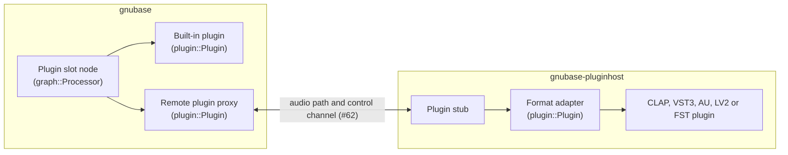
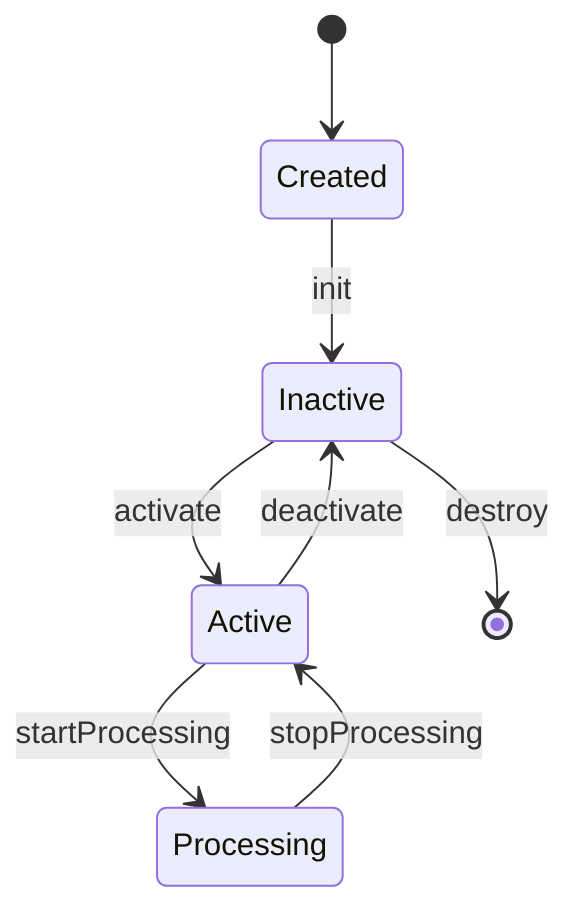

# GNUbase plugin API

Design note for #61. Status: proposed; the header draft is in `src/plugin/` and a test adapts a built-in processor through it (`tests/plugin_api_tests.cpp`). It covers what the reference manual expects from plugins: insert and instrument slots (pp. 542–546, 981–997), the editor and its header (pp. 563–566), presets (pp. 567–571, 989–990), delay compensation (pp. 543, 994), side-chains (pp. 558–561, 996–997), remote controls (p. 1089), modulators (pp. 1049–1077) and per-note expressions (pp. 1293–1300).

## Goal

GNUbase hosts CLAP, VST3, AU, LV2 and FST plugins, and its own built-in plugins. Rule 4 of [CLAUDE.md](../CLAUDE.md) says every format is adapted to one internal API, so the engine has one code path for all of them, and features that no single format has can be added once. This note defines that API, the **plugin wrapper**:

- a small core interface: create, activate, process, look up extensions;
- extensions for everything else: ports, parameters, state, latency, tail, editors, presets, menus, and GNUbase's own;
- how each format maps onto it, and how it is split between the engine and the plugin host process (rule 3), so the IPC of #62 carries it.

## Where the API sits

- A **format adapter** in the host process implements `plugin::Plugin` on top of one format. It is the only code that talks to a format.
- The **stub** in the host process drives an adapter from IPC messages, and the **proxy** in the engine implements `plugin::Plugin` by sending them. Proxy and stub are generic: they know the API, not the formats.
- **Built-in plugins** (#114) implement `plugin::Plugin` directly and run in the engine.
- The engine's **plugin slot node** is a `graph::Processor` that hosts any `plugin::Plugin`, local or remote. The graph doesn't know the difference.

`graph::Processor` stays the interface of the graph's own nodes (busses, channels, the channel strip). `plugin::Plugin` is for what sits in a plugin slot: insert effects, instruments and MIDI effects, built-in or third-party.

The API is the header-only module `src/plugin` (CMake target `gnubase-plugin`), without dependencies, so the engine, the host process and the adapters all include it. The proxy and stub go into `src/plugin/remote`, which adds the dependency on `ipc`.

## Core interface

`src/plugin/plugin.h`, modeled on CLAP's `clap_plugin` and `clap_host`:

| Type | Role |
|---|---|
| `Descriptor` | id (`<format>:<format id>`), format, the format's own id, name, vendor, version, CLAP's feature names (`instrument`, `audio-effect`, `note-effect`, `analyzer`, ...). DAWproject's plugin elements need the format and its id separately. |
| `Factory` | lists the descriptors of one plugin file (or of the built-ins) and creates instances. The scanner (#66) uses it. |
| `Plugin` | an instance: `init`, `activate(sampleRate, minFrames, maxFrames)`, `deactivate`, `startProcessing`, `stopProcessing`, `reset`, `process`, `extension(id)`, `onMainThread`. |
| `Host` | what the plugin may ask: `requestRestart`, `requestProcess`, `requestCallback`, `extension(id)`. |
| `Process` | one block: frames, steady time, process mode, audio buffers per port, input and output events, transport segments. |

The lifecycle is CLAP's, with the same states for every format:

- `activate` allocates; the block size is between `minFrames` and `maxFrames`. A slot is activated with the larger of the device block size and the prefetch block size, so moving between the live and the prefetch path never reactivates it ([anticipative-processing.md](anticipative-processing.md)).
- `process` returns a status, as in CLAP: `Error` (the host outputs silence and reports the plugin), `Continue`, `ContinueIfNotQuiet`, `Tail` or `Sleep`. With the constant masks on the audio buffers, this is how GNUbase stops processing plugins on silent passages (reference manual p. 543) for every format, not only those that support it themselves: a sleeping plugin is skipped until it gets events or input that is not silent.
- `reset` forgets the past (delay lines, voices) without reallocating; the transport uses it on locate.
- Methods report failure by their result. An exception that escapes a plugin is caught by the stub, and the plugin is reported as failed (#65).

### Process

- **Audio:** one `AudioBuffer` per port, 32-bit float, with a `constantMask` per channel (silence and other constant signals) in both directions. Inputs and outputs never share memory: the IPC path has separate buffers anyway, and several formats don't allow processing in place.
- **Steady time:** the stream frame of the block's first frame, which counts on while the device runs. Prefetch blocks lie on a fixed grid of stream frames, so a plugin can tell where it is even when blocks are larger than the device's.
- **Process mode:** `Realtime`, `Prefetch` or `Offline`, per block.
- **Transport:** `TransportSegment`s, the first one at offset 0. A new segment starts where cycle playback jumps or the tempo changes, so cycle jumps are sample-accurate for plugins as they are for the engine (#16). `Transport` is a fixed 64-byte record: flags (playing, recording, cycle, tempo and musical positions valid), position in samples and quarter notes, tempo, bar start, bar number, time signature, cycle start and end.
- **Events:** `EventList`s in and out, see below.

## Extension mechanism

Everything beyond the core is an **extension**, as in CLAP:

- An extension is a C++ interface with a static `extensionId()`: `"gnubase.params"`, `"gnubase.gui"`. The id names one version of the extension; an incompatible change gets a new id (`"gnubase.params.2"`), and a plugin can offer both while hosts move over.
- `Plugin::extension(id)` and `Host::extension(id)` return a pointer or `nullptr`. `extension<Params>(plugin)` is the typed lookup; `provide<Params, State, ...>(this, id)` answers lookups in an implementation and casts to the right base class first, so multiple inheritance can't return a wrong address.
- Hosts look extensions up once, on the main thread after `init`, and keep the pointers for the instance's lifetime. Nothing is looked up while processing.
- One class usually implements several extensions, so every method name is unique across all extensions (`audioPortCount`, `paramCount`, `saveState`, `guiShow`). Two extensions can never force one implementation on each other.
- Extensions are C++ interfaces, not a C ABI. Adapters, built-ins and the engine are all GNUbase code built with one compiler; the stable boundary to the outside world is each plugin format, and across processes it is the IPC protocol, not the C++ layout.
- Every extension the API defines also needs its proxy and stub. A test checks that the proxy implements every extension id listed in the API, like the check that every command has its MCP tool and Lua function (#31). The proxy only answers `extension(id)` for the ids the remote adapter reported when it was initialized.

The extensions of the draft (`src/plugin/extensions.h`):

| Extension | Side | What |
|---|---|---|
| `AudioPorts` | plugin | audio input and output ports: id, name, channels, layout (mono, stereo, surround with a speaker mask, ambisonic), main or side-chain, optional |
| `ConfigurableAudioPorts` | plugin | the host asks for layouts, e.g. a surround bus |
| `AudioPortsActivation` | plugin | turns ports on and off: side-chain inputs and the outputs of multi-output instruments (pp. 564, 987) |
| `HostAudioPorts` | host | the ports changed |
| `NotePorts` | plugin | note input and output ports and the dialects they take: notes, MIDI 1.0, MPE, MIDI 2.0 |
| `Params`, `HostParams` | both | parameters, see below |
| `State`, `HostState` | both | saving and loading; the host learns about changes parameters don't show |
| `Presets` | plugin | the plugin's programs and preset files, and loading one |
| `Latency`, `HostLatency` | both | the plugin's latency and its changes |
| `Tail` | plugin | how long the plugin sounds after its input went quiet |
| `Render` | plugin | the plugin depends on real time, so offline and prefetch blocks must come in real time |
| `NoteNames` | plugin | names of keys, e.g. a drum kit |
| `Gui`, `HostGui` | both | the editor, see below |
| `RemoteControls` | plugin | pages of eight parameters for hardware controllers and the editor's remote controls (p. 1089) |
| `ContextMenu` | plugin | the plugin's own entries for GNUbase's menus |
| `ThreadCheck` | host | which thread the plugin is on |
| `HostTrackInfo` | host | the channel's name, color and channel count |
| `LowLatency` | plugin | GNUbase extension, see "GNUbase extensions" |

## Threading rules

Every method in the headers is tagged with the thread it may be called on:

- **[main]**: the instance's main thread. In the host process it is the thread that runs the OS event loop, which is what CLAP's main thread, the VST3 UI thread, AU's main thread and LV2's UI thread all expect. For a built-in plugin it is the engine's command thread. For a remote plugin, the engine side's main thread is the **plugin control thread** of its host process connection (below).
- **[audio]**: the thread that processes the instance: the audio thread, a worker (#212) or a prefetch thread (#23). It can change from block to block, but only one thread processes an instance at a time, as for every `graph::Processor`. Real-time rules apply (rule 5).
- **[any]**: any thread, real-time safe.

Further rules:

- `Params::flushParams` is called on the audio thread while the plugin processes and on the main thread while it doesn't, never both at once (CLAP's rule).
- A plugin's own threads are its business, but everything it calls on its host follows the tags. The adapters check this with `ThreadCheck` in debug builds.
- In the host process, the stub serializes main-thread calls on the main thread and runs `process` on a real-time thread that waits for IPC requests (#64). Timers, file descriptor watches (CLAP, VST3's run loop on Linux), LV2's worker and FST's editor idle calls are served by the host process itself and never cross to the engine.
- On the engine side, the command thread never waits for a host process for long. Main-thread calls to remote plugins go through one **plugin control thread** per host process connection. Quick queries (value texts, port and parameter info) have a short timeout; slow operations (creating an instance, loading state or a preset, opening an editor) run as jobs whose completion the engine reports as an event. A host process that doesn't answer in time is treated as hung (#65).

## Audio ports and side-chains

- Every format's buses become ports. The **main** input and output carry the channel's signal; other inputs are **side-chain** inputs (pp. 558–561, 996), other outputs auxiliary outputs, e.g. of multi-output instruments.
- A port has an id, a name, a channel count and a layout. Surround layouts use the WAVE_FORMAT_EXTENSIBLE speaker mask; ambisonic ports use ACN order and SN3D normalization. Adapters convert from VST3 speaker arrangements, AU channel layouts and LV2 port groups.
- `ConfigurableAudioPorts` lets the engine ask for the layout of the channel a plugin is inserted in. A plugin that can't take it is inserted with its own layout, and the engine maps channels.
- `AudioPortsActivation` implements the reference's "activate outputs" and side-chain switches. Inactive ports get a buffer without channels, which saves IPC bandwidth too.

## Events and notes

`src/plugin/events.h`. An `Event` is a fixed 48-byte record without pointers (`static_assert`ed), with the frame offset in its block and a type:

- **Notes:** `NoteOn`, `NoteOff`, `NoteChoke`, and `NoteEnd` as an output (a voice ended, so the host can free its per-voice modulation). Notes are matched by note id, port, channel and key, with -1 as a wildcard, as in CLAP. Velocities are 0 to 1.
- **Per-note expressions:** `NoteExpression` with one of volume, pan, tuning, vibrato, expression, brightness and pressure: the set that CLAP, VST3 and MPE have in common (#176).
- **Parameters:** `ParamValue`, `ParamMod`, and as outputs `ParamGestureBegin` and `ParamGestureEnd`.
- **MIDI:** `Midi` (MIDI 1.0 bytes), `Midi2` (one universal MIDI packet) and `Sysex` (the bytes are in the list's byte arena, the event holds offset and size).

An `EventList` is allocated once with a capacity for events and sysex bytes, and only accepts events in order of their offsets. The proxy copies lists into the IPC rings as they are, and the stub copies them out again into lists of the same capacity, so the same records work in the engine, in shared memory and in the host process, between 32- and 64-bit processes (#62).

Dialects: the engine always produces notes and expressions; it never builds MIDI for a plugin. A note port says which dialects it takes, and the adapters convert where a plugin wants MIDI 1.0, MPE or MIDI 2.0, with one shared helper (allocating MPE channels per voice, mapping expressions to pitch bend, channel pressure and CC 74). MIDI that comes from a device and is meant for the plugin as MIDI (a MIDI-thru to a plugin that reads program changes, say) passes as `Midi` events.

Formats without sample-accurate input for some events (LV2 control ports, FST parameters, mid-block transport changes in VST3, AU and FST) are processed by the adapter in sub-blocks split at those events, with a shared helper that also adjusts the transport and steady time of each sub-block. Plugins that demand fixed block sizes (LV2's `bufsz:fixedBlockLength`, FST plugins that misbehave) are never split; their changes apply at the start of the block.

## Parameters and automation

`Params` (plugin) and `HostParams` (host):

- A parameter has a **stable 32-bit id**, flags, a name, a module path for grouping (`"Oscillators/Osc 1"`), a range and a default. Flags: stepped, periodic, hidden, read only (meters such as gain reduction), bypass, automatable (also per note), modulatable (also per note), enum, requires process.
- **Values are plain values** in the parameter's range, as in CLAP and in GNUbase's built-in processors (dB, Hz). Formats with normalized values (VST3, FST) declare the range 0 to 1, or 0 to the step count for stepped parameters, so the adapter never needs a non-real-time conversion while processing. `paramValueToText` and `paramTextToValue` give the plugin's own texts on the main thread; for VST3 they call the edit controller.
- **Changes from the host** are `ParamValue` events at their offset: automation (#120), the generic editor, MCP and Lua (#75). While the plugin isn't processing, the engine sends them with `flushParams`.
- **Changes from the plugin** come back as output events from `process` or `flushParams`: `ParamValue` for the value, `ParamGestureBegin` and `ParamGestureEnd` around a drag in the editor. Formats that report edits on the main thread (VST3's `beginEdit`, `performEdit`, `endEdit`, AU's parameter listeners, LV2 UIs' port writes) are turned into output events by the adapter, which calls `HostParams::requestParamFlush` when the plugin isn't processing. For VST3 the adapter also passes the editor's changes on to the processor component, which a VST3 host has to do.
- **Gestures** drive touch automation: between begin and end the automation of that parameter records instead of playing (#70, #120). Output events carry the stream frame of their block, so recorded automation lands at the frame the plugin processed when the change arrived.
- **Modulation** (the reference's modulators, pp. 1049–1077) uses `ParamMod` for parameters marked modulatable: an offset that doesn't change the value or the automation. For other parameters the engine sends `ParamValue` events computed from the automated value plus the modulation, and keeps the automated value as the base, so stopping modulation restores it.
- **Per-note values** (CLAP's polyphonic parameters) are `ParamValue` and `ParamMod` events with a note match.
- **Automation curves** are sampled by the engine at their breakpoints and in between at a fixed resolution. Events are steps; VST3 interprets the points of its parameter queues as linear segments, which the adapter keeps, so curves sound the same in both.
- **The engine keeps a mirror** of every parameter value of a slot, updated from what it sends and from the plugin's output events. The UI, MCP and Lua read values from the mirror without a round trip to the host process. Texts are fetched for the parameters that are shown and cached per value.
- `HostParams::rescanParams` tells the engine what changed: values (after a preset), texts, infos, or everything (only while inactive, e.g. a plugin that changes its parameter set with its configuration).
- **Bypass:** a plugin's own bypass parameter (VST3 `kIsBypass`, AU's bypass property, LV2's `lv2:enabled`, CLAP's bypass flag) is used for the slot's bypass switch, so the plugin fades and keeps its latency. Otherwise the engine bypasses the plugin itself, with a short crossfade to the input delayed by the plugin's latency, so bypassing never shifts timing.
- DAWproject automation refers to parameters by id and stores values in the parameter's own range, so automation written for a VST3 plugin is stored normalized, as DAWproject expects (#72).

## State and presets

- `State::saveState` and `loadState` exchange the plugin's whole state as bytes, with a context: project, preset (no project-specific data such as sample paths) or duplicate (copying the plugin to another slot).
- **The state is the format's own preset file:** a `.vstpreset` for VST3 (it holds both the component and the controller state), an `.aupreset` property list for AU, the plugin's state stream for CLAP, the Turtle of LV2's state interface, and an `.fxp` for FST (the chunk, or the parameter values). DAWproject stores plugin states in the format's preset file, so `project.save` writes the bytes as they are, and a GNUbase user preset of a plugin is the same file (#72).
- `HostState::markStateDirty` reports changes that parameters don't show, such as a sample loaded in the editor.
- Host features built on state, without a plugin extension: A/B settings and copying between them, copy and paste of settings between instances of a plugin, the default preset of a plugin (pp. 564–570), and reloading a crashed plugin with its last state (#65). The engine keeps the last saved state of every remote plugin for that.
- `Presets` lists a plugin's factory programs and the preset files in its format's folders, and loads one; next and previous preset (p. 563) step through the list. GNUbase's preset browser adds its own preset files and those of other formats' folders (#72). Insert chain presets are lists of plugins with their states, handled by the engine.

## Latency and tail

- `Latency::latency()` is read on the main thread while the plugin is active; delay compensation (#71) uses it. A plugin that changes its latency calls `HostLatency::latencyChanged`, and `Host::requestRestart` if it is active. The engine then deactivates and activates it again at a block boundary, outputs its input delayed by the old latency meanwhile (or silence for an instrument), and compiles a graph with the new latency. Formats: CLAP latency changes need a restart; VST3 reports `kLatencyChanged`; AU a property change; LV2 a latency output port; FST `audioMasterIOChanged`.
- The IPC round trip adds no latency: a slot's block is processed by its host process within the same cycle (#62, #76). If #76 adds an asynchronous mode that hands blocks over one cycle late, that cycle is added to the slot's reported latency, so delay compensation covers it.
- `LowLatency`, a GNUbase extension, lets a plugin drop look-ahead for live playing; see below.
- `Tail::tail()` says how long a plugin sounds after its input went quiet (`g_infiniteTail` for reverbs with infinite hold, `0` when it doesn't), and is used for sleeping, for export tails, and for the reverb tails on stop (anticipative processing). LV2 has no tail; its adapter reports infinite, so silence detection on the outputs decides.

## Editors across processes

Plugin editors are windows of the host process (#69); GNUbase never embeds a plugin window in one of its own windows across processes. On Windows a cross-process parent window attaches the two processes' input queues, so a hanging plugin editor could freeze GNUbase's UI, which rule 3 forbids.

- `Gui` is CLAP's editor interface: supported window APIs (Win32, Cocoa, X11, Wayland), embedded or floating, create and destroy, scale, size and resizing, parent, transient owner, show and hide. VST3, AU, LV2 and FST editors are embedded views; CLAP editors can be either.
- The host process creates a top-level **frame window** per editor and embeds the plugin's view in it, so parent and child are in the same process. GNUbase passes the handle of the window the editor belongs to (64 bits in every process), and the host process keeps the frame in front of it with each OS's mechanism: owned windows on Windows, window levels on macOS, transient-for on X11, xdg-foreign on Wayland (#69).
- **The editor header** (activate, bypass, read and write automation, A/B, side-chain, preset browser, functions menu: pp. 563–565) belongs to GNUbase's UI. Two options for #69: GNUbase draws it in a slim window of its own glued to the frame, which the host process reports moves and resizes for; or the host process draws it into its frame from a description the engine sends. The first keeps all UI code in GNUbase and is the proposal.
- **Scaling:** GNUbase tells the host process the scale of the monitor the editor is on and when it changes (rule 10); the adapter passes it on (`guiSetScale`, VST3's content scale, LV2's scale option). For plugins that ignore it, the per-plugin "allow window to be resized" setting (p. 564) makes the host process run that editor without per-monitor DPI awareness, so the OS scales it.
- **Resizing** goes through `guiCanResize`, `guiAdjustSize` and `HostGui::guiRequestResize`; the host process resizes its frame and reports the new size to GNUbase.
- **Testing and remote control:** the host process captures its frame windows as images and injects input into them on request, so MCP's UI tools reach plugin editors too (#58, #69, #75). Every plugin also has GNUbase's **generic editor**, drawn from the parameter infos, which tests and agents can drive without pixels.
- Linux: X11 editors work under Wayland through XWayland, as floating frame windows.

## Split across the engine and the host process

What the proxy does with each call, and what crosses the process boundary:

| Call | Path | Notes |
|---|---|---|
| `process`, `flushParams` while processing, `startProcessing`, `stopProcessing`, `reset` | audio path (shared memory) | per block, real-time, under the watchdog (#65) |
| `requestProcess` | audio path | a flag in the block's reply |
| `init`, `activate`, `deactivate` | control channel | `init` returns the supported extension ids and the descriptor; `activate` returns ports, parameter infos, latency, tail and the note ports, which the proxy caches |
| `paramValue` | none | from the engine's mirror |
| `paramValueToText`, `paramTextToValue`, infos after a rescan | control channel | cached by the proxy |
| `saveState`, `loadState`, presets, context menus | control channel | jobs on the plugin control thread |
| `gui*` | control channel | the windows live in the host process |
| `requestRestart`, `rescan*`, `latencyChanged`, `markStateDirty`, `guiRequestResize`, `guiClosed` | control channel, host process to engine | |
| `requestCallback`, timers, file descriptors, LV2 workers | none | served in the host process |
| output events (values, gestures, MIDI, note ends) | audio path | with the block's stream frame |

The audio path of #62 carries per block: the `Process` header (frames, steady time, mode, the constant masks), the transport segments, the input events and their sysex bytes, and the audio of each active input port; the reply carries the status, the output events and the audio of each active output port. Audio buffers have fixed places in the shared memory, assigned at activation; event and sysex capacities are agreed at activation too. `Event` and `Transport` are fixed-layout records that #62 copies as they are; `Process` and `AudioBuffer` hold pointers and are rebuilt on each side from the shared memory.

Several instances can share one host process (rule 3's hosting modes, #64). Each has an instance id in the protocol, and the host process processes the instances it gets requests for on as many real-time threads as the engine processes slots in parallel, so sharing a process doesn't serialize a parallel graph.

## Format mapping

The tables name each format's own functions and flags. Where a format has no equivalent, the adapter does what the last column of the row says, or the engine does it for every plugin.

### Lifecycle and processing

| API | CLAP | VST3 | AU (v2 / v3) | LV2 | FST |
|---|---|---|---|---|---|
| `Factory` | `clap_plugin_factory` | `IPluginFactory` (2, 3) | `AudioComponentFindNext` | lilv's world and plugin list | `VSTPluginMain`; shell plugins via `effShellGetNextPlugin` |
| `init` | `init` | `IComponent::initialize`, controller created and connected (`IConnectionPoint`) | `AudioComponentInstanceNew` / `instantiate` | `instantiate` (needs the sample rate: done at the first `activate`) | `effOpen` |
| `activate` | `activate` | `setupProcessing` (`kSample32`, max block, process mode), `setBusArrangements`, `activateBus`, `setActive(true)` | stream formats, `MaximumFramesPerSlice`, `AudioUnitInitialize` / `allocateRenderResources` | `options` (block lengths), `connect_port`, `activate`; a new sample rate instantiates again | `effSetSampleRate`, `effSetBlockSize`, `effMainsChanged(1)` |
| `startProcessing` / `stopProcessing` | same | `setProcessing(true/false)` | none | none | `effStartProcess` / `effStopProcess` |
| `reset` | `reset` | `setProcessing(false)` then `true` | `AudioUnitReset` / `reset` | none: `deactivate` and `activate` on the main thread instead | none: `effMainsChanged(0)` and `(1)` on the main thread instead |
| `process` | `process` | `process` with `ProcessData` | `AudioUnitRender` with a render callback for the inputs / `internalRenderBlock` | `run` (in sub-blocks, see "Events and notes") | `processReplacing` |
| constant masks | `constant_mask` | `silenceFlags` | none: computed by the adapter | none | none |
| status | `clap_process_status` | always continue | always continue | always continue | `effFlagsNoSoundInStop` hint |
| process mode | `render` extension: prefetch maps to realtime | `processMode`: `kRealtime`, `kPrefetch`, `kOffline` (applied at activation) | `OfflineRender` / `isRenderingOffline` | `lv2:freeWheeling` port | `audioMasterGetCurrentProcessLevel` |
| transport | `clap_event_transport` per segment | `ProcessContext` per sub-block | host callbacks / `musicalContextBlock`, `transportStateBlock` | `time:Position` atom | `audioMasterGetTime` (`VstTimeInfo`) |
| steady time | `steady_time` | `continousTimeSamples` | the render timestamp's sample time | none | none |
| `requestRestart` | `request_restart` | `restartComponent` (`kReloadComponent`, `kIoChanged`, `kLatencyChanged`) | property listeners | none | `audioMasterIOChanged` |
| `requestCallback` | `request_callback` | none (adapter-internal) | none | none | none |

### Ports and events

| API | CLAP | VST3 | AU | LV2 | FST |
|---|---|---|---|---|---|
| `AudioPorts` | `audio-ports` | audio buses, `kMain` / `kAux`, speaker arrangements | elements, channel layouts, supported channel counts | `lv2:AudioPort`s and port groups | `numInputs`, `numOutputs`, `effGetInputProperties` |
| `ConfigurableAudioPorts` | `configurable-audio-ports` | `setBusArrangements` | `SupportedNumChannels`, `AudioChannelLayout` | none | `effSetSpeakerArrangement` |
| `AudioPortsActivation` | `audio-ports-activation` | `activateBus` | enabling elements | `connectionOptional` ports | none: the adapter passes silence |
| `NotePorts` | `note-ports` with dialects | event buses | `MusicDevice` / MIDI input; MIDI 2.0 event lists (v3) | `atom:AtomPort` with `midi:MidiEvent` | `effCanDo("receiveVstEvents")` |
| notes | `CLAP_EVENT_NOTE_*` | `kNoteOnEvent`, `kNoteOffEvent` with note ids | `MusicDeviceMIDIEvent` / MIDI event blocks | MIDI in an atom sequence | `VstMidiEvent` via `effProcessEvents` |
| expressions | `CLAP_EVENT_NOTE_EXPRESSION` | `kNoteExpressionValueEvent`, `INoteExpressionController` | MPE / MIDI 2.0 | MPE | MPE |
| MIDI CC, pitch bend, pressure | `CLAP_EVENT_MIDI` | `IMidiMapping` to parameters, `kPolyPressureEvent`, legacy CC output | MIDI | MIDI | MIDI |
| sysex | `CLAP_EVENT_MIDI_SYSEX` | `kDataEvent` | `MusicDeviceSysEx` | MIDI in an atom sequence | `VstMidiSysexEvent` |
| MIDI output | output events | output event bus | MIDI output callback / block | output atom port | `audioMasterProcessEvents` |
| `NoteNames` | `note-name` | `IUnitInfo` program pitch names | none | midnam extension | none |

### Parameters

| API | CLAP | VST3 | AU | LV2 | FST |
|---|---|---|---|---|---|
| id | `clap_id` | `ParamID` | `AudioUnitParameterID` / 64-bit `AUParameterAddress` (open question) | control port index; `patch:` parameters by a stable hash of their URI | index |
| range | plain `min`, `max` | normalized: 0 to 1, or 0 to `stepCount` | plain `minValue`, `maxValue` | plain `lv2:minimum`, `lv2:maximum` | normalized 0 to 1 |
| module | `module` | unit path (`IUnitInfo`) | clumps / parameter groups | port groups | none |
| flags | `CLAP_PARAM_*` | `kCanAutomate`, `kIsReadOnly`, `kIsWrapAround`, `kIsList`, `kIsHidden`, `kIsBypass` | `kAudioUnitParameterFlag_*` | `lv2:integer`, `lv2:enumeration`, `lv2:toggled`, `pprops:notAutomatic`, output ports read only | `effCanBeAutomated` |
| value text | `value_to_text`, `text_to_value` | `getParamStringByValue`, `getParamValueByString` | `ParameterStringFromValue`, value strings | scale points, otherwise number and unit | `effGetParamDisplay` (current value only: cached) |
| host changes | `CLAP_EVENT_PARAM_VALUE` | `IParameterChanges` queues | `AudioUnitScheduleParameters` / schedule parameter block | control ports (split at changes), `patch:Set` | `setParameter` (split at changes) |
| modulation | `CLAP_EVENT_PARAM_MOD` | none: values | none: values | none: values | none: values |
| plugin changes, gestures | output events, `CLAP_EVENT_PARAM_GESTURE_*` | `IComponentHandler` `beginEdit`, `performEdit`, `endEdit` | parameter listener with begin and end gesture events / parameter observers | UI port writes, `ui:touch` | `audioMasterBeginEdit`, `audioMasterAutomate`, `audioMasterEndEdit` |
| `rescanParams` | `params.rescan` | `restartComponent(kParamValuesChanged, kParamTitlesChanged)` | parameter list property change | none | `audioMasterUpdateDisplay` |
| `RemoteControls` | `remote-controls` | `IXmlRepresentationController` where offered | none | none | none: GNUbase pages the first automatable parameters |

### State, presets, latency, tail

| API | CLAP | VST3 | AU | LV2 | FST |
|---|---|---|---|---|---|
| `State` | `state`, `state-context` | component and controller state as a `.vstpreset` | `ClassInfo` / `fullState` as an `.aupreset` | state interface, as Turtle | `effGetChunk`, `effSetChunk` or parameter values, as an `.fxp` |
| `markStateDirty` | `state.mark_dirty` | `IComponentHandler2::setDirty` | none | none | none |
| `Presets` | preset discovery factory, `preset-load` | program lists, `.vstpreset` files | factory presets, `.aupreset` files, user presets (v3) | `pset:Preset`s | programs (`effSetProgram`, `effGetProgramNameIndexed`) |
| `Latency` | `latency` | `getLatencySamples` | `Latency` (seconds) | latency output port | `initialDelay` |
| `Tail` | `tail` | `getTailSamples` | `TailTime` (seconds) | none: infinite | `effGetTailSize` |
| `Render` | `render.has_hard_realtime_requirement` | none | none | `lv2:hardRTCapable` (inverted) | none |
| `HostTrackInfo` | `track-info` | `IInfoListener` channel context | `ContextName` | none | none |
| `ContextMenu` | `context-menu` | none; `IComponentHandler3` is the other way round: the editor asks GNUbase for its parameter menu | none | none | none |
| `ThreadCheck` | `thread-check` | adapter-internal | adapter-internal | adapter-internal | adapter-internal |

### Editors

| API | CLAP | VST3 | AU | LV2 | FST |
|---|---|---|---|---|---|
| create | `gui.create` (embedded or floating) | `createView("editor")`, `attached` | Cocoa view factory / `requestViewController` | a UI of the platform's type (`ui:X11UI`, `ui:CocoaUI`, `ui:WindowsUI`), through the host's own UI loader | `effEditOpen` |
| size, resize | `get_size`, `can_resize`, `adjust_size`, `set_size`, `request_resize` | `getSize`, `canResize`, `checkSizeConstraint`, `onSize`, `IPlugFrame::resizeView` | the view's frame | `ui:resize` | `effEditGetRect`, `audioMasterSizeWindow` |
| scale | `set_scale` | `IPlugViewContentScaleSupport` | the OS | `ui:scaleFactor` option | none: OS scaling |
| idle and timers | `timer-support`, `posix-fd-support` | `IRunLoop` (Linux) | the main run loop | `ui:idleInterface` | `effEditIdle` |

## GNUbase extensions

Features beyond any single format go into extensions under the same mechanism. Built-in plugins implement them; third-party plugins opt in through their format, for example a CLAP extension or a VST3 interface defined by GNUbase, which the adapter offers as the wrapper extension (#154 decides how). Proposed, with the first in the draft:

- **`gnubase.low-latency`** (`LowLatency`): a mode for playing live without look-ahead, so the plugin's latency drops. While latency is constrained for live playing (p. 994), the engine turns it on for plugins on live paths and reads their latency again; plugins without it are bypassed on those paths, as in the reference. Effects on send channels are left alone.
- **Articulations** (#154, #175): the articulations or key switches an instrument offers, so articulation maps can be built from the plugin (VST3's `IKeyswitchController` maps to it).
- **Inline display** (#154): a small display that the mixer draws in the plugin's slot, such as a compressor's curve (the LV2 inline-display extension maps to it).
- **Controller hints** (#154): which parameters a plugin suggests for hardware controllers and the remote controls, beyond pages of eight.
- **Deterministic rendering**: a seed for a plugin's random generators, set by the engine for offline rendering, so renders and tests with that plugin are bit-identical (rule 6). Built-in plugins never use unseeded randomness anyway.

Features that need no extension, because the engine builds them on the core for every plugin: suspending processing on silence, bypass with latency-compensated crossfades, activating and deactivating a plugin, A/B settings, copy and paste of settings, default presets, insert chain presets, the generic editor, side-chain switches and output activation.

## Open questions

1. **64-bit samples.** The API is float only, like the engine. CLAP and VST3 offer double precision; it can be added as a port flag later without changing anything else.
2. **VST3 process mode changes** need `setupProcessing`, so a reactivation. A VST3 plugin that moves from the prefetch path to the live path keeps its mode until the next stop, when it is reactivated. Is that acceptable for disk-streaming samplers, or should the move wait for the stop as well?
3. **AUv3 parameter addresses** are 64-bit. Use them directly when they fit in 32 bits, otherwise a table built from a stable hash and saved with the state?
4. **DAWproject parameter ids** are signed 32-bit integers, VST3's are unsigned. Store them as their two's complement, as other hosts do? To check with #72.
5. **Sub-block splitting** for formats without sample-accurate parameters: split at every change, or at a minimum sub-block size such as 32 frames, which bounds the overhead of automation that changes every frame?
6. **Automation interpolation**: is the engine's sampled automation close enough to VST3's linear segments for null tests between formats, or does the engine send VST3 adapters its breakpoints instead?
7. **The plugin control thread**: one per host process connection, or one for all? Owned by #64.
8. **The editor header**: a glued GNUbase window, or drawn by the host process (#69)?
9. **CLAP's thread pool** extension: the host process serves it with its own workers within the block's deadline. How many, per host process or per instance (#64, #76)?
10. **MIDI 2.0**: should notes and expressions be replaced by MIDI 2.0 packets as the engine's internal note format, or stay CLAP-like with MIDI 2.0 as a dialect?
11. **Note expression ranges**: VST3 expressions are normalized and plugins can define their own; the adapter maps the common seven, and custom ones need an extension (#176).
12. **ARA** (#185) and LV2 UIs that need direct access to the plugin instance: both work inside the host process, but ARA's document controller also needs the engine's audio sources across the IPC, which ARA's own IPC support may cover.

## Implementation steps

Each step comes with its tests first.

1. **This spike (#61):** the note and the header draft in `src/plugin`, with a test that adapts a built-in processor through the API.
2. **IPC transport (#62):** the audio path and control channel carry `Event`, `Transport` and the block header as fixed-layout records; the round-trip benchmark uses a plugin-shaped block.
3. **New: remote plugin proxy and stub** (or part of #64): `src/plugin/remote`, a proxy and a stub per extension, the caches and the parameter mirror, the coverage test for extension ids. Tests run a built-in plugin through proxy and stub in one process and compare its output with the direct path, bit for bit.
4. **New: plugin slots in the document and graph:** insert, instrument and MIDI effect slots in the document model and DAWproject, the plugin slot node (`graph::Processor` hosting a `plugin::Plugin`), sleeping on silence, bypass with crossfade, activation. Tested with built-in plugins.
5. **Built-in plugins (#114):** the existing built-in processors behind the API (`processors::BuiltinFactory`), then the mixing set. Still open: `LowLatency` for the limiter's look-ahead.
6. **Plugin host process (#64)** with the stub, hosting modes and the plugin control thread; **test plugins (#63)**.
7. **CLAP adapter (#67)**, then **VST3 adapter (#68)**, each with the format mapping above. **New: shared adapter helpers**: notes to MIDI 1.0, MPE and MIDI 2.0, splitting blocks at events, transport conversion, used by every adapter.
8. **Parameters and automation (#70)**, **delay compensation (#71)**, **state and presets (#72)**, **instruments (#73)**, **side-chains (#74)**, **editors (#69)**, **MCP tools (#75)**, **crash recovery (#65)**, **IPC budget (#76)**.
9. **More formats (#148 AU, #149 LV2, #150 FST)** and bridges (#151–#153).
10. **GNUbase extensions (#154)**, per-note expressions (#176), articulations (#175), ARA (#185).

## Alternatives considered

- **CLAP itself as the internal API.** Its C structs, extension mechanism and threading rules are what this API copies, and the CLAP adapter is almost a pass-through. But a C ABI costs C++ code a lot of boilerplate (function pointer tables, `void*` contexts, manual lifetimes) for a boundary that doesn't exist: every implementation is GNUbase code built together. GNUbase also needs things CLAP lacks (prefetch mode, fixed-layout events for the IPC, its own extensions), and adding them to an external C ABI would mean extending someone else's standard. The C++ API keeps CLAP's design and its semantics, so the mapping stays simple.
- **VST3 as the internal API.** Its split into component and controller fits a process boundary, but normalized values, COM-style interfaces and the missing extension mechanism make every other format harder to map.
- **Dynamic cast instead of extension ids.** `dynamic_cast` finds interfaces without ids, but ids are needed anyway: the proxy has to know which extensions the remote adapter supports before anyone asks, and ids version an extension without breaking older adapters.
- **Embedding plugin editors in GNUbase windows.** Simple for users and common in hosts that run plugins in their own process, but a cross-process parent window couples the two processes' UIs; separate top-level windows keep a hanging editor from freezing GNUbase.
- **Converting notes to MIDI in the engine.** One conversion for every format, but the engine would need to know each plugin's dialect and MPE zone setup. In the adapters, the conversion happens where the format is known, with one shared helper.
