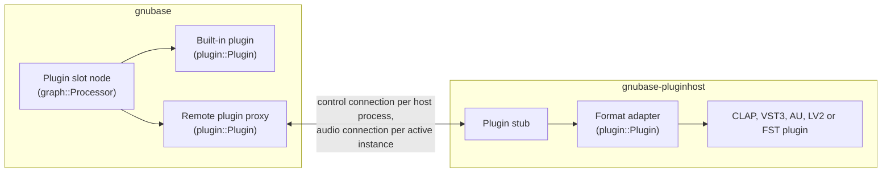
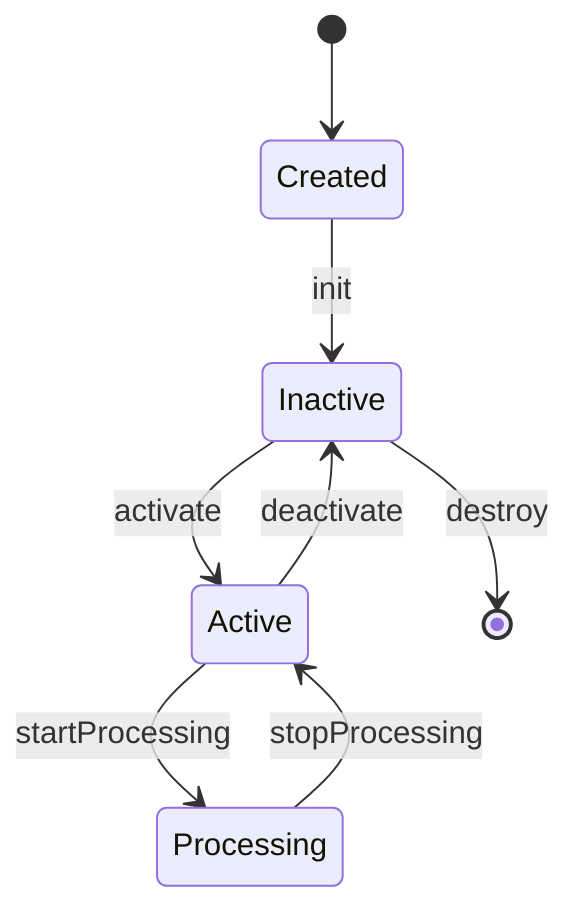

# GNUbase plugin API

Design note for #61. Status: proposed; the header draft is in `src/plugin/` and a test adapts a built-in processor through it (`tests/plugin_api_tests.cpp`). It covers what the reference manual expects from plugins: insert and instrument slots (pp. 542–546, 981–997), the editor and its header (pp. 563–566), presets (pp. 567–571, 989–990), delay compensation (pp. 543, 994), side-chains (pp. 558–561, 996–997), remote controls (p. 1089), modulators (pp. 1049–1077) and per-note expressions (pp. 1293–1300).

## Goal

GNUbase hosts CLAP, VST3, AU, LV2 and FST plugins, and its own built-in plugins. Rule 4 of [CLAUDE.md](../CLAUDE.md) says every format is adapted to one internal API, so the engine has one code path for all of them, and features that no single format has can be added once. This note defines that API, the **plugin wrapper**:

- a small core interface: create, activate, process, look up extensions;
- extensions for everything else: ports, parameters, state, latency, tail, editors, presets, menus, and GNUbase's own;
- how each format maps onto it, and how it is split between the engine and the plugin host process (rule 3), so the IPC of #62 and the host process of #64 carry it.

## Where the API sits

- A **format adapter** in the host process implements `plugin::Plugin` on top of one format. It is the only code that talks to a format.
- The **stub** in the host process drives an adapter from IPC messages, and the **proxy** in the engine implements `plugin::Plugin` by sending them. Proxy and stub are generic: they know the API, not the formats.
- **Built-in plugins** (#114) implement `plugin::Plugin` directly and run in the engine.
- The engine's **plugin slot node** is a `graph::Processor` that hosts any `plugin::Plugin`, local or remote. The graph doesn't know the difference.

`graph::Processor` stays the interface of the graph's own nodes (busses, channels, the channel strip). `plugin::Plugin` is for what sits in a plugin slot: insert effects, instruments and MIDI effects, built-in or third-party.

The API is the header-only module `src/plugin` (CMake target `gnubase-plugin`), without dependencies, so the engine, the host process and the adapters all include it. The proxy and stub go into `src/plugin/remote`, which adds the dependency on `ipc`.

## Core interface

`src/plugin/plugin.h`, modeled on CLAP's `clap_plugin` and `clap_host`:

| Type | Role |
|---|---|
| `Descriptor` | id (`<format>:<format id>`), format, the format's own id, name, vendor, version, CLAP's feature names (`instrument`, `audio-effect`, `note-effect`, `analyzer`, ...). DAWproject's plugin elements need the format and its id separately. |
| `Factory` | lists the descriptors of one plugin file (or of the built-ins) and creates instances. The scanner (#66) uses it. |
| `Plugin` | an instance: `init`, `setProcessMode`, `activate(sampleRate, minFrames, maxFrames)`, `deactivate`, `startProcessing`, `stopProcessing`, `reset`, `process`, `extension(id)`, `onMainThread`. |
| `Host` | what the plugin may ask: `requestRestart`, `requestProcess`, `requestCallback`, `extension(id)`. |
| `Process` | one block: frames, steady time, process mode (for information), audio buffers per port, input and output events, transport segments. |
| `CheckedPlugin` | a `Plugin` that checks every call against the thread tags and the lifecycle, for debug builds (`src/plugin/checkedplugin.h`, see "Threading rules"). |

The lifecycle is CLAP's, with the same states for every format:

- After `init` the plugin's audio ports, note ports and parameters are known, so an inactive plugin already has its automation lanes and generic editor, and configurable ports are set up before the first activation. They change only when the plugin asks for a rescan (`HostAudioPorts`, `HostNotePorts`, `HostParams`).
- `setProcessMode` is called while the plugin is inactive, and the mode holds until the next call; see "Process" below.
- `activate` allocates; the block size is between `minFrames` and `maxFrames`. A slot is activated with the larger of the device block size and the prefetch block size, so moving between the live and the prefetch path never reactivates it ([anticipative-processing.md](anticipative-processing.md)).
- `process` returns a status, as in CLAP: `Error` (the host outputs silence and reports the plugin), `Continue`, `ContinueIfNotQuiet`, `Tail` or `Sleep`. With the constant masks on the audio buffers, this is how GNUbase stops processing plugins on silent passages (reference manual p. 543) for every format, not only those that support it themselves: a sleeping plugin is skipped until it gets events or input that is not silent.
- `reset` forgets the past (delay lines, voices) without reallocating; the transport uses it on locate.
- Methods report failure by their result. An exception that escapes a plugin is caught by the stub, and the plugin is reported as failed (#65).

### Process

- **Audio:** one `AudioBuffer` per port, 32-bit float, with a `constantMask` per channel (silence and other constant signals) in both directions. Inputs and outputs never share memory: the IPC path has separate buffers anyway, and several formats don't allow processing in place.
- **Steady time:** the stream frame of the block's first frame, which counts on while the device runs. Prefetch blocks lie on a fixed grid of stream frames, so a plugin can tell where it is even when blocks are larger than the device's.
- **Process mode:** `Realtime`, `Prefetch` or `Offline`. Every format sets it outside processing: CLAP's render mode on the main thread, VST3 in `setupProcessing`, AU with its offline render property while uninitialized. So the mode is a main-thread call, `setProcessMode`, while the plugin is inactive, and changing it on an active plugin is a restart: the engine deactivates the plugin, sets the mode and activates it again at a block boundary, as for a latency change. `Process::mode` tells each block what it is, for information only.
  - An export or `audio.render` sets `Offline` before it starts and restores the mode afterwards; the watchdog (#65) gives offline blocks a relaxed deadline (seconds instead of a fraction of the device block), since a plugin may render slower than real time.
  - A slot that moves from the prefetch to the live path during playback ([anticipative-processing.md](anticipative-processing.md#moving-a-node-between-the-paths)) gets `Realtime` blocks at once, but keeps its `Prefetch` mode until the next stop, when the engine restarts it with the new mode. Moving never waits for a restart.
- **Transport:** `TransportSegment`s, the first one at offset 0. A new segment starts where cycle playback jumps or the tempo changes, so cycle jumps are sample-accurate for plugins as they are for the engine (#16). `Transport` is a fixed 64-byte record: flags (playing, recording, cycle, tempo and musical positions valid), position in samples and quarter notes, tempo, bar start, bar number, time signature, cycle start and end.
- **Events:** `EventList`s in and out, see below.

## Extension mechanism

Everything beyond the core is an **extension**, as in CLAP:

- An extension is a C++ interface with a static `extensionId()`: `"gnubase.params"`, `"gnubase.gui"`. The id names one version of the extension; an incompatible change gets a new id (`"gnubase.params.2"`), and a plugin can offer both while hosts move over.
- `Plugin::extension(id)` and `Host::extension(id)` return a pointer or `nullptr`. `extension<Params>(plugin)` is the typed lookup; `provide<Params, State, ...>(this, id)` answers lookups in an implementation and casts to the right base class first, so multiple inheritance can't return a wrong address.
- Hosts look extensions up once, on the main thread after `init`, and keep the pointers for the instance's lifetime. Nothing is looked up while processing.
- One class usually implements several extensions, so every method name is unique across all extensions (`audioPortCount`, `paramCount`, `saveState`, `guiShow`). Two extensions can never force one implementation on each other.
- Extensions are C++ interfaces, not a C ABI. Adapters, built-ins and the engine are all GNUbase code built with one compiler; the stable boundary to the outside world is each plugin format, and across processes it is the IPC protocol, not the C++ layout.
- Every extension the API defines also needs its proxy and stub. A test checks that the proxy implements every extension id listed in the API, like the check that every command has its MCP tool and Lua function (#31). The proxy only answers `extension(id)` for the ids the remote adapter reported when it was initialized.

The extensions of the draft (`src/plugin/extensions.h`):

| Extension | Side | What |
|---|---|---|
| `AudioPorts` | plugin | audio input and output ports: id, name, channels, layout (mono, stereo, surround with a speaker mask, ambisonic), main or side-chain, optional |
| `ConfigurableAudioPorts` | plugin | the host asks for layouts, e.g. a surround bus |
| `AudioPortsActivation` | plugin | turns ports on and off: side-chain inputs and the outputs of multi-output instruments (pp. 564, 987); while inactive, and on the audio thread for plugins that can |
| `HostAudioPorts` | host | the ports changed |
| `NotePorts`, `HostNotePorts` | both | note input and output ports and the dialects they take: notes, MIDI 1.0, MPE, MIDI 2.0; the ports changed |
| `Params`, `HostParams` | both | parameters, see below |
| `State`, `HostState` | both | saving and loading; the host learns about changes parameters don't show |
| `Presets` | plugin | the plugin's programs and preset files, and loading one |
| `Latency`, `HostLatency` | both | the plugin's latency and its changes |
| `Tail`, `HostTail` | both | how long the plugin sounds after its input went quiet, and its changes |
| `Render` | plugin | the plugin depends on real time, so offline and prefetch blocks must come in real time |
| `NoteNames` | plugin | names of keys, e.g. a drum kit |
| `Voices`, `HostVoices` | both | how many voices the plugin plays and can play, for per-note modulators (pp. 1049–1077); its changes |
| `Gui`, `HostGui` | both | the editor, see below; key presses the editor didn't handle go to GNUbase's key commands |
| `RemoteControls` | plugin | pages of eight parameters for hardware controllers and the editor's remote controls (p. 1089) |
| `ContextMenu` | plugin | the plugin's own entries for GNUbase's menus |
| `HostContextMenu` | host | GNUbase's parameter menu (automation, remote controls) for a knob the user right-clicks in the editor |
| `ThreadCheck` | host | which thread the plugin is on |
| `HostTrackInfo`, `TrackInfoListener` | both | the channel's name, color and channel count; the plugin hears when they change |
| `LowLatency` | plugin | GNUbase extension, see "GNUbase extensions" |

## Threading rules

Every method in the headers is tagged with the thread it may be called on:

- **[main]**: the instance's main thread. In the host process it is the thread that runs the OS event loop, which is what CLAP's main thread, the VST3 UI thread, AU's main thread and LV2's UI thread all expect. For a built-in plugin it is the engine's command thread. For a remote plugin, the engine side's main-thread calls come from the host manager's **job thread** (slow calls) and the command thread (quick queries), never at once for one instance; what the plugin asks of the engine arrives on the **plugin control thread** of its host process connection (below).
- **[audio]**: the thread that processes the instance: the audio thread, a worker (#212) or a prefetch thread (#23). It can change from block to block, but only one thread processes an instance at a time, as for every `graph::Processor`. Real-time rules apply (rule 5).
- **[any]**: any thread, real-time safe.
- A state after the thread, as in **[main, inactive]** or **[main, active]**, says when in the lifecycle a call is allowed.

Further rules:

- `Params::flushParams` is called on the audio thread while the plugin processes and on the main thread while it doesn't, never both at once (CLAP's rule).
- A plugin's own threads are its business, but everything it calls on its host follows the tags. The adapters check this with `ThreadCheck` in debug builds.
- The tags are checked, not only documented: in debug builds the engine wraps every plugin of a slot, and the stub every adapter, in a `CheckedPlugin` (`src/plugin/checkedplugin.h`). It asks the host's `ThreadCheck` which thread a call is on and keeps the lifecycle state, and it reports every call on the wrong thread or in the wrong state (`activate` before `init`, `process` while not processing, `setProcessMode` while active, destroying an active plugin) through a real-time safe handler, which the engine points at `GNUBASE_ASSERT`. A reported call isn't passed on: it fails with `false`, `ProcessStatus::Error` or `nullptr`. Wrappers for the extensions' tags follow with the proxy and stub.
- In the host process, the stub serializes main-thread calls on the main thread and runs `process` on a real-time thread that waits for IPC requests (#64). Timers, file descriptor watches (CLAP, VST3's run loop on Linux), LV2's worker and FST's editor idle calls are served by the host process itself and never cross to the engine.
- On the engine side, the command thread never waits for a host process for long. Main-thread calls to remote plugins go through the host process's control connection, which one **plugin control thread** per host process serves (see "Split across the engine and the host process"). Quick queries (value texts, flushing parameters, the process mode) have a short timeout (`Deadlines::query`, 2 s); slow operations (starting a host process, creating, activating and moving an instance, loading state or a preset, fetching what a notification changed, opening an editor) run as jobs on the host manager's job thread (`HostManager::load`, `run`, `setMode`), with a long timeout (`Deadlines::job`, 30 s), and the engine reports their completion as an event. A reply that comes after its timeout is dropped; a late create is undone with a destroy, a late activate with a deactivate. A block its host doesn't answer in time is silence for that plugin and block; a plugin that answers no block in time for 250 ms hangs, and so does its host process (#65 recovers them).

## Audio ports and side-chains

- Every format's buses become ports. The **main** input and output carry the channel's signal; other inputs are **side-chain** inputs (pp. 558–561, 996), other outputs auxiliary outputs, e.g. of multi-output instruments.
- A port has an id, a name, a channel count and a layout. Surround layouts use the WAVE_FORMAT_EXTENSIBLE speaker mask; ambisonic ports use ACN order and SN3D normalization. Adapters convert from VST3 speaker arrangements, AU channel layouts and LV2 port groups.
- `ConfigurableAudioPorts` lets the engine ask for the layout of the channel a plugin is inserted in. A plugin that can't take it is inserted with its own layout, and the engine maps channels.
- `AudioPortsActivation` implements the reference's "activate outputs" and side-chain switches. `setAudioPortActive` is **[main, inactive]**: VST3's `activateBus` only works in the setup state, and CLAP allows it only while inactive. Inactive ports get a buffer without channels, which saves IPC bandwidth too; switching one of an active plugin is a restart, which creates a new audio connection with the new port-to-channel map.
- Plugins that can switch ports while processing (CLAP's `can_activate_while_processing`) say so with `audioPortsActivatableWhileProcessing`, and the engine then switches them on the audio thread with `setAudioPortActiveWhileProcessing` between two blocks, so a side-chain can be turned on during playback without a restart. Such a plugin's audio connection has room for all its ports: a port switched off keeps its channels in the block, and the engine passes silence with the constant mask set instead of copying. The message that switches it goes before the block on the audio path.

## Events and notes

`src/plugin/events.h`. An `Event` is a fixed 56-byte record without pointers (`static_assert`ed), with the frame offset in its block, a namespace and a type:

| Offset | Field | Type | |
|---|---|---|---|
| 0 | `offset` | uint32 | frame within the block |
| 4 | `space` | uint16 | the namespace of `type`; `g_coreEventSpace` (0) for `EventType` |
| 6 | `type` | uint8 | `EventType` in the core namespace |
| 7 | `reserved0` | uint8 | 0 |
| 8 | `flags` | uint16 | `Live`, `DontRecord` |
| 10 | `port` | int16 | note port, -1 for any |
| 12 | `noteId` | int32 | -1 for any |
| 16 | `channel` | int16 | -1 for any |
| 18 | `key` | int16 | -1 for any |
| 20 | `param` | uint32 | parameter id |
| 24 | `value` | double | velocity, plain parameter value, modulation amount or expression value |
| 32 | `expression` | uint32 | expression id of a `NoteExpression` event |
| 36 | `reserved1` | uint32 | 0 |
| 40 | `data` | uint32[4] | MIDI bytes, a universal MIDI packet, or the sysex offset and size |

- **Namespaces:** `space` makes the record extensible without changing its layout. Events of GNUbase's own extensions, such as articulations (#175), get a namespace of their own with its own types, a fixed id defined next to the extension. A receiver ignores events of namespaces it doesn't know, and the IPC passes every event on as it is, so a new namespace changes neither the record nor the protocol.
- **Notes:** `NoteOn`, `NoteOff`, `NoteChoke`, and `NoteEnd` as an output (a voice ended, so the host can free its per-voice modulation). Notes are matched by note id, port, channel and key, with -1 as a wildcard, as in CLAP. Velocities are 0 to 1.
- **Per-note expressions:** `NoteExpression` events with a 32-bit expression id. Ids below `g_firstPluginExpression` (0x10000) are the common set of CLAP, VST3 and MPE (#176): volume, pan, tuning, vibrato, expression, brightness and pressure (`expressionId(NoteExpression::Pan)`), numbered as VST3 numbers its predefined types. Ids from `g_firstPluginExpression` on are the plugin's own, such as VST3's custom note expressions, which the plugin describes with names and ranges in an extension of #176.
- **Parameters:** `ParamValue`, `ParamMod`, and as outputs `ParamGestureBegin` and `ParamGestureEnd`.
- **MIDI:** `Midi` (MIDI 1.0 bytes), `Midi2` (one universal MIDI packet) and `Sysex` (the bytes are in the list's byte arena, the event holds offset and size).

An `EventList` is allocated once with a capacity for events and sysex bytes, and only accepts events in order of their offsets. The proxy copies lists into the IPC rings as they are, and the stub copies them out again into lists of the same capacity, so the same records work in the engine, in shared memory and in the host process, between 32- and 64-bit processes (#62).

A full list never loses events silently:

- `push` counts every event it refuses (`dropped()`, until the list is cleared). The plugin slot adds the counts of its input and output lists to its statistics after every block and logs them through the real-time logger, and the host process reports the output events it couldn't pass on in the block's result (see "The plugin block record").
- The last places of a list (`endReserve()`, an eighth of the capacity by default) only take events that end something: `NoteOff`, `NoteChoke`, `NoteEnd` and `ParamGestureEnd`. A list that fills up with notes or parameter changes still takes the ends of what it already holds, so a lost gesture end can't leave touch automation recording and a lost note off can't leave a note hanging.

Dialects: the engine always produces notes and expressions; it never builds MIDI for a plugin. A note port says which dialects it takes, and the adapters convert where a plugin wants MIDI 1.0, MPE or MIDI 2.0, with one shared helper (allocating MPE channels per voice, mapping expressions to pitch bend, channel pressure and CC 74). MIDI that comes from a device and is meant for the plugin as MIDI (a MIDI-thru to a plugin that reads program changes, say) passes as `Midi` events.

- **MIDI for a port that only takes notes** (no MIDI dialect): the engine doesn't send it there. It counts what it drops, and the routing UI can show that the port takes no MIDI. Channel-wide pitch bend and pressure can reach such a port as tuning and pressure expressions with a wildcard note id and key, which every note port takes (#176).
- **VST3** has no CC, pitch bend or channel pressure events: its event buses report the notes dialect and MIDI 1.0, and the adapter turns those MIDI messages into parameter changes through `IMidiMapping`. It reads the mapping on the main thread after `init` and again when the plugin calls `restartComponent(kMidiCCAssignmentChanged)`, and publishes the table to the audio thread as an immutable snapshot, so processing never calls the edit controller. A converted message becomes a `ParamValue` for the processor, and also an output `ParamValue` event with `DontRecord`, so the engine's parameter mirror follows it without recording it as automation. Poly pressure becomes `kPolyPressureEvent`; MIDI the mapping doesn't cover (unmapped CCs, program changes) is dropped and counted.

Formats without sample-accurate input for some events (LV2 control ports, FST parameters, mid-block transport changes in VST3, AU and FST) are processed by the adapter in sub-blocks split at those events, with a shared helper that also adjusts the transport and steady time of each sub-block. Plugins that demand fixed block sizes (LV2's `bufsz:fixedBlockLength`, FST plugins that misbehave) are never split; their changes apply at the start of the block.

## Parameters and automation

`Params` (plugin) and `HostParams` (host):

- A parameter has a **stable 32-bit id**, flags, a name, a module path for grouping (`"Oscillators/Osc 1"`), a range, a default and, if it is stepped, a step count. Flags: stepped, periodic, hidden, read only (meters such as gain reduction), bypass, automatable (also per note), modulatable (also per note), enum, requires process.
- **Values are plain values** in the parameter's range, as in CLAP and in GNUbase's built-in processors (dB, Hz). Formats with normalized values (VST3, FST) declare the range 0 to 1 for every parameter, stepped ones included, so the adapter never needs a non-real-time conversion while processing, and automation is stored in the format's own values (below). A stepped parameter's values are *minimum + k × (maximum − minimum) / stepCount*: a CLAP parameter from 0 to 4 has the step count 4, and so does a VST3 parameter with the step count 4, whose values are 0, 0.25, ... 1. A normalized value between two steps belongs to the step VST3 gives it, *min(stepCount, ⌊value × (stepCount + 1)⌋)*, so the VST3 adapter quantizes values, defaults and parsed texts by that rule. `paramValueToText` and `paramTextToValue` give the plugin's own texts on the main thread; for VST3 they call the edit controller.
- **Changes from the host** are `ParamValue` events at their offset: automation (#120), the generic editor, MCP and Lua (#75). While the plugin isn't processing, the engine sends them with `flushParams`.
- **Changes from the plugin** come back as output events from `process` or `flushParams`: `ParamValue` for the value, `ParamGestureBegin` and `ParamGestureEnd` around a drag in the editor. Formats that report edits on the main thread (VST3's `beginEdit`, `performEdit`, `endEdit`, AU's parameter listeners, LV2 UIs' port writes) are turned into output events by the adapter, which calls `HostParams::requestParamFlush` when the plugin isn't processing. For VST3 the adapter also passes the editor's changes on to the processor component, which a VST3 host has to do. Many VST3 plugins call the component handler from their audio thread; the adapter queues such calls (edits, restarts, the dirty flag) without blocking, asks for a main-thread callback and handles them there, as if the editor had made them. Its parameter queues for the processor are sized at activation for every parameter; changes that still don't fit wait for the next block, and a queue that is full takes a change at its last point.
- **Gestures** drive touch automation: between begin and end the automation of that parameter records instead of playing (#70, #120). Output events carry the stream frame of their block, so recorded automation lands at the frame the plugin processed when the change arrived. That is the frame the user hears only on the live path: a prefetched slot runs up to the prefetch latency ahead, so its knob moves would lag and its touch automation would land early. A slot whose editor is open, or whose automation is in a write mode, is therefore a live source ([anticipative-processing.md](anticipative-processing.md#two-paths-through-one-graph)).
- **Modulation** (the reference's modulators, pp. 1049–1077) uses `ParamMod` for parameters marked modulatable: an offset that doesn't change the value or the automation. For other parameters the engine sends `ParamValue` events computed from the automated value plus the modulation, and keeps the automated value as the base, so stopping modulation restores it.
- **Per-note values** (CLAP's polyphonic parameters) are `ParamValue` and `ParamMod` events with a note match.
- **Automation curves** are sampled by the engine at their breakpoints and in between at a fixed resolution. Events are steps; VST3 interprets the points of its parameter queues as linear segments, which the adapter keeps, so curves sound the same in both.
- **The engine keeps a mirror** of every parameter value of a slot, updated from what it sends and from the plugin's output events. The UI, MCP and Lua read values from the mirror without a round trip to the host process. Texts are fetched for the parameters that are shown and cached per value.
- `HostParams::rescanParams` tells the engine what changed: values (after a preset), texts, infos, or everything (only while inactive, e.g. a plugin that changes its parameter set with its configuration).
- **Bypass:** a plugin's own bypass parameter (VST3 `kIsBypass`, AU's bypass property, LV2's `lv2:enabled`, CLAP's bypass flag) is used for the slot's bypass switch, so the plugin fades and keeps its latency. Otherwise the engine bypasses the plugin itself, with a short crossfade to the input delayed by the plugin's latency, so bypassing never shifts timing.
- DAWproject automation refers to parameters by id and stores values in the parameter's own range. A VST3 plugin's range is 0 to 1 for every parameter, so its automation is stored normalized, as DAWproject expects (#72).
- **Ids** must stay the same across versions of a plugin, because automation and saved projects use them. CLAP, VST3 and AU have such ids. LV2 control port indices don't: a new version can insert ports. The LV2 adapter uses a 32-bit FNV-1a hash of the port's `lv2:symbol`, which LV2 requires to stay stable, and of the URI for `patch:` parameters. A collision within one plugin, unlikely as it is, is resolved in port order by taking the next free id, and the state stores symbols, not ids.

## State and presets

- `State::saveState` and `loadState` exchange the plugin's whole state as bytes, with a context: project, preset (no project-specific data such as sample paths) or duplicate (copying the plugin to another slot).
- **The state is the format's own preset file:** a `.vstpreset` for VST3 (it holds both the component and the controller state), an `.aupreset` property list for AU, the plugin's state stream for CLAP, the Turtle of LV2's state interface, and an `.fxp` for FST (the chunk, or the parameter values). DAWproject stores plugin states in the format's preset file, so `project.save` writes the bytes as they are, and a GNUbase user preset of a plugin is the same file (#72).
- `HostState::markStateDirty` reports changes that parameters don't show, such as a sample loaded in the editor.
- Host features built on state, without a plugin extension: A/B settings and copying between them, copy and paste of settings between instances of a plugin, the default preset of a plugin (pp. 564–570), and reloading a crashed plugin with its last state (#65). The engine keeps the last saved state of every remote plugin for that.
- `Presets` lists a plugin's factory programs and the preset files in its format's folders, and loads one; next and previous preset (p. 563) step through the list. GNUbase's preset browser adds its own preset files and those of other formats' folders (#72). Insert chain presets are lists of plugins with their states, handled by the engine.

## Latency and tail

- `Latency::latency()` is read on the main thread while the plugin is active; delay compensation (#71) uses it. A plugin that changes its latency calls `HostLatency::latencyChanged`, and `Host::requestRestart` if it is active. The engine then deactivates and activates it again at a block boundary, outputs its input delayed by the old latency meanwhile (or silence for an instrument), and compiles a graph with the new latency. Formats: CLAP latency changes need a restart; VST3 reports `kLatencyChanged`; AU a property change; LV2 a latency output port; FST `audioMasterIOChanged`.
- The IPC round trip adds no latency: a slot's block is processed by its host process within the same cycle (#62, #76). If #76 adds an asynchronous mode that hands blocks over one cycle late, that cycle is added to the slot's reported latency, so delay compensation covers it.
- `LowLatency`, a GNUbase extension, lets a plugin drop look-ahead for live playing; see below.
- `Tail::tail()` says how long a plugin sounds after its input went quiet (`g_infiniteTail` for reverbs with infinite hold, `0` when it doesn't), and is used for sleeping, for export tails, and for the reverb tails on stop (anticipative processing). LV2 has no tail; its adapter reports infinite, so silence detection on the outputs decides.
- A plugin whose tail changes, e.g. with its reverb time, calls `HostTail::tailChanged`; the proxy caches the tail and reads it again then (CLAP's host `tail.changed`, AU's `TailTime` property listener; the VST3 adapter reads `getTailSamples` again after every restart and reports a change).

## Editors across processes

Plugin editors are windows of the host process (#69); GNUbase never embeds a plugin window in one of its own windows across processes. On Windows a parent/child or owner/owned relationship between windows of different threads, and so of different processes, attaches the threads' input queues, transitively ([The Old New Thing, 2013](https://devblogs.microsoft.com/oldnewthing/20130412-00/?p=4683)). A hanging plugin editor could then freeze GNUbase's UI, which rule 3 forbids.

- `Gui` is CLAP's editor interface: supported window APIs (Win32, Cocoa, X11, Wayland), embedded or floating, create and destroy, scale, size and resizing, parent, transient owner, show and hide. VST3, AU, LV2 and FST editors are embedded views; CLAP editors can be either.
- The host process creates a top-level **frame window** per editor and embeds the plugin's view in it, so parent and child are in the same process and thread. The frame has no relationship to any GNUbase window that the OS would turn into shared input; the host process keeps it in front of GNUbase's windows by other means, per OS (#69):
  - **Windows:** an unowned top-level window, kept off the taskbar (`WS_EX_TOOLWINDOW`). Owned windows would attach the input queues just as child windows do, so they are ruled out. GNUbase tells the host process when it becomes the active application or stops being it; meanwhile the host process keeps its frames topmost, and drops topmost when another application becomes active. GNUbase also passes minimizing and restoring on.
  - **macOS:** a window level above GNUbase's normal windows while GNUbase or the host process is active. The host process runs as an accessory application (no Dock icon, no menu bar of its own).
  - **X11:** `WM_TRANSIENT_FOR` GNUbase's window, which needs only the window id (64 bits) and attaches nothing.
  - **Wayland:** xdg-foreign: GNUbase exports its window and passes the handle, a string (`WindowHandle::exported`), and the host process imports it and makes its frame a child of that window with `set_parent_of`. This works only between native Wayland windows: an XWayland frame, which X11 editors need, can't be linked to GNUbase's Wayland window, so with GNUbase running natively on Wayland, X11 editors are plain floating windows (or GNUbase runs on XWayland itself, a setting). Wayland clients also can't position their windows, so the compositor places frames, and nothing can be glued to a frame (see the editor header below).
- **Key commands:** while an editor has the focus, its keys go to the host process, so without forwarding space wouldn't start playback, and on macOS the host process would be the active application for the menu's key equivalents too. The host process forwards key presses the editor doesn't handle to GNUbase (`HostGui::guiKeyUnhandled`, a `KeyEvent` with the USB HID scancode SDL uses, the character and the modifiers), and GNUbase runs the key command bound to them as if its own window had the focus. Which keys the editor handled: VST3's `IPlugView::onKeyDown` and FST's `effEditKeyDown` say so; on macOS a key event that travels the responder chain up to the frame window is unhandled; on X11, a key press the plugin's window doesn't select propagates to the frame, which forwards it. On Windows the host process's message loop sees every key before the plugin's window does, and forwards the keys that are bound to a GNUbase key command unless an edit control of the editor has the focus. GNUbase keeps the list of bound keys in the host process up to date.
- **The editor header** (activate, bypass, read and write automation, A/B, side-chain, preset browser, functions menu: pp. 563–565) belongs to GNUbase's UI. Two options for #69: GNUbase draws it in a slim window of its own glued to the frame, which the host process reports moves and resizes for; or the host process draws it into its frame from a description the engine sends. The first keeps all UI code in GNUbase and is the proposal; on Wayland, where windows can't be glued together, GNUbase shows the header in the plugin's mixer slot and its own windows instead.
- **Scaling:** GNUbase tells the host process the scale of the monitor the editor is on and when it changes (rule 10); the adapter passes it on (`guiSetScale`, VST3's content scale, LV2's scale option). For plugins that ignore it, the per-plugin "allow window to be resized" setting (p. 564) makes the host process run that editor without per-monitor DPI awareness, so the OS scales it.
- **Resizing** goes through `guiCanResize`, `guiAdjustSize` and `HostGui::guiRequestResize`; the host process resizes its frame and reports the new size to GNUbase.
- **Testing and remote control:** the host process captures its frame windows as images and injects input into them on request, so MCP's UI tools reach plugin editors too (#58, #69, #75). Every plugin also has GNUbase's **generic editor**, drawn from the parameter infos, which tests and agents can drive without pixels.
- **GNUbase's parameter menu in the editor:** when the user right-clicks a knob, VST3 editors ask the host for its menu (`IComponentHandler3::createContextMenu`) and CLAP editors use the host's context menu extension. Both go to `HostContextMenu`: the plugin fills its own menu with GNUbase's entries (automation, remote controls) and runs one, or GNUbase pops its menu up at the click.

## Split across the engine and the host process

### Connections

How plugins are grouped into host processes is a user setting (rule 3: shared, per vendor, per plugin, per instance; #64). Whatever the grouping, the engine talks to a host process over two kinds of IPC connections (#62), as the plugin host process of #64 implements them:

- **One control connection per host process.** Every main-thread call to one of its plugins is a request with a request id and the **instance id** of the plugin it is for, answered by a reply; what plugins ask of the engine (restart, rescans, state changed, ...) comes back as notifications with their instance id. One **plugin control thread** per host process on the engine side reads the replies and notifications and watches the process; main-thread calls send their request and wait for the reply with a timeout. In the host process, its main thread runs the control loop and is the plugins' main thread.
- **One audio connection per active plugin instance.** The engine creates it when it activates the plugin, sized for the plugin's active ports and its maximum block size, and names it in the activate request; it goes away when the plugin is deactivated. Each instance's blocks are processed by a real-time thread of its own in the host process. So every plugin has its own deadline, a slow plugin never delays another one in the same process, and sharing a process doesn't serialize a parallel graph.
- A **reactivation** with other ports (a side-chain switched while inactive, a surround layout) or another block size creates a new audio connection: the segment's channels and frames are fixed when it is created. Switching ports on the audio path, for plugins that can (see "Audio ports and side-chains"), keeps the connection.
- **Handshake:** opening a connection checks the IPC protocol's own version. Then the engine sends `Hello` on the control connection with the version of the plugin messages and the plugin API's `g_apiVersion`; a host process built against other versions refuses and exits. The IPC transport (#62) therefore needs no knowledge of the plugin API, but every host process is checked against it before it gets a plugin.

### Calls

What the proxy does with each call, and what crosses the process boundary:

| Call | Path | Notes |
|---|---|---|
| `process`, `flushParams` while active, `startProcessing`, `stopProcessing`, `reset` | the instance's audio connection | per block, real-time, under the watchdog (#65); start, stop and flush are blocks without frames of their own, sent at once and answered with their status; reset is a flag of the next block |
| `requestProcess`, `requestParamFlush` | audio connection | flags in the block's result |
| `setAudioPortActiveWhileProcessing` | audio connection | a message before the block |
| `init` | control connection | creates the instance; returns the descriptor, the supported extension ids, the audio ports, the note ports and the parameter infos with their values, which the proxy caches |
| `setProcessMode`, `activate`, `deactivate` | control connection | `activate` first fetches the ports as they are (`Describe`), sizes the new audio connection for them, names it in the request and returns latency and tail |
| `paramValue` | none | from the engine's mirror |
| `paramValueToText`, `paramTextToValue` | control connection | cached by the proxy |
| `flushParams` while inactive | control connection | |
| ports, note ports and parameter infos after a rescan | control connection | fetched again (`Describe`) when the plugin asks for a rescan, by `RemotePlugin::refresh` as a job; the cache is replaced: parameter infos when their ids stay the same or the plugin is inactive, ports while inactive |
| `saveState`, `loadState`, presets, context menus | control connection | jobs on the host manager's job thread; a message larger than a ring message goes in parts, up to 256 MiB |
| `gui*` | control connection | the windows live in the host process |
| `requestRestart`, `rescan*`, `latencyChanged`, `tailChanged`, `voiceInfoChanged`, `markStateDirty`, `guiRequestResize`, `guiClosed`, `guiKeyUnhandled`, host context menus | control connection, host process to engine | notifications, or requests the engine answers; a restart request reaches the engine's `Host` at once, the others with `RemotePlugin::refresh` (#64 has restart, rescans, latency, tail and state dirty) |
| `trackInfoChanged` | control connection, engine to host process | |
| `requestCallback`, timers, file descriptors, LV2 workers | none | served in the host process |
| output events (values, gestures, MIDI, note ends) | audio connection | with the block's stream frame |

`Event` and `Transport` are fixed-layout records that the IPC copies as they are; `Process` and `AudioBuffer` hold pointers and are rebuilt on each side from the shared memory.

### The plugin block record

A block is a set of messages on the audio connection's event ring followed by the block itself in its block ring (#62): the IPC's block header carries sequence, position, frames, channel count and the number of messages that belong to the block, and the messages carry everything else. Everything is little-endian, without pointers, and every size is `static_assert`ed. The fields match `ProcessInfo` and `ProcessResult` of #64; the transport count and the dropped events take their reserved fields.

**Engine to host process,** in this order:

1. `ProcessInfo`, 16 bytes, then one 64-bit constant mask per input port:

   | Offset | Field | Type | |
   |---|---|---|---|
   | 0 | `steadyTime` | int64 | stream frame of the block's first frame, -1 unknown |
   | 8 | `flags` | uint32 | `Start` (call `startProcessing` first), `Stop` (call `stopProcessing`), `Reset` (call `reset` first), `Flush` (a block of 0 frames: call `flushParams` instead of `process`) |
   | 12 | `mode` | uint8 | `ProcessMode` of the block, for information |
   | 13 | `portCount` | uint8 | input ports, so constant masks that follow |
   | 14 | `transportCount` | uint16 | transport segments that follow; at least 1 when the block has frames |

2. `transportCount` `TransportSegment`s (72 bytes each: offset, reserved, the 64-byte `Transport`), the first at offset 0.
3. A message to switch a port on or off, for plugins that switch ports while processing.
4. The input events, each an `Event` of 56 bytes as it is, a `Sysex` event followed by its bytes.
5. The block: the active input ports' channels one after the other, in port order.

**Host process to engine,** the answer to the block with the same sequence:

1. `ProcessResult`, 8 bytes, then one 64-bit constant mask per output port:

   | Offset | Field | Type | |
   |---|---|---|---|
   | 0 | `status` | uint8 | `ProcessStatus` |
   | 1 | `portCount` | uint8 | output ports, so constant masks that follow |
   | 2 | `droppedEvents` | uint16 | output events the host process couldn't pass on, saturating; the engine logs them |
   | 4 | `flags` | uint32 | `RequestProcess` (1), `RequestParamFlush` (2) |

2. The output events, as above.
3. The block: the active output ports' channels one after the other.

**The port-to-channel map** isn't part of a block: it is fixed when the audio connection is created. The activate request lists each port with its channel count and whether it is active, in port order; a block holds the active ports' channels in that order, and an inactive port has none. A plugin that switches ports while processing gets every port in the map, and a port it switched off carries silence with its constant mask set. Event and sysex capacities are agreed at activation too (`EventList`s of the same capacity on both sides).

## Format mapping

The tables name each format's own functions and flags. Where a format has no equivalent, the adapter does what the last column of the row says, or the engine does it for every plugin.

### Lifecycle and processing

| API | CLAP | VST3 | AU (v2 / v3) | LV2 | FST |
|---|---|---|---|---|---|
| `Factory` | `clap_plugin_factory` | `IPluginFactory` (2, 3) | `AudioComponentFindNext` | lilv's world and plugin list | `VSTPluginMain`; shell plugins via `effShellGetNextPlugin` |
| `init` | `init` | `IComponent::initialize`, controller created and connected (`IConnectionPoint`) | `AudioComponentInstanceNew` / `instantiate` | `instantiate` (needs the sample rate: done at the first `activate`) | `effOpen` |
| `activate` | `activate` | `setupProcessing` (`kSample32`, max block, process mode), `setBusArrangements`, `activateBus`, `setActive(true)` | stream formats, `MaximumFramesPerSlice`, `AudioUnitInitialize` / `allocateRenderResources` | `options` (block lengths), `connect_port`, `activate`; a new sample rate instantiates again | `effSetSampleRate`, `effSetBlockSize`, `effMainsChanged(1)` |
| `startProcessing` / `stopProcessing` | same | `setProcessing(true/false)` | none | none | `effStartProcess` / `effStopProcess` |
| `reset` | `reset` | `setProcessing(false)` then `true` | `AudioUnitReset` / `reset` | none: `deactivate` and `activate` on the main thread instead | none: `effMainsChanged(0)` and `(1)` on the main thread instead |
| `process` | `process` | `process` with `ProcessData` | `AudioUnitRender` with a render callback for the inputs / `internalRenderBlock` | `run` (in sub-blocks, see "Events and notes") | `processReplacing` |
| constant masks | `constant_mask` | `silenceFlags` | none: computed by the adapter | none | none |
| status | `clap_process_status` | always continue | always continue | always continue | `effFlagsNoSoundInStop` hint |
| `setProcessMode` | `render.set` on the main thread; prefetch maps to realtime | `processMode` in `setupProcessing`: `kRealtime`, `kPrefetch`, `kOffline` | `OfflineRender` property while uninitialized / `isRenderingOffline` | `lv2:freeWheeling` port, set in every `run` from the mode | the answer to `audioMasterGetCurrentProcessLevel` |
| transport | `clap_event_transport` per segment | `ProcessContext` per sub-block | host callbacks / `musicalContextBlock`, `transportStateBlock` | `time:Position` atom | `audioMasterGetTime` (`VstTimeInfo`) |
| steady time | `steady_time` | `continousTimeSamples` | the render timestamp's sample time | none | none |
| `requestRestart` | `request_restart` | `restartComponent` (`kReloadComponent`, `kIoChanged`, `kLatencyChanged`); after a restart for new buses the adapter reads them again and calls `rescanAudioPorts` | property listeners | none | `audioMasterIOChanged` |
| `requestCallback` | `request_callback` | none (adapter-internal) | none | none | none |

### Ports and events

| API | CLAP | VST3 | AU | LV2 | FST |
|---|---|---|---|---|---|
| `AudioPorts` | `audio-ports` | audio buses, `kMain` / `kAux`, speaker arrangements | elements, channel layouts, supported channel counts | `lv2:AudioPort`s and port groups | `numInputs`, `numOutputs`, `effGetInputProperties` |
| `ConfigurableAudioPorts` | `configurable-audio-ports` | `setBusArrangements` | `SupportedNumChannels`, `AudioChannelLayout` | none | `effSetSpeakerArrangement` |
| `AudioPortsActivation` | `audio-ports-activation`; on the audio thread if `can_activate_while_processing` | `activateBus`, inactive only | enabling elements, while uninitialized | `connectionOptional` ports | none: the adapter passes silence |
| `NotePorts` | `note-ports` with dialects | event buses | `MusicDevice` / MIDI input; MIDI 2.0 event lists (v3) | `atom:AtomPort` with `midi:MidiEvent` | `effCanDo("receiveVstEvents")` |
| notes | `CLAP_EVENT_NOTE_*` | `kNoteOnEvent`, `kNoteOffEvent` with note ids | `MusicDeviceMIDIEvent` / MIDI event blocks | MIDI in an atom sequence | `VstMidiEvent` via `effProcessEvents` |
| expressions | `CLAP_EVENT_NOTE_EXPRESSION` | `kNoteExpressionValueEvent`, `INoteExpressionController`; custom types as the plugin's own expression ids | MPE / MIDI 2.0 | MPE | MPE |
| MIDI CC, pitch bend, pressure | `CLAP_EVENT_MIDI` | `IMidiMapping` to parameters, cached on the main thread and read again on `restartComponent(kMidiCCAssignmentChanged)`, reported back as `DontRecord` value events; `kPolyPressureEvent`; legacy CC output | MIDI | MIDI | MIDI |
| sysex | `CLAP_EVENT_MIDI_SYSEX` | `kDataEvent` | `MusicDeviceSysEx` | MIDI in an atom sequence | `VstMidiSysexEvent` |
| MIDI output | output events | output event bus | MIDI output callback / block | output atom port | `audioMasterProcessEvents` |
| `HostNotePorts` | `note-ports.rescan` | `restartComponent(kIoChanged)` | property listeners | none | `audioMasterIOChanged` |
| `NoteNames` | `note-name` | `IUnitInfo` program pitch names | none | midnam extension | none |

### Parameters

| API | CLAP | VST3 | AU | LV2 | FST |
|---|---|---|---|---|---|
| id | `clap_id` | `ParamID` | `AudioUnitParameterID` / 64-bit `AUParameterAddress` (open question) | FNV-1a hash of the control port's `lv2:symbol`; `patch:` parameters by the hash of their URI | index |
| range, steps | plain `min`, `max`; stepped: `max - min` steps | normalized 0 to 1 for every parameter; `stepCount` | plain `minValue`, `maxValue`; indexed: `maxValue - minValue` steps | plain `lv2:minimum`, `lv2:maximum`; `lv2:integer`: `maximum - minimum` steps | normalized 0 to 1 |
| module | `module` | unit path (`IUnitInfo`) | clumps / parameter groups | port groups | none |
| flags | `CLAP_PARAM_*` | `kCanAutomate`, `kIsReadOnly`, `kIsWrapAround`, `kIsList`, `kIsHidden`, `kIsBypass` | `kAudioUnitParameterFlag_*` | `lv2:integer`, `lv2:enumeration`, `lv2:toggled`, `pprops:notAutomatic`, output ports read only | `effCanBeAutomated` |
| value text | `value_to_text`, `text_to_value` | `getParamStringByValue`, `getParamValueByString` | `ParameterStringFromValue`, value strings | scale points, otherwise number and unit | `effGetParamDisplay` (current value only: cached) |
| host changes | `CLAP_EVENT_PARAM_VALUE` | `IParameterChanges` queues | `AudioUnitScheduleParameters` / schedule parameter block | control ports (split at changes), `patch:Set` | `setParameter` (split at changes) |
| modulation | `CLAP_EVENT_PARAM_MOD` | none: values | none: values | none: values | none: values |
| plugin changes, gestures | output events, `CLAP_EVENT_PARAM_GESTURE_*` | `IComponentHandler` `beginEdit`, `performEdit`, `endEdit` | parameter listener with begin and end gesture events / parameter observers | UI port writes, `ui:touch` | `audioMasterBeginEdit`, `audioMasterAutomate`, `audioMasterEndEdit` |
| `rescanParams` | `params.rescan` | `restartComponent(kParamValuesChanged, kParamTitlesChanged)` | parameter list property change | none | `audioMasterUpdateDisplay` |
| `RemoteControls` | `remote-controls` | `IXmlRepresentationController` where offered | none | none | none: GNUbase pages the first automatable parameters |

### State, presets, latency, tail

| API | CLAP | VST3 | AU | LV2 | FST |
|---|---|---|---|---|---|
| `State` | `state`, `state-context` | component and controller state as a `.vstpreset` | `ClassInfo` / `fullState` as an `.aupreset` | state interface, as Turtle | `effGetChunk`, `effSetChunk` or parameter values, as an `.fxp` |
| `markStateDirty` | `state.mark_dirty` | `IComponentHandler2::setDirty` | none | none | none |
| `Presets` | preset discovery factory, `preset-load` | program lists, `.vstpreset` files | factory presets, `.aupreset` files, user presets (v3) | `pset:Preset`s | programs (`effSetProgram`, `effGetProgramNameIndexed`) |
| `Latency` | `latency` | `getLatencySamples` | `Latency` (seconds) | latency output port | `initialDelay` |
| `Tail` | `tail` | `getTailSamples` | `TailTime` (seconds) | none: infinite | `effGetTailSize` |
| `HostTail` | `tail.changed` | none: read again after every restart | `TailTime` property listener | none | none |
| `Render` | `render.has_hard_realtime_requirement` | none | none | `lv2:hardRTCapable` (inverted) | none |
| `HostTrackInfo`, `TrackInfoListener` | `track-info`, the plugin's `changed` | `IInfoListener::setChannelContextInfos`, called again on changes | `ContextName` | none | none |
| `Voices`, `HostVoices` | `voice-info`, `voice-info.changed` | none | none | none | none |
| `ContextMenu` | `context-menu` (plugin side) | none | none | none | none |
| `HostContextMenu` | `context-menu` (host side): populate, perform, popup | `IComponentHandler3::createContextMenu`: GNUbase's entries in an `IContextMenu`, which the editor pops up | none | none | none |
| `ThreadCheck` | `thread-check` | adapter-internal | adapter-internal | adapter-internal | adapter-internal |

### Editors

| API | CLAP | VST3 | AU | LV2 | FST |
|---|---|---|---|---|---|
| create | `gui.create` (embedded or floating) | `createView("editor")`, `attached` | Cocoa view factory / `requestViewController` | a UI of the platform's type (`ui:X11UI`, `ui:CocoaUI`, `ui:WindowsUI`), through the host's own UI loader | `effEditOpen` |
| size, resize | `get_size`, `can_resize`, `adjust_size`, `set_size`, `request_resize` | `getSize`, `canResize`, `checkSizeConstraint`, `onSize`, `IPlugFrame::resizeView` | the view's frame | `ui:resize` | `effEditGetRect`, `audioMasterSizeWindow` |
| scale | `set_scale` | `IPlugViewContentScaleSupport` | the OS | `ui:scaleFactor` option | none: OS scaling |
| idle and timers | `timer-support`, `posix-fd-support` | `IRunLoop` (Linux) | the main run loop | `ui:idleInterface` | `effEditIdle` |
| keys the editor didn't handle (`guiKeyUnhandled`) | the host process's event loop | `IPlugView::onKeyDown`, `onKeyUp` return false | the responder chain reaches the frame | the host process's event loop | `effEditKeyDown`, `effEditKeyUp` return 0 |

## GNUbase extensions

Features beyond any single format go into extensions under the same mechanism. Built-in plugins implement them; third-party plugins opt in through their format, for example a CLAP extension or a VST3 interface defined by GNUbase, which the adapter offers as the wrapper extension (#154 decides how). Proposed, with the first in the draft:

- **`gnubase.low-latency`** (`LowLatency`): a mode for playing live without look-ahead, so the plugin's latency drops. While latency is constrained for live playing (p. 994), the engine turns it on for plugins on live paths and reads their latency again; plugins without it are bypassed on those paths, as in the reference. Effects on send channels are left alone.
- **Articulations** (#154, #175): the articulations or key switches an instrument offers, so articulation maps can be built from the plugin (VST3's `IKeyswitchController` maps to it).
- **Inline display** (#154): a small display that the mixer draws in the plugin's slot, such as a compressor's curve (the LV2 inline-display extension maps to it).
- **Controller hints** (#154): which parameters a plugin suggests for hardware controllers and the remote controls, beyond pages of eight.
- **Deterministic rendering**: a seed for a plugin's random generators, set by the engine for offline rendering, so renders and tests with that plugin are bit-identical (rule 6). Built-in plugins never use unseeded randomness anyway.

Features that need no extension, because the engine builds them on the core for every plugin: suspending processing on silence, bypass with latency-compensated crossfades, activating and deactivating a plugin, A/B settings, copy and paste of settings, default presets, insert chain presets, the generic editor, side-chain switches and output activation.

## Open questions

1. **64-bit samples.** The API is float only, like the engine. CLAP and VST3 offer double precision; it can be added as a port flag later without changing anything else.
2. **Process mode changes** (decided): a main-thread call while inactive, so a restart; a slot that moves from the prefetch to the live path keeps its mode until the next stop (see "Process"). If disk-streaming samplers misbehave with that, their slots can turn prefetching off.
3. **AUv3 parameter addresses** are 64-bit. Use them directly when they fit in 32 bits, otherwise a table built from a stable hash and saved with the state?
4. **DAWproject parameter ids** are signed 32-bit integers, VST3's are unsigned. Store them as their two's complement, as other hosts do? To check with #72.
5. **Sub-block splitting** for formats without sample-accurate parameters: split at every change, or at a minimum sub-block size such as 32 frames, which bounds the overhead of automation that changes every frame?
6. **Automation interpolation**: is the engine's sampled automation close enough to VST3's linear segments for null tests between formats, or does the engine send VST3 adapters its breakpoints instead?
7. **The plugin control thread**: decided in #64: one per host process connection (`plugin::remote::HostConnection`). It reads replies and notifications; main-thread calls send their request and wait for the reply with a timeout.
8. **The editor header**: a glued GNUbase window, or drawn by the host process (#69)?
9. **CLAP's thread pool** extension: the host process serves it with its own workers within the block's deadline. How many, per host process or per instance (#64, #76)?
10. **MIDI 2.0**: should notes and expressions be replaced by MIDI 2.0 packets as the engine's internal note format, or stay CLAP-like with MIDI 2.0 as a dialect?
11. **Note expression ranges**: VST3 expressions are normalized and plugins can define their own. The adapter maps the common seven, and custom ones already have their ids (from `g_firstPluginExpression` on); their names and ranges need an extension (#176).
13. **Editors on Wayland**: X11 editors can't be linked to a native Wayland GNUbase window. Should GNUbase run on XWayland by default while such editors are open, or accept unlinked floating editors (#69)?
12. **ARA** (#185) and LV2 UIs that need direct access to the plugin instance: both work inside the host process, but ARA's document controller also needs the engine's audio sources across the IPC, which ARA's own IPC support may cover.

## Implementation steps

Each step comes with its tests first.

1. **This spike (#61):** the note and the header draft in `src/plugin`, with a test that adapts a built-in processor through the API.
2. **IPC transport (#62):** the audio and control connections carry `Event`, `Transport` and the plugin block record as fixed-layout records; the round-trip benchmark uses a plugin-shaped block. The plugin host's handshake checks `g_apiVersion` (#64).
3. **New: remote plugin proxy and stub** (started in #64: `src/plugin/remote` with the core, `AudioPorts`, `Params`, `State`, `Latency` and `Tail`, the caches and the parameter mirror; the other extensions and the coverage test for extension ids remain). Tests run a built-in plugin through proxy and stub in one process and compare its output with the direct path, bit for bit.
4. **New: plugin slots in the document and graph:** insert, instrument and MIDI effect slots in the document model and DAWproject, the plugin slot node (`graph::Processor` hosting a `plugin::Plugin`), sleeping on silence, bypass with crossfade, activation. Tested with built-in plugins.
5. **Built-in plugins (#114):** the existing built-in processors behind the API, then the mixing set; they implement `LowLatency` where they have look-ahead.
6. **Plugin host process (#64)** with the stub, hosting modes and the plugin control thread; **test plugins (#63)**.
7. **CLAP adapter (#67)**, then **VST3 adapter (#68)**, each with the format mapping above. **New: shared adapter helpers**: notes to MIDI 1.0, MPE and MIDI 2.0, splitting blocks at events, transport conversion, used by every adapter.
8. **Parameters and automation (#70)**, **delay compensation (#71)**, **state and presets (#72)**, **instruments (#73)**, **side-chains (#74)**, **editors (#69)**, **MCP tools (#75)**, **crash recovery (#65)**, **IPC budget (#76)**.
9. **More formats (#148 AU, #149 LV2, #150 FST)** and bridges (#151–#153).
10. **GNUbase extensions (#154)**, per-note expressions (#176), articulations (#175), ARA (#185).

## Alternatives considered

- **CLAP itself as the internal API.** Its C structs, extension mechanism and threading rules are what this API copies, and the CLAP adapter is almost a pass-through. But a C ABI costs C++ code a lot of boilerplate (function pointer tables, `void*` contexts, manual lifetimes) for a boundary that doesn't exist: every implementation is GNUbase code built together. GNUbase also needs things CLAP lacks (prefetch mode, fixed-layout events for the IPC, its own extensions), and adding them to an external C ABI would mean extending someone else's standard. The C++ API keeps CLAP's design and its semantics, so the mapping stays simple.
- **VST3 as the internal API.** Its split into component and controller fits a process boundary, but normalized values, COM-style interfaces and the missing extension mechanism make every other format harder to map.
- **Dynamic cast instead of extension ids.** `dynamic_cast` finds interfaces without ids, but ids are needed anyway: the proxy has to know which extensions the remote adapter supports before anyone asks, and ids version an extension without breaking older adapters.
- **Embedding plugin editors in GNUbase windows, or making them owned windows of GNUbase's.** Simple for users and common in hosts that run plugins in their own process, but on Windows a cross-process parent or owner window attaches the two processes' input queues; unowned top-level windows keep a hanging editor from freezing GNUbase.
- **One connection per plugin, control included.** Simple, and each plugin's deadline is independent, but every plugin would need a control thread of its own in the engine, and a host process would serve many control loops on its one main thread anyway. **One connection per host process, audio included**, saves segments but serializes or couples the deadlines of the plugins in a process. The hybrid keeps one control path per process, where the main thread is, and one audio path per plugin, where the deadlines are.
- **Converting notes to MIDI in the engine.** One conversion for every format, but the engine would need to know each plugin's dialect and MPE zone setup. In the adapters, the conversion happens where the format is known, with one shared helper.
